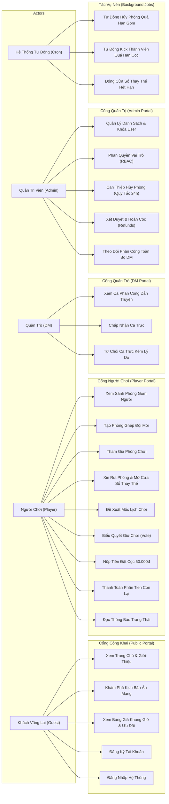
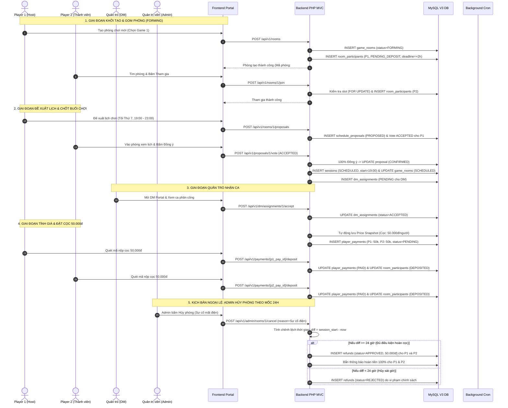

# BÁO CÁO TOÀN DIỆN VỀ ACTOR & NGHIỆP VỤ HỆ THỐNG (ACTOR & BUSINESS LOGIC AUDIT)

**Dự án:** Nền tảng Đặt Lịch & Ghép Phòng Chơi Kịch Bản Sát (Booking Kịch Bản Sát)  
**Phiên bản hệ thống:** V16 Baseline (PHP Native MVC + MySQL + Vanilla ES Modules)  
**Tài liệu tham chiếu:** `PRODUCT_SPEC_V16_Final.md`, `IMPLEMENTATION_PLAN_V16_Final.md`, `docs/api/AUTHORIZATION_MATRIX.md`, `docs/database/DATABASE_V3_ARCHITECTURE_GUIDE.md`, `kich_ban_sat_v3_clean.sql`  
**Phương pháp thực hiện:** Reverse Engineering từ Source Code thực tế kết hợp đối chiếu Baseline Specs (Read-Only Audit).

---

## 1. EXECUTIVE SUMMARY

### 1.1. Tổng quan hệ thống
Hệ thống **Kịch Bản Sát** là nền tảng web phục vụ việc khám phá kịch bản trinh thám/tabletop RPG (Jubensha), tạo và ghép phòng chơi (`GameRoom`), biểu quyết lịch chơi, điều phối Quản trò (`DM`), sắp xếp cơ sở vật chất (`Venues` & `PhysicalRooms`), thanh toán cọc và tất toán mô phỏng, và hệ thống thông báo trạng thái.

Kiến trúc hiện tại đã triển khai:
- **Backend:** PHP 8.4 Native MVC (Modular Monolith chia theo 9 Domain Features) đặt tại `backend/app`. Framework tự xây dựng tối giản (`Core\Router`, `Core\Request`, `Core\Response`, `Core\Application`, Pipeline Middleware). Truy xuất CSDL qua PDO và Repository Pattern.
- **Database:** MySQL 8.0/8.4 (CSDL `kich_ban_sat_v3`), gồm **21 bảng** (19 bảng nghiệp vụ + 2 bảng hạ tầng kỹ thuật: `idempotency_records`, `outbox_events`). Đã áp dụng các tối ưu V3: Generated Columns (`active_user_id`, `active_game_room_id`), nhúng Replacement Window và Price Snapshot vào bảng `game_rooms`.
- **Frontend:** Single-entry MPA / Client-side Component Views sử dụng Vanilla JavaScript ES Modules (không framework) đặt tại `frontend/src`, phục vụ qua Front Controller PHP với mô hình Same-Origin (`backend/public/index.php`).
- **Phân quyền & Cổng:** 3 Portal dùng chung 1 Backend và 1 Database:
  1. **Player Portal:** Trang chủ, khám phá game, sảnh phòng, chi tiết phòng, biểu quyết lịch, thanh toán mô phỏng.
  2. **DM Portal:** Quản lý ca trực, nhận/từ chối ca dẫn kịch bản.
  3. **Admin Portal:** Quản lý người dùng, phân quyền RBAC, can thiệp hủy phòng khẩn cấp theo mốc 24h, xét duyệt hoàn tiền.

---

### 1.2. Thống kê Actors phát hiện trong hệ thống
Qua reverse engineering thực tế trên Database, Session và Backend Middleware, hệ thống tồn tại **5 nhóm Actor**:

1. **Human Actors (3 Actors người dùng):**
   - **`Guest` (Khách vãng lai):** Người dùng chưa đăng nhập (Unauthenticated).
   - **`Player` (Người chơi):** Tài khoản đã đăng nhập có vai trò `PLAYER` (Role ID: 1).
   - **`DM` (Dungeon Master / Quản trò / Host):** Tài khoản đã đăng nhập có vai trò `DM` (Role ID: 2).
   - **`Admin` (Quản trị viên):** Tài khoản đã đăng nhập có vai trò `ADMIN` (Role ID: 3).
2. **System Actors (1 Actor hệ thống tự động):**
   - **`Cron / Background Job Runner`:** CLI script `backend/bin/cron.php` thực thi dịch vụ `BackgroundJobService` để quét quá hạn gom phòng, quá hạn cọc và hết hạn tìm người thay thế.
3. **External Actors (1 Actor dịch vụ bên ngoài):**
   - **`Payment Gateway Providers`:** Momo / VNPay (hiện đang dừng ở mức mô phỏng chuỗi giao dịch nội bộ `SIMULATED_MOMO`, `SIMULATED_VNPAY`, chưa có webhook live).

---

### 1.3. Thống kê kết quả kiểm tra nghiệp vụ
Tổng số nghiệp vụ / Use Cases được rà soát: **54 nghiệp vụ**.

| Trạng thái | Số lượng | Tỷ lệ (%) | Định nghĩa trạng thái |
|---|---|---|---|
| **IMPLEMENTED** | **23** | 42.6% | Đầy đủ từ UI → Client → Route → Controller → Service/Repo → DB. |
| **PARTIAL** | **11** | 20.4% | Đã thông luồng chính nhưng thiếu validation, thiếu locking hoặc thiếu side effects. |
| **UI_ONLY** | **3** | 5.5% | Có giao diện/modal nhưng click chỉ hiện toast/alert, chưa gọi API thật. |
| **API_ONLY** | **8** | 14.8% | Backend đã có Route & Controller nhưng chưa tích hợp vào giao diện Frontend. |
| **MISSING** | **6** | 11.1% | Có trong tài liệu V15/V16/Matrix nhưng chưa được viết cả Frontend lẫn Backend. |
| **BROKEN** | **3** | 5.6% | Đã code nhưng logic bị đứt gãy, dẫn đến deadlock trạng thái hoặc vi phạm ràng buộc. |
| **UNVERIFIED** | **0** | 0.0% | Toàn bộ source code, database và script đã được kiểm tra trực tiếp. |

---

### 1.4. Các vấn đề nghiêm trọng nhất (Top Critical Red Flags)

1. **Đứt gãy luồng Thanh toán (Payment Flow Disconnect - `BROKEN` & `UI_ONLY`):**
   - Trên Frontend (`frontend/src/pages/rooms/rooms-view.js` line 485–493): Nút nộp cọc `#btn-confirm-pay` chỉ hiển thị Toast thành công dạng giả lập, **hoàn toàn không gọi bất kỳ HTTP request nào** đến Backend.
   - Trên Backend (`PaymentController.php` & `PaymentRepository.php`): API `POST /api/v1/payments/{paymentId}/deposit` bắt buộc phải có `paymentId` hợp lệ trỏ tới bảng `player_payments`. Tuy nhiên, trong toàn bộ mã nguồn của `GameRoomController::create()`, `GameRoomController::join()`, và `PricingService::calculateAndSnapshot()`, **không có bất kỳ dòng code nào INSERT bản ghi vào bảng `player_payments`**. Do đó, ở môi trường vận hành thực tế, không có hóa đơn nào tồn tại để Player thanh toán.
2. **Kẹt trạng thái GameRoom (`GameRoom State Freeze` - `BROKEN`):**
   - Khi tất cả thành viên biểu quyết `ACCEPTED` lịch chơi, `SchedulingController::vote()` (line 276–320) chuyển trạng thái `schedule_proposals` sang `CONFIRMED` và tạo `Session` với trạng thái `SCHEDULED`. Tuy nhiên, **trạng thái của `game_rooms.status` không hề được cập nhật** mà vẫn giữ nguyên là `FORMING`.
   - Hậu quả: Phòng đã chốt lịch và tạo buổi chơi nhưng vẫn hiển thị trên danh sách tuyển người công khai (`GET /rooms?status=FORMING`), và người chơi mới vẫn có thể bấm Join vào một phòng đã hoàn tất lên lịch.
3. **Cạnh tranh Race Condition khi Join slot cuối cùng (`PARTIAL` / Lỗ hổng Concurrency):**
   - Trong `GameRoomController::join()` (line 223–325), việc đếm số lượng thành viên đang chiếm slot (`activeParticipants`) và kiểm tra `count < max_players` được thực hiện bằng câu lệnh `SELECT` thông thường bên ngoài Database Transaction, **không có `SELECT ... FOR UPDATE`**.
   - Khi hai người chơi cùng gửi request join slot cuối cùng đồng thời, cả hai cùng vượt qua điều kiện kiểm tra và cùng được ghi nhận vào `room_participants`, khiến số lượng người chơi thực tế vượt quá `max_players` của phòng.
4. **Vòng lặp vô hiệu của Quét quá hạn cọc (`Deposit Timeout Phantom Loop` - `BROKEN`):**
   - Khi người chơi join phòng (`GameRoomRepository::addParticipant()`, line 143–150), cột `deposit_deadline_at` trong bảng `room_participants` bị bỏ qua và mặc định lưu `NULL`.
   - Trong khi đó, Background Job `runDepositTimeout()` (`BackgroundJobService.php`, line 129) lại truy vấn: `WHERE rp.status = 'PENDING_DEPOSIT' AND rp.deposit_deadline_at IS NOT NULL AND rp.deposit_deadline_at <= NOW()`.
   - Do `deposit_deadline_at` luôn là `NULL`, cron job không bao giờ phát hiện được người chơi nào quá hạn để xử lý kick và mở tuyển thay thế.
5. **Thiếu xử lý khi DM từ chối phân công (`DM Rejection Deadlock` - `PARTIAL`):**
   - Khi DM bấm từ chối nhận ca (`POST /api/v1/dm/assignments/{id}/reject`), bản ghi phân công chuyển sang `REJECTED`. Tuy nhiên, buổi chơi (`sessions`) vẫn tiếp tục tham chiếu đến `dm_assignment_id` này. Hệ thống không có cơ chế chuyển trạng thái buổi chơi, không có thông báo cho Admin phân công DM thay thế, và cũng không có API cho Admin phân công lại.

---

## 2. REPOSITORY ARCHITECTURE OVERVIEW

### 2.1. Cấu trúc Frontend
- **Mô hình kiến trúc:** Client-side Component Views chạy trên nền Vanilla JavaScript ES Modules thuần (không React, không Vue, không build tool nặng).
- **Điểm vào (Entry Point):** `frontend/index.html` tải module bootstrap `frontend/src/app.js`.
- **Định tuyến (Routing):** Hash-based routing (`#home`, `#games`, `#rooms`, `#dm`, `#admin`, `#notifications`).
- **Phân tách Module:**
  - `frontend/src/api/api-client.js`: Lớp bọc HTTP chuẩn với cơ chế tự động nạp `CSRF token`, đính kèm Session Cookie (`credentials: 'include'`), chuẩn hóa lỗi `ApiError` và xử lý AbortController/Timeout.
  - `frontend/src/api/auth-state.js`: Quản lý danh tính người dùng phía Client theo mô hình Observer Pattern (`subscribe`/`notify`).
  - `frontend/src/pages/`: Các thành phần giao diện phân tách theo ngữ cảnh: `home-view.js`, `games-view.js`, `rooms-view.js`, `dm-view.js`, `admin-view.js`, `notifications-view.js`, `auth-modal.js`.
  - `frontend/src/utils/`: Công cụ làm sạch dữ liệu XSS (`sanitize.js`), hiển thị thông báo nổi (`toast.js`), cấu hình môi trường (`config.js`).

### 2.2. Cấu trúc Backend
- **Mô hình kiến trúc:** Feature-oriented + Layered Architecture (PHP 8.4 Native MVC).
- **Core Framework tối giản (`backend/app/Core`):**
  - `Application.php`: Khởi tạo và điều phối Middleware Pipeline qua `runPipeline()`.
  - `Router.php`: Phân tích URL pattern, biên dịch regex cho route parameters (`{id}`) và map HTTP method.
  - `Request.php` & `Response.php`: Đóng gói dữ liệu HTTP Request (JSON body, route params, query, headers) và chuẩn hóa JSON Response (`success`, `fail`, `paginated`).
  - `Exceptions/ExceptionHandler.php`: Bắt mọi lỗi ngoại lệ `Throwable`, ẩn stack trace ở môi trường production và map HTTP status codes phù hợp.
- **Middleware Pipeline:**
  - `CorsMiddleware`: Hỗ trợ CORS bảo mật, ngăn chặn wildcard (`*`) khi bật credentials, append header `Vary: Origin`.
  - `CsrfMiddleware`: Bảo vệ toàn bộ HTTP Mutation (`POST`, `PUT`, `PATCH`, `DELETE`) bằng session token `_csrf_token`.
  - `AuthMiddleware`: Kiểm tra danh tính từ `$_SESSION['user_id']` hoặc `Authorization: Bearer {id}`, truy vấn tài khoản đang `ACTIVE`, thực thi kiểm tra vai trò (RBAC) và phòng chống lỗ hổng IDOR.
- **Các Domain Features (`backend/app/Features`):**
  - `Identity`: Quản lý xác thực, đăng ký, đăng nhập và quản trị người dùng.
  - `GameCatalog`: Danh mục kịch bản, bảng giá giờ chơi và cấu hình đạo cụ.
  - `GameroomManagement`: Vòng đời phòng ghép, thành viên, cửa sổ tìm người thay thế và Background Jobs.
  - `VenueScheduling`: Địa điểm, phòng chơi vật lý, đề xuất lịch và biểu quyết.
  - `DMManagement`: Quản lý phân công và phản hồi của Quản trò.
  - `Pricing` & `Promotion`: Bộ tính toán snapshot giá phòng, tiền cọc 50.000đ và đánh giá khuyến mãi.
  - `PaymentRefund`: Thanh toán cọc/tất toán có bảo vệ Idempotency Key và xét duyệt hoàn tiền.
  - `Notification`: Lưu trữ và truy xuất thông báo cho người dùng.

### 2.3. Cơ sở dữ liệu (Database Schema V3)
- Gồm **21 bảng** InnoDB chạy trên MySQL 8.0+/8.4 LTS, mã ký tự `utf8mb4_0900_ai_ci`, múi giờ `+07:00`.
- **Cải tiến tối ưu V3:**
  - Nhúng trực tiếp thông tin Cửa sổ thay thế (`replacement_*`) và Ảnh chụp giá phòng (`price_*`) vào bảng `game_rooms` (quan hệ 1:0..1), loại bỏ các bảng phụ không cần thiết.
  - Áp dụng cột sinh học `STORED GENERATED COLUMN` cho `active_user_id` trong `room_participants` và `active_game_room_id` trong `schedule_proposals` kết hợp `UNIQUE CONSTRAINT` để đảm bảo:
    - Một người chỉ chiếm tối đa 1 slot đang hoạt động trong một phòng chơi.
    - Một phòng chơi chỉ có tối đa 1 đề xuất lịch đang mở biểu quyết.
  - Ràng buộc toàn vẹn dữ liệu chặt chẽ qua CHECK constraints: khoảng người chơi, thời gian lịch trình, tính toán công thức tiền cọc/tiền giảm giá, và tính hợp lệ của trạng thái.

---

## 3. ACTOR INVENTORY

Bảng kiểm kê toàn bộ Actor phát hiện trong hệ thống:

| Actor | Nguồn gốc / Role Code | Cổng truy cập (Portal) | Trách nhiệm & Quyền hạn thực tế | Bằng chứng mã nguồn (Evidence) |
|---|---|---|---|---|
| **Guest** | Không xác thực (`NULL`) | Public Home, Catalog, Auth Modal | Xem trang chủ, tra cứu danh mục game, xem bảng giá công khai, xem danh sách phòng đang gom người, xem chi nhánh quán, lấy CSRF token, đăng ký tài khoản, đăng nhập. | `backend/routes/api.php` line 25, 36–38, 51–54, 59, 75.<br>`frontend/src/pages/home/home-view.js`. |
| **Player** | `PLAYER` (Role ID: 1 trong bảng `roles`) | Player Portal, Home, Notifications | Tạo phòng chơi mới, xem chi tiết phòng, tham gia phòng (`join`), xin rút phòng (`leave`), đề xuất mốc giờ chơi (`proposals`), vote biểu quyết lịch (`vote`), yêu cầu tính snapshot giá phòng, thực hiện thanh toán cọc/tất toán cho slot của chính mình, đọc và đánh dấu thông báo. | `backend/app/Features/GameroomManagement/Controllers/GameRoomController.php`.<br>`backend/app/Features/VenueScheduling/Controllers/SchedulingController.php`.<br>`backend/database/kich_ban_sat_v3_clean.sql` line 781. |
| **DM** (Quản trò) | `DM` (Role ID: 2 trong bảng `roles`) | DM Portal, Notifications | Xem danh sách các ca dẫn kịch bản được phân công cho chính tài khoản của mình, chấp nhận ca trực (`accept`), từ chối ca trực kèm lý do bắt buộc (`reject`). | `backend/app/Features/DMManagement/Controllers/DMAssignmentController.php` line 34, 61, 99.<br>`frontend/src/pages/dm/dm-view.js`. |
| **Admin** | `ADMIN` (Role ID: 3 trong bảng `roles`) | Admin Portal, DM Portal, Toàn hệ thống | Quản lý danh sách người dùng, xem chi tiết và cập nhật thông tin/khóa tài khoản, nâng/hạ vai trò (RBAC), xem danh sách phân công của toàn bộ DM, can thiệp hủy phòng khẩn cấp theo mốc 24h, quản lý danh sách yêu cầu hoàn tiền, phê duyệt/từ chối hoàn tiền. | `backend/app/Features/Identity/Controllers/AdminUserController.php`.<br>`backend/app/Features/GameroomManagement/Controllers/AdminGameRoomController.php`.<br>`backend/app/Features/PaymentRefund/Controllers/AdminRefundController.php`.<br>`frontend/src/pages/admin/admin-view.js`. |
| **System Actor** (Cron Job) | System CLI Process | Không có UI (Chạy qua CLI scheduler) | Tự động quét và giải tán các phòng gom người quá hạn (`formation_deadline_at`), quét và kick thành viên quá hạn đóng tiền cọc (`deposit_deadline_at`), đóng các cửa sổ tìm người thay thế quá hạn 24 tiếng. | `backend/bin/cron.php` line 1–52.<br>`backend/app/Features/GameroomManagement/Services/BackgroundJobService.php`. |
| **External Actor** (Payment Provider) | Dịch vụ ngoài (Mô phỏng) | Không có Portal | Tiếp nhận thanh toán mô phỏng từ Player (Momo/VNPay), đối chiếu `idempotency_key` và phản hồi mã giao dịch thành công. | `backend/app/Features/PaymentRefund/Repositories/PaymentRepository.php` line 83–105.<br>`PaymentController.php` line 78, 129. |

### Phân tích chi tiết về Role & Cơ chế Đa Vai Trò (Multi-Role Analysis)
1. **Lưu trữ vai trò trong Database:**
   - Trong bảng `users` (`kich_ban_sat_v3_clean.sql` line 47), trường `role_id` là cột đơn (Scalar column) có khóa ngoại liên kết tới `roles(id)`.
   - **Kết luận:** Trong CSDL hiện tại, **một tài khoản người dùng chỉ có duy nhất một vai trò tại một thời điểm**. Không có bảng trung gian `user_roles` để gán đồng thời nhiều vai trò.
2. **Cơ chế phân quyền ở Backend:**
   - Backend xác thực bằng PHP Session: `$_SESSION['user_id']`, `$_SESSION['role_id']`, `$_SESSION['role_code']`.
   - `AuthMiddleware::authenticate($request, $allowedRoles)` lấy thông tin user từ CSDL và so sánh mã vai trò (`$user['role_code']`).
   - Mọi endpoint quan trọng đều có bộ lọc role nghiêm ngặt phía Server:
     - Admin endpoints (`/admin/*`): Yêu cầu role `ADMIN` (Nếu không thỏa mãn trả về HTTP 403 Forbidden).
     - DM endpoints (`/dm/*`): Cho phép role `DM` hoặc `ADMIN`.
3. **Phân quyền tại Frontend:**
   - Frontend (`frontend/src/app.js` line 148–165 và `auth-state.js` line 90–102) kiểm tra quyền để hiển thị/ẩn các tab trên Navbar (`#nav-btn-dm`, `#nav-btn-admin`).
   - Nếu người chơi cố tình chuyển hash URL vào `#admin` hoặc `#dm`, Component View (`AdminView.js`, `DmView.js`) sẽ chặn lại và hiển thị màn hình cảnh báo 403.
4. **Bản chất của Multi-Role Selector trong Auth Modal:**
   - Tại `frontend/src/pages/auth/auth-modal.js` (line 14–60), có thanh tab chọn 3 vai trò (Player / DM / Admin).
   - **Bằng chứng mã nguồn:** Đây không phải là cơ chế cho phép 1 user chọn nhiều role khi đăng nhập, mà là **công cụ Demo Switcher** giúp người chấm bài/developer nhanh chóng tự động điền (autofill) thông tin của 3 tài khoản mẫu được seed sẵn trong CSDL (`player.hieu@kichbansat.vn`, `dm.nam@kichbansat.vn`, `admin@kichbansat.vn`).

---

## 4. ROLE & PERMISSION MATRIX

Bảng đối chiếu quyền hạn chi tiết giữa các Actor và việc thực thi kiểm tra quyền ở Backend:

| Actor | Module | Chức năng / Permission | Backend Enforcement | Status | Bằng chứng file & method |
|---|---|---|---|---|---|
| **Guest** | Auth | Đăng ký tài khoản (`register`) | Hardcoded role `PLAYER` tại backend, cấm tự cấp role khác | IMPLEMENTED | `AuthController::register` (`AuthController.php` line 40–97) |
| **Guest** | Auth | Đăng nhập (`login`) | Kiểm tra email/password bcrypt, trạng thái `ACTIVE` | IMPLEMENTED | `AuthController::login` (`AuthController.php` line 102–143) |
| **Guest** | Catalog | Xem danh mục & chi tiết game | Endpoint công khai, không yêu cầu token | IMPLEMENTED | `GameController::index`, `show` (`GameController.php` line 28, 49) |
| **Guest** | Venue | Xem chi nhánh & phòng vật lý | Endpoint công khai | IMPLEMENTED | `SchedulingController::venues` (`SchedulingController.php` line 30) |
| **Guest** | Room | Xem danh sách phòng gom người | Endpoint công khai, filter status | IMPLEMENTED | `GameRoomController::index` (`GameRoomController.php` line 39) |
| **Player** | Room | Tạo phòng chơi mới | Bắt buộc login, gán creator là `session.user_id` | PARTIAL | `GameRoomController::create` (Thiếu kiểm tra giới hạn 3 phòng active) |
| **Player** | Room | Tham gia phòng chơi (`join`) | Bắt buộc login, chống trùng slot active, kiểm tra max_players | PARTIAL | `GameRoomController::join` (Thiếu locking phòng chống race condition) |
| **Player** | Room | Rời phòng / Yêu cầu thay thế | Bắt buộc login, kiểm tra thành viên active trong phòng | IMPLEMENTED | `GameRoomController::leave` (`GameRoomController.php` line 332) |
| **Player** | Schedule | Đề xuất mốc giờ chơi (`proposals`) | Kiểm tra thành viên active trong phòng, tự động vote ACCEPTED | IMPLEMENTED | `SchedulingController::propose` (`SchedulingController.php` line 51) |
| **Player** | Schedule | Biểu quyết đề xuất lịch (`vote`) | Kiểm tra thành viên active, chống vote chéo qua Composite FK | IMPLEMENTED | `SchedulingController::vote` (`SchedulingController.php` line 182) |
| **Player** | Pricing | Yêu cầu tính toán snapshot giá | Cho phép tính toán bảng giá phòng và lưu snapshot DB | IMPLEMENTED | `PricingController::calculate` (`PricingController.php` line 32) |
| **Player** | Payment | Nộp tiền đặt cọc 50.000đ | Kiểm tra IDOR (chính chủ hoặc Admin), Idempotency Key | API_ONLY | `PaymentController::deposit` (Frontend chưa gọi API thật, DB thiếu bản ghi) |
| **Player** | Payment | Thanh toán số tiền còn lại | Kiểm tra IDOR, cập nhật trạng thái PAID | API_ONLY | `PaymentController::remaining` (Frontend chưa có nút/giao diện gọi API) |
| **Player** | Notif | Xem thông báo & Đánh dấu đã đọc | Chỉ truy vấn và cập nhật thông báo của chính `session.user_id` | IMPLEMENTED | `NotificationController::index`, `markAsRead` |
| **DM** | DM Portal | Xem danh sách ca dẫn kịch bản | Bắt buộc role `DM` hoặc `ADMIN`, chỉ xem ca của chính mình | IMPLEMENTED | `DMAssignmentController::index` (`DMAssignmentController.php` line 33) |
| **DM** | DM Portal | Chấp nhận ca trực (`accept`) | Chống IDOR: chỉ DM được gán mới được chấp nhận | IMPLEMENTED | `DMAssignmentController::accept` (`DMAssignmentController.php` line 61) |
| **DM** | DM Portal | Từ chối ca trực (`reject`) | Chống IDOR: bắt buộc nhập lý do từ chối | PARTIAL | `DMAssignmentController::reject` (Thiếu xử lý hủy/đổi DM cho Session) |
| **DM** | DM Portal | Quản lý lịch rảnh (Availability) | Phương thức repo trả về mảng rỗng `[]`, không có bảng DB | MISSING | `DMRepository::getAvailabilities` (`DMRepository.php` line 51) |
| **DM** | Payment | Xác nhận thu tiền mặt tại quán | Không có route, không có controller method | MISSING | Yêu cầu trong `AUTHORIZATION_MATRIX.md` line 137 |
| **Admin** | User | Xem danh sách & chi tiết người dùng | Bắt buộc role `ADMIN` | IMPLEMENTED | `AdminUserController::index`, `show` (`AdminUserController.php` line 33, 60) |
| **Admin** | User | Cập nhật thông tin / Khóa tài khoản | Bắt buộc role `ADMIN`, chống tự khóa tài khoản của chính mình | IMPLEMENTED | `AdminUserController::update` (`AdminUserController.php` line 85) |
| **Admin** | User | Nâng/hạ vai trò người dùng (RBAC) | Bắt buộc role `ADMIN`, chống tự tước quyền Admin của chính mình | IMPLEMENTED | `AdminUserController::assignRole` (`AdminUserController.php` line 146) |
| **Admin** | Room | Hủy phòng chơi khẩn cấp | Bắt buộc role `ADMIN`, bắt buộc lý do, áp dụng quy tắc 24h | IMPLEMENTED | `AdminGameRoomController::cancel` (`AdminGameRoomController.php` line 34) |
| **Admin** | Refund | Xem danh sách yêu cầu hoàn tiền | Bắt buộc role `ADMIN`, hỗ trợ phân trang & lọc trạng thái | IMPLEMENTED | `AdminRefundController::index` (`AdminRefundController.php` line 33) |
| **Admin** | Refund | Phê duyệt hoàn tiền (`approve`) | Bắt buộc role `ADMIN`, cập nhật `reviewed_by`, `reviewed_at` | IMPLEMENTED | `AdminRefundController::approve` (`AdminRefundController.php` line 90) |
| **Admin** | Refund | Từ chối hoàn tiền (`reject`) | Bắt buộc role `ADMIN`, bắt buộc nhập lý do từ chối | IMPLEMENTED | `AdminRefundController::reject` (`AdminRefundController.php` line 123) |
| **Admin** | DM | Phân công DM thủ công cho phòng | Không có API endpoint trong `routes/api.php` | API_ONLY | Phương thức có sẵn trong `DMRepository::assignToRoom`, thiếu Route/Controller |
| **Admin** | Game | Thêm / Sửa kịch bản & cấu hình đạo cụ | Không có API endpoint trong `routes/api.php` | MISSING | Nằm trong yêu cầu V16 nhưng chưa triển khai |
| **System** | Jobs | Quét phòng quá hạn gom người | Chạy qua PHP CLI `cron.php`, hủy phòng & hủy unpaid participants | IMPLEMENTED | `BackgroundJobService::runFormationTimeout` (`BackgroundJobService.php` line 40) |
| **System** | Jobs | Quét người chơi quá hạn nộp cọc | Chạy qua PHP CLI, kick participant và mở cửa sổ thay thế | BROKEN | `BackgroundJobService::runDepositTimeout` (Không hoạt động do deadline là NULL) |
| **System** | Jobs | Đóng cửa sổ thay thế quá hạn | Chạy qua PHP CLI, đóng cửa sổ EXPIRED và phạt cọc người rút | IMPLEMENTED | `BackgroundJobService::runReplacementTimeout` (`BackgroundJobService.php` line 194) |

---

## 5. ACTOR BUSINESS CAPABILITY MATRIX

Đánh giá từng nghiệp vụ qua chuỗi liên kết:  
**Frontend Page → JS / API Client → Backend Route → Middleware → Controller → Service / Repository → Database.**

| Actor | Nghiệp vụ (Business Capability) | Trạng thái | Bằng chứng Frontend | Bằng chứng Backend | Bằng chứng Database |
|---|---|---|---|---|---|
| **Guest** | Khám phá kịch bản & filter số người | IMPLEMENTED | `home-view.js` line 90–139<br>`games-view.js` line 14–70 | `GET /api/v1/games`<br>`GameController::index` line 28 | Bảng `games`, `game_prices` |
| **Guest** | Xem chi tiết cốt truyện, đạo cụ, giá ca | IMPLEMENTED | `games-view.js` line 80–150 | `GET /api/v1/games/{id}`<br>`GameController::show` line 49 | Bảng `games`, `game_configurations` |
| **Guest** | Đăng ký tài khoản mới | IMPLEMENTED | `auth-modal.js` line 250–320 | `POST /api/v1/auth/register`<br>`AuthController::register` line 40 | Bảng `users` (status: ACTIVE) |
| **Guest** | Đăng nhập hệ thống (Bcrypt + Session) | IMPLEMENTED | `auth-modal.js` line 150–240 | `POST /api/v1/auth/login`<br>`AuthController::login` line 102 | Bảng `users`, `roles` |
| **Player** | Xem danh sách phòng đang gom người | IMPLEMENTED | `rooms-view.js` line 51–105 | `GET /api/v1/rooms?status=FORMING`<br>`GameRoomController::index` line 39 | Bảng `game_rooms`, `room_participants` |
| **Player** | Tạo phòng ghép đội mới | PARTIAL | `rooms-view.js` line 504–560 | `POST /api/v1/rooms`<br>`GameRoomController::create` line 137 | Bảng `game_rooms`, `room_participants` |
| **Player** | Tham gia phòng chơi (Join slot) | PARTIAL | `rooms-view.js` line 395–415 | `POST /api/v1/rooms/{id}/join`<br>`GameRoomController::join` line 204 | Bảng `room_participants` |
| **Player** | Xin rút phòng trước khi chốt lịch | IMPLEMENTED | `rooms-view.js` line 420–440 | `POST /api/v1/rooms/{id}/leave`<br>`GameRoomController::leave` line 332 | Bảng `room_participants` (status: LEFT) |
| **Player** | Xin rút phòng sau chốt lịch & Mở tuyển thay thế | IMPLEMENTED | `rooms-view.js` line 420–440 | `POST /api/v1/rooms/{id}/leave`<br>`GameRoomController::leave` line 372 | `room_participants` (LEAVE_REQUESTED)<br>`game_rooms` (replacement_status: OPEN) |
| **Player** | Tham gia thế chỗ slot người xin rút (Takeover) | PARTIAL | `rooms-view.js` line 400–415 | `POST /api/v1/rooms/{id}/join`<br>`GameRoomController::join` line 237 | Cập nhật slot cũ sang LEFT, tạo slot mới cho người thế chỗ |
| **Player** | Đề xuất mốc thời gian chơi | IMPLEMENTED | `rooms-view.js` line 580–630 | `POST /api/v1/rooms/{id}/proposals`<br>`SchedulingController::propose` line 51 | Bảng `schedule_proposals` |
| **Player** | Biểu quyết đồng ý/từ chối lịch chơi | PARTIAL | `rooms-view.js` line 635–658 | `POST /api/v1/proposals/{id}/vote`<br>`SchedulingController::vote` line 182 | Bảng `schedule_responses`, `sessions` (Thiếu cập nhật trạng thái game_rooms) |
| **Player** | Tính toán bảng giá snapshot theo ca & ưu đãi | IMPLEMENTED | `rooms-view.js` line 227–233 | `POST /api/v1/rooms/{id}/calculate-price`<br>`PricingController::calculate` line 32 | Bảng `participant_price_snapshots`, cột snapshot trong `game_rooms` |
| **Player** | Nộp tiền đặt cọc 50.000 VNĐ | UI_ONLY | `rooms-view.js` line 443–502 (Chỉ alert toast, không gọi API) | `POST /api/v1/payments/{paymentId}/deposit`<br>`PaymentController::deposit` line 38 | Bảng `player_payments`, `payment_transactions` |
| **Player** | Thanh toán số tiền còn lại sau cọc | API_ONLY | Chưa có nút/form trên giao diện | `POST /api/v1/payments/{paymentId}/remaining`<br>`PaymentController::remaining` line 97 | Bảng `player_payments`, `payment_transactions` |
| **Player** | Nhận và đọc thông báo hệ thống | IMPLEMENTED | `notifications-view.js` line 57–130 | `GET /api/v1/notifications`<br>`POST /api/v1/notifications/{id}/read` | Bảng `notifications` |
| **Player** | Xem lịch sử phòng, thanh toán & hoàn tiền | PARTIAL | Chưa có trang History riêng, chỉ xem trong chi tiết phòng | Chưa có API tổng hợp lịch sử cá nhân (`/users/me/history`) | Dữ liệu rải rác trong `room_participants`, `player_payments` |
| **DM** | Xem danh sách ca phân công quản trò | IMPLEMENTED | `dm-view.js` line 145–190 | `GET /api/v1/dm/assignments`<br>`DMAssignmentController::index` line 33 | Bảng `dm_assignments`, `game_rooms`, `games` |
| **DM** | Chấp nhận ca dẫn kịch bản (`accept`) | IMPLEMENTED | `dm-view.js` line 171–175 | `POST /api/v1/dm/assignments/{id}/accept`<br>`DMAssignmentController::accept` line 61 | Bảng `dm_assignments` (status: ACCEPTED) |
| **DM** | Từ chối ca dẫn kịch bản kèm lý do (`reject`) | PARTIAL | `dm-view.js` line 72–142 (Native Modal) | `POST /api/v1/dm/assignments/{id}/reject`<br>`DMAssignmentController::reject` line 99 | Bảng `dm_assignments` (status: REJECTED)<br>(Thiếu xử lý Session) |
| **DM** | Quản lý thời gian rảnh (Availability) | MISSING | Không có trên giao diện | `DMRepository::getAvailabilities` trả về `[]` | Không có bảng `dm_availabilities` |
| **DM** | Bắt đầu buổi chơi (`start session`) | MISSING | Không có trên giao diện | Không có endpoint `POST /sessions/{id}/start` | Bảng `sessions` (status: IN_PROGRESS) |
| **DM** | Xác nhận thanh toán tiền mặt tại quán | MISSING | Không có trên giao diện | Không có endpoint trong `routes/api.php` | Yêu cầu spec V16 |
| **Admin** | Quản lý danh sách người dùng & tìm kiếm | IMPLEMENTED | `admin-view.js` line 135–183 | `GET /api/v1/admin/users`<br>`AdminUserController::index` line 33 | Bảng `users`, `roles` |
| **Admin** | Khóa / Kích hoạt tài khoản người dùng | IMPLEMENTED | `admin-view.js` line 175–178 | `PATCH /api/v1/admin/users/{id}`<br>`AdminUserController::update` line 85 | Bảng `users` (status: ACTIVE/SUSPENDED) |
| **Admin** | Thay đổi vai trò người dùng (Nâng/Hạ RBAC) | IMPLEMENTED | `admin-view.js` line 195–200 | `PUT /api/v1/admin/users/{id}/role`<br>`AdminUserController::assignRole` line 146 | Bảng `users` (`role_id`) |
| **Admin** | Hủy phòng khẩn cấp & Đánh giá hoàn cọc 24h | IMPLEMENTED | `admin-view.js` line 78–105 | `POST /api/v1/admin/rooms/{id}/cancel`<br>`AdminGameRoomController::cancel` line 34 | Bảng `game_rooms`, `sessions`, `room_participants`, `refunds` |
| **Admin** | Xem danh sách yêu cầu hoàn tiền | IMPLEMENTED | `admin-view.js` line 68–71 | `GET /api/v1/admin/refunds`<br>`AdminRefundController::index` line 33 | Bảng `refunds`, `player_payments`, `users` |
| **Admin** | Phê duyệt hoàn tiền (`approve refund`) | IMPLEMENTED | `admin-view.js` line renderRefundRow | `POST /api/v1/admin/refunds/{id}/approve`<br>`AdminRefundController::approve` line 90 | Bảng `refunds` (status: APPROVED) |
| **Admin** | Từ chối hoàn tiền kèm lý do (`reject refund`) | IMPLEMENTED | `admin-view.js` line renderRefundRow | `POST /api/v1/admin/refunds/{id}/reject`<br>`AdminRefundController::reject` line 123 | Bảng `refunds` (status: REJECTED) |
| **Admin** | Phân công DM thủ công cho phòng | API_ONLY | Không có trên giao diện | Phương thức `DMRepository::assignToRoom`, thiếu Route | Bảng `dm_assignments` |
| **Admin** | Mở lại tuyển thành viên khẩn cấp (Reopen) | MISSING | Không có trên giao diện | Không có endpoint `POST /admin/rooms/{id}/reopen` | Bảng `game_rooms` (replacement_status) |
| **Admin** | Quản lý danh mục game & đạo cụ | MISSING | Không có trên giao diện | Không có endpoint trong `routes/api.php` | Bảng `games`, `game_configurations` |
| **Admin** | Quản lý cơ sở & phòng vật lý | MISSING | Không có trên giao diện | `SchedulingRepository::listAvailablePhysicalRooms` có sẵn nhưng thiếu API Admin | Bảng `physical_rooms`, `venues` |
| **System** | Quét giải tán phòng gom quá hạn (Formation Timeout) | IMPLEMENTED | CLI Command: `php bin/cron.php --job=formation-timeout` | `BackgroundJobService::runFormationTimeout` line 40 | Cập nhật `game_rooms` (CANCELLED), `room_participants` (CANCELLED_UNPAID) |
| **System** | Quét kick người quá hạn nộp cọc (Deposit Timeout) | BROKEN | CLI Command: `php bin/cron.php --job=deposit-timeout` | `BackgroundJobService::runDepositTimeout` line 120 | Bảng `room_participants` (Không bao giờ khớp do `deposit_deadline_at` là NULL) |
| **System** | Đóng cửa sổ tìm người thay thế quá hạn | IMPLEMENTED | CLI Command: `php bin/cron.php --job=replacement-timeout` | `BackgroundJobService::runReplacementTimeout` line 194 | Cập nhật `game_rooms` (EXPIRED), `room_participants` (LEFT) |
| **System** | Gửi thông báo nhắc cọc (Reminder 1h, 30m) | MISSING | Không có script hay phương thức nào | Không có mã nguồn | Không có |

---

## 6. DETAILED BUSINESS FLOW AUDIT

### Luồng A: Định danh & Quản lý phiên (Authentication & Identity)
- **Actor khởi tạo:** Guest / Player / DM / Admin.
- **Điều kiện đầu vào:** Email hợp lệ, mật khẩu từ 6 ký tự trở lên.
- **Business Rules:**
  - Đăng ký công khai luôn gán `role_code = 'PLAYER'`. Cấm client tự truyền `role` hoặc `role_id` (`AuthController.php` line 82).
  - Mật khẩu mã hóa bằng chuẩn `password_hash($password, PASSWORD_BCRYPT)`.
  - Đăng nhập thành công phải tái tạo Session ID (`session_regenerate_id(true)`) để chống tấn công Session Fixation (`AuthController.php` line 132).
  - Không được trả về hash mật khẩu trong JSON response.
- **Các bước xử lý:**
  1. Client lấy token qua `GET /api/v1/auth/csrf-token`.
  2. Gửi `POST /api/v1/auth/login` kèm header `X-CSRF-Token`.
  3. Backend kiểm tra thông tin tài khoản, ghi nhận phiên PHP và trả về thông tin user.
- **Database changes:** Cập nhật `last_login_at` trong bảng `users`.
- **Side effects:** Session Cookie được thiết lập phía client.
- **Điểm còn thiếu so với Spec:**
  - Chưa triển khai API cập nhật thông tin cá nhân: `GET /api/v1/users/me/profile` và `PATCH /api/v1/users/me/profile`.
  - Chưa có cơ chế gửi email kích hoạt tài khoản (`email_verified_at` đang được gán thủ công `NOW()` trong seed).

---

### Luồng B: Khám phá Kịch bản & Bảng giá (Game Catalog & Pricing Discovery)
- **Actor khởi tạo:** Guest / Player.
- **Điều kiện đầu vào:** Truy cập trang web.
- **Business Rules:**
  - Chỉ hiển thị các kịch bản đang ở trạng thái `ACTIVE`.
  - Mỗi kịch bản có bảng giá theo khung giờ sáng/chiều/tối (`game_prices`).
  - Hỗ trợ lọc kịch bản theo số lượng người chơi (`min_players <= P <= max_players`) và tìm kiếm từ khóa.
- **Các bước xử lý:**
  1. Frontend gọi `GET /api/v1/games?limit=20&players=6&search=an+mang`.
  2. Frontend gọi `GET /api/v1/games/{id}` để xem chi tiết thời lượng, tóm tắt cốt truyện và bảng giá theo khung giờ.
- **Database changes:** Không (Truy vấn đọc).
- **Điểm còn thiếu so với Spec:**
  - Danh mục game thực tế mới seed **3 kịch bản**, trong khi yêu cầu Business Freeze V16 quy định phải có đủ **42 kịch bản** trong menu.
  - Chưa phân tách rõ ràng cấu hình công khai của người chơi và manh mối/đạo cụ bí mật dành riêng cho DM.

---

### Luồng C: Vòng đời Phòng Chơi (GameRoom Lifecycle)
- **Actor khởi tạo:** Player.
- **Điều kiện đầu vào:** Người dùng đã đăng nhập, chọn 1 kịch bản hợp lệ.
- **Business Rules:**
  - Giới hạn tối đa 3 phòng `FORMING` đang active do 1 creator tạo (Quy tắc kế thừa V15).
  - Thời hạn gom phòng mặc định: 4 giờ (V16).
  - Khi tạo phòng, creator tự động được thêm vào làm thành viên đầu tiên với trạng thái `PENDING_DEPOSIT`.
- **Các bước xử lý:**
  1. Player gửi `POST /api/v1/rooms` kèm `game_id`, `title`, `min_players`, `max_players`.
  2. Backend tạo bản ghi `game_rooms` với trạng thái `FORMING` và thêm creator vào `room_participants`.
- **Database changes:** INSERT vào `game_rooms` và `room_participants`.
- **Điểm còn thiếu & Lỗi logic:**
  - **LỖI:** `GameRoomController::create()` đang gán thời hạn gom phòng là `+3 days` thay vì `4 giờ` theo quy định V16 (`GameRoomController.php` line 169).
  - **THIẾU:** Chưa kiểm tra giới hạn 3 phòng active của creator (`SELECT COUNT(*) FROM game_rooms WHERE creator_id = ? AND status = 'FORMING'`).
  - **LỖI:** Chưa gán `deposit_deadline_at` khi thêm participant mới vào phòng.

---

### Luồng D: Thành viên tham gia, Rút phòng & Tuyển thay thế (Participant & Replacement)
- **Actor khởi tạo:** Player (Tham gia) hoặc Thành viên hiện hữu (Rút phòng).
- **Điều kiện đầu vào:** Phòng đang `FORMING` hoặc đang mở cửa sổ thay thế `OPEN`.
- **Business Rules:**
  - Không cho phép 1 người chiếm 2 slot active trong cùng 1 phòng (Bảo vệ bởi `uq_room_active_user`).
  - Nếu phòng đang `FORMING`: Cho phép rút phòng tự do, cập nhật trạng thái sang `LEFT`.
  - Nếu phòng đã qua giai đoạn `FORMING`: Người rút phòng chuyển sang `LEAVE_REQUESTED` và mở cửa sổ thay thế trong 24 giờ (`game_rooms.replacement_status = 'OPEN'`).
  - Người mới join khi cửa sổ mở sẽ vào thế chỗ (Takeover): Người cũ chuyển sang `LEFT`, người mới nhận slot `PENDING_DEPOSIT`.
  - Nếu hết thời gian cửa sổ mà không ai nhận slot: Background Job đóng cửa sổ (`EXPIRED`) và chuyển người xin rút sang `LEFT` với ghi chú phạt cọc.
- **Database changes:** Cập nhật `room_participants`, cập nhật các trường `replacement_*` trong `game_rooms`.
- **Điểm còn thiếu & Lỗi logic:**
  - Thiếu Locking khi Join slot cuối cùng (Nguy cơ vượt `max_players`).
  - Khi người cũ bị thay thế hoặc rút phòng, hệ thống **không tự động tạo bản ghi hoàn tiền (`refunds`)** tương ứng.

---

### Luồng E: Biểu quyết Lịch chơi & Chốt Buổi chơi (Scheduling & Session Creation)
- **Actor khởi tạo:** Thành viên active trong phòng.
- **Điều kiện đầu vào:** Mốc giờ bắt đầu phải trước giờ kết thúc, tuân thủ thời gian chuẩn bị của DM tối thiểu 12 giờ.
- **Business Rules:**
  - Mỗi phòng chỉ có duy nhất 1 đề xuất lịch đang mở biểu quyết tại một thời điểm (`uq_active_schedule_proposal`).
  - Người đề xuất tự động có 1 phiếu `ACCEPTED`.
  - Nếu có bất kỳ ai vote `REJECTED`: Đề xuất lập tức bị bác bỏ (`REJECTED`) để mở đường cho đề xuất mới.
  - Nếu 100% thành viên active vote `ACCEPTED`: Đề xuất chuyển sang `CONFIRMED`. Hệ thống tự động tạo `Session` với trạng thái `SCHEDULED`.
- **Database changes:** INSERT/UPDATE `schedule_proposals`, `schedule_responses`, `sessions`.
- **Điểm còn thiếu & Lỗi logic:**
  - **LỖI NGHIÊM TRỌNG:** Khi Session được tạo thành công, `game_rooms.status` không được cập nhật sang `SCHEDULED` mà vẫn giữ nguyên là `FORMING`.
  - **LỖI CỨNG (Hardcoded):** `SchedulingController.php` (line 290, 307) đang gán cứng DM User 2 (`Host Hoàng Nam`), Venue ID 1 và Physical Room ID 1 thay vì cho phép Admin điều phối thực tế.

---

### Luồng F: Tính toán Giá Snapshot & Khuyến mãi (Pricing Snapshot & Promotion Evaluation)
- **Actor khởi tạo:** Player hoặc Hệ thống khi chốt lịch.
- **Điều kiện đầu vào:** Phòng có danh sách thành viên và thời gian chơi xác định.
- **Business Rules:**
  - Tiền cọc bắt buộc: Cố định 50.000 VNĐ / người (`DEPOSIT_PER_PERSON = 50000`).
  - Phân định khung giá theo thời điểm chơi: Ban ngày (09:00–19:59) và Buổi tối (từ 20:00).
  - Ưu đãi Thứ 3 giảm 30% (khung 09:00–19:00, đặt trước 24h).
  - Ưu đãi HSSV giảm 20.000 VNĐ / người. Không cộng dồn 2 ưu đãi.
  - Lưu ảnh chụp giá phòng vào `game_rooms` và từng người vào `participant_price_snapshots`.
- **Database changes:** UPDATE `game_rooms`, INSERT `participant_price_snapshots`.
- **Điểm còn thiếu:**
  - Chưa tự động tạo các bản ghi `player_payments` tương ứng với giá trị cọc và phần còn lại sau khi chốt snapshot.

---

### Luồng G: Thanh toán Cọc & Tất toán (Payments & Transactions)
- **Actor khởi tạo:** Player.
- **Điều kiện đầu vào:** Có hóa đơn `player_payments` tương ứng với slot chơi của mình.
- **Business Rules:**
  - Bắt buộc kiểm tra quyền sở hữu hóa đơn (Chống IDOR: `user_id === session.user_id`).
  - Bắt buộc truyền `X-Idempotency-Key` để chống trừ tiền hai lần khi mạng chập chờn.
  - Thanh toán cọc thành công chuyển trạng thái participant từ `PENDING_DEPOSIT` sang `DEPOSITED`.
- **Điểm đứt gãy:**
  - Frontend chỉ hiển thị Toast giả lập, không gọi API thanh toán.
  - Backend không có dữ liệu `player_payments` được khởi tạo tự động.

---

### Luồng H: Hủy phòng & Xét duyệt Hoàn tiền (Cancellation & Refund Workflow)
- **Actor khởi tạo:** Admin (Hủy phòng) hoặc Hệ thống.
- **Điều kiện đầu vào:** Phòng chưa ở trạng thái kết thúc (`CANCELLED`, `COMPLETED`). Bắt buộc nhập lý do hủy.
- **Business Rules (Quy Tắc Vàng 24h V16):**
  - Nếu thời điểm hủy cách giờ bắt đầu Session **&ge; 24 giờ**: Người chơi đã nộp tiền được **tự động duyệt hoàn cọc (`APPROVED`)**.
  - Nếu thời điểm hủy cách giờ bắt đầu Session **< 24 giờ**: Vi phạm chính sách hủy muộn, yêu cầu hoàn tiền bị **từ chối (`REJECTED`)**.
- **Các bước xử lý:**
  1. Admin gửi `POST /api/v1/admin/rooms/{id}/cancel` kèm `reason`.
  2. Backend tính khoảng cách thời gian tới `session.start_at`.
  3. Mở transaction: Hủy phòng, hủy session, cập nhật thành viên sang `CANCELLED_BY_ADMIN`.
  4. Quét danh sách các khoản thanh toán đã nộp (`paid_amount > 0`), tự động tạo bản ghi `refunds` với trạng thái `APPROVED` hoặc `REJECTED`.
  5. Bắn notification cho từng người chơi.
- **Database changes:** UPDATE `game_rooms`, `sessions`, `room_participants`; INSERT `refunds`, `notifications`.
- **Đánh giá:** Đây là luồng được triển khai hoàn chỉnh và chính xác nhất theo quy chuẩn V16 trong toàn bộ hệ thống.

---

### Luồng I: Quản lý Ca trực Quản trò (DM Assignment Workflow)
- **Actor khởi tạo:** DM (Phản hồi) / Admin (Phân công).
- **Business Rules:**
  - DM chỉ được xem và phản hồi các ca được phân công cho chính mình (`dm_user_id === session.user_id`).
  - Từ chối ca trực bắt buộc phải nêu rõ lý do (`reason`).
- **Các bước xử lý:**
  1. DM vào DM Portal xem danh sách ca (`GET /api/v1/dm/assignments`).
  2. Bấm "Nhận ca" (`POST /api/v1/dm/assignments/{id}/accept`) hoặc "Từ chối" (`POST /api/v1/dm/assignments/{id}/reject`).
- **Điểm còn thiếu:**
  - Khi DM từ chối, Session không được cập nhật và không có cơ chế phân công lại.

---

### Luồng J: Trung tâm Thông báo (Notifications)
- **Actor khởi tạo:** Hệ thống khi có sự kiện (Hủy phòng, nộp cọc, phân công DM, có người thế chỗ).
- **Business Rules:**
  - Người dùng chỉ đọc được thông báo của chính mình.
  - Hỗ trợ lọc thông báo chưa đọc và đánh dấu đã đọc (`POST /notifications/{id}/read`).
  - Frontend tự động polling mỗi 15 giây để cập nhật số lượng thông báo chưa đọc trên badge chuông.
- **Database changes:** INSERT / UPDATE trên bảng `notifications`.
- **Đánh giá:** Hoạt động ổn định, đúng thiết kế.

---

## 7. BUSINESS RULES COMPLIANCE

Bảng đối chiếu chi tiết giữa Quy tắc nghiệp vụ Baseline (V15 Freeze & V16) và Hiện trạng triển khai trong mã nguồn:

| Business Rule | Quy định Baseline (Expected) | Hiện trạng trong Source Code (Actual) | Đánh giá | Bằng chứng mã nguồn (Evidence) | Hệ quả nghiệp vụ (Impact) |
|---|---|---|---|---|---|
| **Giới hạn phòng active** | Tối đa 3 phòng `FORMING` do 1 creator tạo | Không kiểm tra số lượng phòng active của creator khi tạo | **NON-COMPLIANT** | `GameRoomController.php` line 137–198 | Một người chơi có thể spam tạo hàng chục phòng ảo, gây nghẽn hệ thống. |
| **Formation timeout** | Hạn gom phòng tối đa **4 giờ** | Mặc định gán `+3 days` (3 ngày) | **NON-COMPLIANT** | `GameRoomController.php` line 169 | Phòng chờ quá lâu không tự giải tán, giữ chỗ kịch bản và làm giảm hiệu quả vận hành. |
| **DM preparation** | Thời gian chuẩn bị của DM tối thiểu **12 giờ** | Chỉ kiểm tra `start_at < end_at`, không kiểm tra mốc 12h | **NON-COMPLIANT** | `SchedulingController.php` line 68–70 | Người chơi có thể đặt lịch chơi ngay trong 1-2 tiếng tới khiến DM không kịp chuẩn bị đạo cụ. |
| **Số tiền đặt cọc** | Cố định **50.000 VNĐ / người**, không dùng % | `PricingService` dùng 50.000đ; nhưng `PaymentController` lại fallback về 50% tổng bill | **NON-COMPLIANT** | `PricingService.php` line 13 vs `PaymentController.php` line 75 | Bất nhất dữ liệu giữa bảng tính giá và bộ xử lý thanh toán, vi phạm Business Freeze V16. |
| **Thời hạn nộp cọc** | Hạn nộp cọc **2 giờ / participant** | Giá trị `deposit_deadline_at` bị bỏ qua, luôn là `NULL` khi join | **NON-COMPLIANT** | `GameRoomRepository.php` line 143–150 | Người chơi giữ chỗ mà không cọc tiền bao lâu tùy thích, Background Job không thể kick. |
| **Nhắc hạn nộp cọc** | Nhắc nhở khi còn **1 giờ** và **30 phút** | Hoàn toàn chưa có background job hay logic gửi nhắc nhở | **MISSING** | `BackgroundJobService.php` | Người chơi quên nộp cọc dẫn đến bị kick mà không nhận được cảnh báo trước. |
| **Cửa sổ tìm người thay thế** | Tối thiểu 30 phút, tối đa 4 giờ; không vượt Session start | Đang gán cứng `INTERVAL 24 HOUR` (24 tiếng), không so sánh với Session start | **NON-COMPLIANT** | `GameRoomController.php` line 383, `BackgroundJobService.php` line 161 | Cửa sổ thay thế kéo dài quá lâu, có thể vượt qua cả giờ bắt đầu buổi chơi thực tế. |
| **Rejoin tạo bản ghi mới** | Người đã rời phòng tham gia lại phải tạo bản ghi participant mới | Logic `addParticipant` tạo record mới, `active_user_id` xử lý tốt NULL | **COMPLIANT** | `GameRoomController.php` line 225–325, `kich_ban_sat_v3_clean.sql` line 61–67 | Đúng thiết kế, bảo lưu lịch sử các lần tham gia trước đó. |
| **Lý do Admin bắt buộc** | Bắt buộc nhập lý do khi Hủy phòng, Từ chối hoàn tiền | Bắt buộc nhập `$reason`, trả về lỗi 422 nếu rỗng | **COMPLIANT** | `AdminGameRoomController.php` line 45, `AdminRefundController.php` line 134 | Đảm bảo tính minh bạch và vết kiểm toán (Auditability). |
| **Khung giá ngày / tối** | Ban ngày: 09:00–19:59; Buổi tối: từ 20:00 | Seed CSDL chia 3 ca: 09-13, 13-18, 18-23; fallback giá cứng 250k | **NON-COMPLIANT** | `kich_ban_sat_v3_clean.sql` line 830–836, `PricingService.php` line 88–101 | Không khớp với biểu giá chuẩn của cửa hàng, tính sai giá khi chơi ngoài các khung giờ trên. |
| **Ưu đãi Thứ 3** | Giảm 30%, trước ít nhất 1 ngày, khung 09:00–19:00 | Chỉ kiểm tra ngày Thứ 3, không kiểm tra đặt trước 24h, không kiểm tra khung giờ 09-19h | **PARTIAL** | `PricingService.php` line 130–155 | Người chơi đặt sát giờ hoặc đặt khung đêm vẫn được giảm 30% trái quy định. |
| **Ưu đãi HSSV** | Giảm 20.000 VNĐ / người, Thứ 2–5, khung 09:00–19:00 | Có trong seed, chỉ áp dụng nếu truyền đúng mã `HSSV_20000` | **PARTIAL** | `PricingService.php` line 150–154 | Chưa có cơ chế xác thực thẻ học sinh sinh viên thực tế. |
| **Không cộng dồn ưu đãi** | Tuyệt đối không cộng dồn Thứ 3 và HSSV | API chỉ nhận 1 tham số `promotion_code` nên không bị cộng dồn | **COMPLIANT** | `PricingService.php` line 30, 113 | Ngăn chặn việc lạm dụng mã giảm giá cùng lúc. |
| **Hủy phòng &ge; 24h hoàn cọc** | Hủy trước giờ chơi &ge; 24h đủ điều kiện hoàn cọc | Kiểm tra `$diffSeconds >= 24 * 3600` -> gán `APPROVED` | **COMPLIANT** | `AdminGameRoomController.php` line 79–135 | Đúng chính sách bảo vệ quyền lợi người chơi khi hủy sớm. |
| **Hủy phòng < 24h không hoàn** | Hủy trước giờ chơi < 24h không được hoàn cọc | Kiểm tra `$diffSeconds < 24 * 3600` -> gán `REJECTED` | **COMPLIANT** | `AdminGameRoomController.php` line 79–135 | Đúng quy định phạt cọc khi hủy sát giờ chơi. |
| **Số lượng kịch bản MVP** | Toàn bộ 42 kịch bản trong menu cửa hàng | CSDL hiện tại mới seed 3 kịch bản mẫu | **NON-COMPLIANT** | `kich_ban_sat_v3_clean.sql` line 813–817 | Thiếu 39 kịch bản án mạng để phục vụ vận hành thực tế. |

---

## 8. STATE MACHINE AUDIT

### 8.1. GameRoom State Machine
- **Các trạng thái định nghĩa (Enum):** `FORMING`, `FORMED`, `SCHEDULE_NEGOTIATING`, `SCHEDULED`, `IN_PROGRESS`, `COMPLETED`, `CANCELLED`, `EXPIRED`.
- **Trạng thái thực tế trong CSDL:** Bảng `game_rooms` không có CHECK constraint giới hạn trạng thái.
- **Các chuyển trạng thái đã triển khai:**
  - `(Khởi tạo)` → `FORMING`: Khi tạo phòng thành công (`GameRoomController::create`).
  - `FORMING` → `CANCELLED`: Khi Admin hủy phòng hoặc Background Job quét hết hạn gom người.
- **Sai lệch & Khoảng trống nghiêm trọng:**
  - **BỊ TREO Ở `FORMING`:** Khi biểu quyết lịch thành công và Session được tạo, trạng thái phòng **không bao giờ chuyển sang `SCHEDULED`**.
  - Không có chuyển trạng thái sang `IN_PROGRESS` (khi bắt đầu chơi) hoặc `COMPLETED` (khi kết thúc buổi chơi).

### 8.2. RoomParticipant State Machine
- **Các trạng thái định nghĩa:** `'PENDING_DEPOSIT'`, `'DEPOSITED'`, `'LEAVE_REQUESTED'`, `'LEFT'`, `'CANCELLED_UNPAID'`, `'CANCELLED_BY_ADMIN'`.
- **CHECK constraint trong DB:** Có (`chk_participant_status`).
- **Các chuyển trạng thái đã triển khai:**
  - `(Khởi tạo)` → `PENDING_DEPOSIT`: Khi người chơi join phòng.
  - `PENDING_DEPOSIT` → `DEPOSITED`: Khi thanh toán cọc thành công (`PaymentRepository::processPayment`).
  - `PENDING_DEPOSIT` / `DEPOSITED` → `LEFT`: Khi tự rời phòng lúc đang `FORMING`.
  - `DEPOSITED` → `LEAVE_REQUESTED`: Khi tự rời phòng lúc đã chốt lịch để tìm người thay thế.
  - `LEAVE_REQUESTED` → `LEFT`: Khi có người khác vào thế chỗ (Takeover) hoặc hết hạn 24h.
  - `PENDING_DEPOSIT` → `CANCELLED_UNPAID`: Khi quá hạn cọc hoặc phòng tự giải tán.
  - Mọi trạng thái active → `CANCELLED_BY_ADMIN`: Khi Admin hủy phòng khẩn cấp.
- **Đánh giá:** Hoạt động rất tốt, đúng thiết kế nhờ ràng buộc cột sinh học `uq_room_active_user`.

### 8.3. DMAssignment State Machine
- **Các trạng thái định nghĩa:** `'PENDING'`, `'ACCEPTED'`, `'REJECTED'`, `'REVOKED'`.
- **CHECK constraint trong DB:** Có (`chk_dm_assignment_status`).
- **Các chuyển trạng thái đã triển khai:**
  - `(Khởi tạo)` → `PENDING` (hoặc `ACCEPTED` gán thẳng trong `SchedulingController`).
  - `PENDING` → `ACCEPTED`: DM nhận ca.
  - `PENDING` → `REJECTED`: DM từ chối ca kèm lý do.
- **Khoảng trống:** Chưa triển khai trạng thái `REVOKED` (Admin thu hồi phân công) và chưa có cơ chế re-assign khi DM từ chối ca.

### 8.4. ScheduleProposal & ScheduleResponse State Machine
- **Các trạng thái định nghĩa:**
  - Proposal: `'PROPOSED'`, `'CONFIRMED'`, `'REJECTED'`, `'EXPIRED'`, `'CANCELLED'`.
  - Response: `'ACCEPTED'`, `'REJECTED'`, `'PENDING'`.
- **CHECK constraint trong DB:** Có đầy đủ.
- **Các chuyển trạng thái đã triển khai:**
  - Tạo đề xuất: `PROPOSED` (Đề xuất cũ nếu có bị chuyển sang `CANCELLED`).
  - Vote có `REJECTED` → Proposal chuyển sang `REJECTED`.
  - 100% active participants vote `ACCEPTED` → Proposal chuyển sang `CONFIRMED`.
- **Khoảng trống:** Chưa có cron job quét chuyển các đề xuất quá 24h sang `EXPIRED`.

### 8.5. Session State Machine
- **Các trạng thái định nghĩa:** `'SCHEDULED'`, `'IN_PROGRESS'`, `'COMPLETED'`, `'CANCELLED'`.
- **CHECK constraint trong DB:** Có (`chk_sessions_status`).
- **Các chuyển trạng thái đã triển khai:**
  - `CONFIRMED` proposal → Tạo Session ở trạng thái `SCHEDULED`.
  - Admin hủy phòng → Session chuyển sang `CANCELLED`.
- **Khoảng trống:**
  - Không có API chuyển sang `IN_PROGRESS` (Bắt đầu chơi).
  - Không có API hoặc Cron chuyển sang `COMPLETED` (Kết thúc buổi chơi).

### 8.6. PlayerPayment State Machine
- **Các trạng thái định nghĩa:** `'PENDING'`, `'PROCESSING'`, `'PAID'`, `'PARTIALLY_PAID'`, `'FAILED'`, `'EXPIRED'`, `'CANCELLED'`.
- **CHECK constraint trong DB:** Có (`chk_player_payment_status`).
- **Các chuyển trạng thái đã triển khai:**
  - Giao dịch cọc thành công → `PAID` (nếu đủ) hoặc `PARTIALLY_PAID`.
  - Thanh toán số tiền còn lại → `PAID`.
- **Khoảng trống:** Không được sinh tự động khi chốt giá/join phòng, dẫn đến toàn bộ state machine này bị cô lập trong thực tế.

### 8.7. Refund State Machine
- **Các trạng thái định nghĩa:** `'PENDING'`, `'APPROVED'`, `'REJECTED'`, `'PROCESSING'`, `'COMPLETED'`, `'FAILED'`.
- **CHECK constraint trong DB:** Có (`chk_refunds_status`).
- **Các chuyển trạng thái đã triển khai:**
  - Admin hủy phòng: Tự động sinh `refunds` ở trạng thái `APPROVED` (nếu &ge; 24h) hoặc `REJECTED` (nếu < 24h).
  - Admin duyệt hoàn tiền: `PENDING` → `APPROVED`.
  - Admin từ chối hoàn tiền: `PENDING` → `REJECTED` kèm lý do.
- **Khoảng trống:** Chưa có chuyển trạng thái sang `COMPLETED` sau khi tiền đã được chuyển trả cho khách qua ngân hàng/ví điện tử.

---

## 9. MISSING BUSINESS LIST

Bảng tổng hợp các nghiệp vụ còn thiếu được phân loại theo 3 nhóm nghiệp vụ:

| ID | Nghiệp vụ còn thiếu (Missing Business) | Nhóm | Actor | Vấn đề hiện tại trong mã nguồn | Mức độ ảnh hưởng | Độ ưu tiên |
|---|---|---|---|---|---|---|
| **MB-01** | Tự động sinh hóa đơn thanh toán khi tham gia/chốt lịch | Nhóm A (Core) | Player, System | Không có lệnh INSERT vào `player_payments` trong toàn bộ nghiệp vụ phòng | Không thể thanh toán cọc và tất toán thực tế | **P0** |
| **MB-02** | Kết nối API nộp cọc trên giao diện Frontend | Nhóm A (Core) | Player | Frontend chỉ hiện modal giả lập và toast, không gọi API `/deposit` | Luồng thanh toán của Player hoàn toàn không hoạt động | **P0** |
| **MB-03** | Cập nhật trạng thái GameRoom khi chốt Session | Nhóm A (Core) | System, Player | `SchedulingController` không đổi trạng thái phòng từ `FORMING` sang `SCHEDULED` | Phòng đã chốt lịch vẫn hiển thị tìm người, người ngoài vẫn join được | **P0** |
| **MB-04** | Kiểm soát Concurrency bằng Row Locking khi Join slot | Nhóm A (Core) | Player | `GameRoomController::join` kiểm tra slot bên ngoài transaction, thiếu `FOR UPDATE` | Nguy cơ vượt số người tối đa (`max_players`) khi join đồng thời | **P0** |
| **MB-05** | Gán hạn nộp cọc (`deposit_deadline_at`) khi thêm thành viên | Nhóm A (Core) | System | `addParticipant` bỏ qua cột `deposit_deadline_at`, luôn mang giá trị `NULL` | Background Job quét quá hạn cọc bị vô hiệu hóa hoàn toàn | **P0** |
| **MB-06** | Xử lý điều phối lại khi DM từ chối ca trực | Nhóm A (Core) | DM, Admin | DM bấm reject thì ca thành `REJECTED` nhưng Session vẫn gắn với ca đó | Buổi chơi không có người dẫn dắt, Admin không biết để phân công lại | **P0** |
| **MB-07** | Nhập đầy đủ 42 kịch bản án mạng từ menu vào CSDL | Nhóm A (Core) | Guest, Player | Mới seed 3 game mẫu, thiếu 39 game trong danh mục menu V16 | Không đáp ứng tiêu chí nghiệm thu Business Freeze V16 | **P0** |
| **MB-08** | Chuẩn hóa khung giờ giá (09:00–19:59 & từ 20:00) | Nhóm A (Core) | Player, Admin | CSDL seed khung giờ lệch (09-13, 13-18, 18-23), fallback giá cứng 250k | Tính sai giá ca ngày và ca tối theo menu của cửa hàng | **P0** |
| **MB-09** | Giao diện và API thanh toán khoản phí còn lại (Remaining) | Nhóm B (Supporting) | Player | Có API backend nhưng Frontend không có nút/giao diện gọi API | Người chơi không thể thanh toán nốt tiền vé trước giờ chơi | **P1** |
| **MB-10** | Quản lý thời gian rảnh của Quản trò (DM Availability) | Nhóm B (Supporting) | DM, Admin | Phương thức trả về mảng rỗng `[]`, không có bảng trong CSDL | Admin không biết DM nào đang rảnh để phân công lịch | **P1** |
| **MB-11** | API chuyển trạng thái Buổi chơi (`start` / `complete`) | Nhóm B (Supporting) | DM, Admin | Session mãi mãi ở trạng thái `SCHEDULED`, không thể bấm bắt đầu/kết thúc | Vòng đời buổi chơi bị cụt, không ghi nhận được lịch sử hoàn thành | **P1** |
| **MB-12** | Quản lý danh mục kịch bản & cấu hình đạo cụ cho Admin | Nhóm B (Supporting) | Admin | Không có API thêm, sửa kịch bản hay cập nhật JSON đạo cụ | Phải sửa thủ công trực tiếp bằng SQL trong database | **P1** |
| **MB-13** | Phân công DM thủ công & Xếp phòng vật lý cho Admin | Nhóm B (Supporting) | Admin | Đang hardcode DM 2 và Physical Room 1 trong Controller | Không linh hoạt điều phối theo thực tế quán | **P1** |
| **MB-14** | Tự động gửi thông báo nhắc cọc trước 1 giờ và 30 phút | Nhóm B (Supporting) | System | Chưa có Cron Job quét và bắn thông báo nhắc cọc | Người chơi dễ bị kick do quên hạn nộp cọc | **P1** |
| **MB-15** | Trang tra cứu lịch sử cá nhân (My History Portal) | Nhóm B (Supporting) | Player | Chưa có giao diện và API tổng hợp lịch sử phòng, hóa đơn và hoàn tiền | Người chơi không xem lại được các trận đã chơi hoặc tiền đã hoàn | **P1** |
| **MB-16** | Đánh giá điều kiện ưu đãi tự động & Xác thực HSSV | Nhóm C (Enhancement)| Player, Admin | Chưa kiểm tra điều kiện đặt trước 24h của Thứ 3; HSSV chưa có tải thẻ | Phải kiểm tra thủ công bằng mắt tại quán | **P2** |
| **MB-17** | Tích hợp cổng thanh toán trực tuyến Live (Momo/VNPAY) | Nhóm C (Enhancement)| External | Hiện đang chạy mô phỏng nội bộ | Chưa hỗ trợ quẹt thẻ/chuyển khoản thật | **P2** |
| **MB-18** | Hệ thống đánh giá, chấm điểm sau buổi chơi (Review/Rating)| Nhóm C (Enhancement)| Player, DM | Chưa có trong phạm vi MVP | Tính năng mở rộng sau khi vận hành ổn định | **P2** |

---

## 10. BROKEN / INCOMPLETE BUSINESS FLOWS

Chi tiết 7 điểm nghẽn có thể làm đứt gãy luồng vận hành thực tế:

```
[Phòng Tạo & Gom Thành Viên] 
        │
        ▼ (Tất cả vote ACCEPTED)
[Tạo Session SCHEDULED] ───(LỖI 1: Không đổi trạng thái GameRoom)───► [GameRoom vẫn FORMING vĩnh viễn]
        │                                                                        │
        ▼                                                                        ▼ (Người ngoài vẫn join được!)
[Chốt Giá Snapshot] ───(LỖI 2: Không tạo player_payments)────────► [Hóa đơn thanh toán = NULL]
        │                                                                        │
        ▼                                                                        ▼ (Không có ID để gọi API)
[Giao Diện Bấm Nộp Cọc] ───(LỖI 3: Nút bấm chỉ hiện Toast mô phỏng)──► [Tiền cọc không vào hệ thống]
        │
        ▼
[Không ghi nhận deposit_deadline_at] ───(LỖI 4: Luôn mang giá trị NULL)──► [Cron Job không kick được ai]
```

1. **Điểm gãy 1 — Luồng Thanh toán bị cô lập (Payment Isolation Disconnect):**  
   - Frontend không gọi API. Backend không có bản ghi khởi tạo. Khi người dùng click nộp cọc, giao diện báo thành công nhưng trong CSDL tiền không vào, trạng thái thành viên vẫn là `PENDING_DEPOSIT`.
2. **Điểm gãy 2 — Trạng thái Phòng bị đóng băng (`GameRoom Status Freeze`):**  
   - Phòng đã có lịch và tạo Session nhưng vẫn hiển thị ở sảnh gom khách. Người chơi mới join vào làm thay đổi danh sách thành viên của một buổi chơi đã chốt, gây xung đột dữ liệu nghiêm trọng.
3. **Điểm gãy 3 — Xung đột Slot cuối cùng khi Join đồng thời (`Race Condition on Last Slot`):**  
   - Đọc dữ liệu ngoài transaction dẫn đến hiện tượng over-booking (phòng 8 người có thể nhận thành 9 hoặc 10 người).
4. **Điểm gãy 4 — Vòng lặp vô hiệu của Quét quá hạn cọc (`Dead Deposit Timeout Cron`):**  
   - Không gán thời hạn cọc khi join (`deposit_deadline_at IS NULL`) khiến logic giải phóng slot cho người khác không bao giờ được kích hoạt tự động.
5. **Điểm gãy 5 — Ca Quản trò bị kẹt khi DM từ chối (`Orphaned Session on DM Rejection`):**  
   - Session vẫn giữ ID của ca bị từ chối. Không có cảnh báo cho Admin để đổi người dẫn chuyện.
6. **Điểm gãy 6 — Mất vết Hoàn tiền khi có người thế chỗ (`Replacement Refund Blindspot`):**  
   - Khi có người vào nhận slot thay thế, người cũ chuyển thành `LEFT` nhưng CSDL không tự tạo yêu cầu hoàn tiền `refunds` cho số tiền cọc mà người cũ đã đóng trước đó.
7. **Điểm gãy 7 — Buổi chơi không có điểm kết thúc (`Dead-End Session Lifecycle`):**  
   - Buổi chơi không có trạng thái `IN_PROGRESS` và `COMPLETED`, khiến hệ thống không thể thống kê được số lượng ca chơi đã hoàn thành thành công trong tuần/tháng.

---

## 11. PROPOSED NEW BUSINESS PROPOSALS

### Đề xuất 1: Cơ chế Tự Động Khởi Tạo Hóa Đơn & Nối Luồng Thanh Toán Thật
- **Tên nghiệp vụ:** Auto-provisioning Player Payments & Real Flow Integration.
- **Vấn đề hiện tại:** Sau khi tính snapshot giá hoặc khi người chơi tham gia phòng, không có bản ghi `player_payments` nào được sinh ra; nút bấm thanh toán trên giao diện chỉ hiện toast giả lập.
- **Giá trị nghiệp vụ:** Đưa luồng thanh toán cọc và tất toán vào hoạt động thực tế, đảm bảo doanh thu và sự ràng buộc trách nhiệm của người chơi.
- **Actor liên quan:** Player, System.
- **Luồng nghiệp vụ đề xuất:**
  1. Khi người chơi join phòng hoặc khi chốt snapshot giá, Service tự động tạo 1 bản ghi `player_payments` loại `DEPOSIT` với số tiền cố định `50.000 VNĐ`, `deadline_at = NOW() + 2 HOUR`.
  2. Khi Session được chốt, hệ thống tự động tạo tiếp bản ghi `player_payments` loại `REMAINING` với số tiền bằng `final_amount - 50.000 VNĐ`.
  3. Frontend gọi `POST /api/v1/payments/{paymentId}/deposit` và nhận kết quả giao dịch thực sự.
- **Ảnh hưởng CSDL:** Sử dụng bảng `player_payments` và `payment_transactions` sẵn có, không cần sửa schema.
- **Ảnh hưởng API:** Sử dụng API `POST /api/v1/payments/{id}/deposit` và `/remaining` sẵn có. Bổ sung `payment_id` vào payload chi tiết phòng `GET /api/v1/rooms/{id}`.
- **Ảnh hưởng Frontend:** Sửa hàm `handlePayDeposit()` trong `rooms-view.js` để gọi `api.post(...)`.
- **Độ ưu tiên & Khuyến nghị MVP:** **P0 (Bắt buộc cho MVP)**.

---

### Đề xuất 2: Khóa Trạng Thái Phòng & Tự Động Đồng Bộ Vòng Đời Buổi Chơi
- **Tên nghiệp vụ:** GameRoom-to-Session Lifecycle Synchronization.
- **Vấn đề hiện tại:** `game_rooms.status` giữ nguyên `FORMING` sau khi đã tạo `Session`.
- **Giá trị nghiệp vụ:** Ngăn chặn việc người ngoài tiếp tục join vào phòng đã chốt lịch; đảm bảo tính toàn vẹn trạng thái hệ thống.
- **Actor liên quan:** Player, DM, Admin, System.
- **Luồng nghiệp vụ đề xuất:**
  1. Khi đề xuất lịch được 100% thành viên chấp thuận trong `SchedulingController::vote()`:
     - Chuyển `schedule_proposals.status = 'CONFIRMED'`.
     - Tạo `Session` ở trạng thái `SCHEDULED`.
     - **Cập nhật `game_rooms.status = 'SCHEDULED'`** trong cùng transaction.
  2. Khi DM bấm bắt đầu ca chơi: Cập nhật `sessions.status = 'IN_PROGRESS'` và `game_rooms.status = 'IN_PROGRESS'`.
  3. Khi kết thúc ca: Cập nhật `sessions.status = 'COMPLETED'` và `game_rooms.status = 'COMPLETED'`.
- **Ảnh hưởng CSDL:** Không thay đổi cấu trúc bảng; chỉ kích hoạt chuyển đổi các trạng thái hợp lệ đã có trong Enum `GameRoomStatus`.
- **Ảnh hưởng API:** Bổ sung route `POST /api/v1/sessions/{id}/start` và `POST /api/v1/sessions/{id}/complete`.
- **Ảnh hưởng Frontend:** Sảnh phòng (`rooms-view.js`) loại bỏ các phòng `SCHEDULED` khỏi danh sách phòng gom người.
- **Độ ưu tiên & Khuyến nghị MVP:** **P0 (Bắt buộc cho MVP)**.

---

### Đề xuất 3: Khắc phục Concurrency bằng Pessimistic Row-Locking khi Join Phòng
- **Tên nghiệp vụ:** Concurrency Guard for Room Join & Slot Takeover.
- **Vấn đề hiện tại:** `GameRoomController::join` kiểm tra số lượng thành viên ngoài transaction, gây nguy cơ over-booking khi nhiều người cùng tranh chấp slot cuối cùng.
- **Giá trị nghiệp vụ:** Đảm bảo phòng không bao giờ vượt quá sức chứa tối đa quy định của kịch bản án mạng.
- **Actor liên quan:** Player.
- **Luồng nghiệp vụ đề xuất:**
  1. Bắt đầu Transaction: `beginTransaction()`.
  2. Khóa dòng phòng chơi: `SELECT id, max_players, status FROM game_rooms WHERE id = :id FOR UPDATE`.
  3. Đếm số thành viên active bên trong transaction: `SELECT COUNT(*) FROM room_participants WHERE game_room_id = :id AND status IN (...) FOR UPDATE`.
  4. Nếu `count >= max_players`: Rollback và trả về lỗi `HTTP 409 Conflict - Phòng đã đủ người`.
  5. Nếu còn slot: Tiến hành `INSERT INTO room_participants` và Commit.
- **Ảnh hưởng CSDL:** Không đổi cấu trúc; chỉ sử dụng câu lệnh khóa dòng `FOR UPDATE` của InnoDB.
- **Ảnh hưởng API:** Trả về mã lỗi `409 CONFLICT` chuẩn xác khi tranh chấp thất bại.
- **Ảnh hưởng Frontend:** Bắt lỗi 409 và hiển thị thông báo "Rất tiếc, người chơi khác vừa nhanh tay giữ slot cuối cùng!".
- **Độ ưu tiên & Khuyến nghị MVP:** **P0 (Bắt buộc cho MVP)**.

---

### Đề xuất 4: Kích Hoạt Hạn Nộp Cọc & Cơ Chế Cảnh Báo Nhắc Nhở
- **Tên nghiệp vụ:** Deposit Deadline Activation & Notification Reminders.
- **Vấn đề hiện tại:** `deposit_deadline_at` luôn bị bỏ trống (`NULL`), Background Job quét quá hạn cọc không hoạt động; thiếu thông báo nhắc nộp cọc.
- **Giá trị nghiệp vụ:** Tự động giải phóng chỗ cho những người chơi thực sự muốn tham gia; giảm tỷ lệ hủy phòng ảo.
- **Actor liên quan:** Player, System.
- **Luồng nghiệp vụ đề xuất:**
  1. Khi người chơi join phòng: Tự động gán `deposit_deadline_at = DATE_ADD(NOW(), INTERVAL 2 HOUR)`.
  2. Bổ sung Cron Job `runDepositReminder()`: Quét các bản ghi `PENDING_DEPOSIT` có deadline còn 60 phút và 30 phút để tạo thông báo nhắc nhở vào bảng `notifications`.
  3. Khi đến hạn mà chưa cọc: Background Job kick và mở cửa sổ thay thế.
- **Ảnh hưởng CSDL:** Không đổi cấu trúc; chỉ gán giá trị thời gian cho cột `deposit_deadline_at` đã có sẵn.
- **Ảnh hưởng API:** Không.
- **Ảnh hưởng Frontend:** Hiển thị đồng hồ đếm ngược thời hạn cọc còn lại trên giao diện chi tiết phòng.
- **Độ ưu tiên & Khuyến nghị MVP:** **P0 (Kích hoạt hạn cọc 2h)** / **P1 (Hệ thống nhắc cọc 1h & 30m)**.

---

### Đề xuất 5: Xử lý Tái Phân Công khi DM Từ Chối Ca Trực (DM Re-assignment Flow)
- **Tên nghiệp vụ:** DM Rejection Handling & Fallback Assignment.
- **Vấn đề hiện tại:** DM từ chối ca thì Session bị bỏ rơi, không có ai dẫn dắt và Admin không nhận được cảnh báo để can thiệp.
- **Giá trị nghiệp vụ:** Giữ vững vận hành, đảm bảo mọi buổi chơi đã chốt lịch đều có nhân sự phục vụ.
- **Actor liên quan:** DM, Admin, System.
- **Luồng nghiệp vụ đề xuất:**
  1. Khi DM bấm reject: Cập nhật assignment sang `REJECTED`, đồng thời tự động bắn thông báo khẩn cấp cho toàn bộ tài khoản `ADMIN`.
  2. Admin truy cập Admin Portal, xem danh sách các buổi chơi đang khuyết DM và bấm "Phân công lại" để chọn một DM khác đang rảnh.
- **Ảnh hưởng CSDL:** Không đổi cấu trúc.
- **Ảnh hưởng API:** Bổ sung endpoint `POST /api/v1/admin/sessions/{sessionId}/reassign-dm`.
- **Ảnh hưởng Frontend:** Thêm mục "Ca chơi thiếu Quản trò" trong Admin Portal.
- **Độ ưu tiên & Khuyến nghị MVP:** **P1 (Nên có cho MVP)**.

---

## 12. RECOMMENDED MVP BUSINESS SCOPE

### Nhóm P0 — Bắt buộc phải hoàn thiện để MVP có thể vận hành thực tế
1. **Sửa lỗi ngắt kết nối Thanh toán:** Kết nối hàm `handlePayDeposit()` ở Frontend với API `POST /api/v1/payments/{id}/deposit`. Bổ sung logic tự động sinh `player_payments` trị giá 50.000 VNĐ khi người chơi tham gia phòng.
2. **Cập nhật trạng thái GameRoom:** Chuyển `game_rooms.status` sang `SCHEDULED` ngay khi biểu quyết lịch hoàn tất, loại bỏ phòng đã chốt khỏi sảnh gom khách.
3. **Pessimistic Row-Locking cho Join slot:** Thêm `SELECT ... FOR UPDATE` trong transaction của `GameRoomController::join()` để triệt tiêu lỗi over-booking.
4. **Kích hoạt Hạn nộp cọc 2 giờ:** Gán giá trị `NOW() + 2 HOUR` vào `deposit_deadline_at` khi thêm participant mới để Background Job hoạt động được.
5. **Seed đầy đủ 42 kịch bản menu:** Bổ sung dữ liệu seed cho 39 kịch bản án mạng còn thiếu theo đúng cam kết Business Freeze V16.
6. **Chuẩn hóa lại bảng giá và Promotion:** Cập nhật bảng giá CSDL theo đúng 2 khung (09:00–19:59 và từ 20:00). Đồng bộ lại logic tính cọc 50.000đ trong `PaymentController`.

### Nhóm P1 — Nên bổ sung để tối ưu trải nghiệm và quản trị vận hành
1. **Giao diện thanh toán khoản tiền còn lại (Remaining Payment):** Bổ sung nút thanh toán nốt tiền vé trên chi tiết phòng cho người chơi.
2. **Quản lý vòng đời buổi chơi cho DM:** Cung cấp nút "Bắt đầu chơi" (`start`) và "Kết thúc ca" (`complete`) trong DM Portal.
3. **Cảnh báo và phân công lại DM:** Thông báo cho Admin khi DM từ chối ca trực để phân công nhân sự thay thế.
4. **Thông báo nhắc cọc:** Bổ sung cron job gửi notification nhắc nộp cọc trước 1 giờ và 30 phút.
5. **Rút ngắn Cửa sổ thay thế:** Sửa lại thời gian mở cửa sổ thay thế từ 24 giờ thành 30 phút đến 4 giờ (không vượt giờ bắt đầu Session).

### Nhóm P2 — Nghiệp vụ mở rộng, để lại sau MVP
1. Tích hợp thanh toán trực tuyến qua Webhook IPN thật của Momo / VNPay / ZaloPay.
2. Upload ảnh thẻ học sinh sinh viên và duyệt tự động qua AI/OCR.
3. Hệ thống đánh giá, review kịch bản và chấm sao Quản trò sau buổi chơi.
4. Dashboard phân tích doanh thu, tỷ lệ lấp đầy phòng và hiệu suất của từng DM.

---

## 13. FINAL ACTOR & BUSINESS MAP

### 13.1. Sơ đồ Use Case tổng thể (Use Case Diagram)



---

### 13.2. Sơ đồ Luồng Nghiệp vụ Xuyên suốt (End-to-End Business Flow)



---

## 14. OPEN DECISIONS (CÁC QUYẾT ĐỊNH CẦN LEAD PHÊ DUYỆT)

Trước khi tiến hành sửa code hoàn thiện MVP, các vấn đề kỹ thuật và nghiệp vụ sau đây cần được Lead dự án xác nhận bằng văn bản:

1. **Thứ tự ưu tiên khi trùng điều kiện ưu đãi:**  
   - Hiện tại đã chốt quy tắc *Không cộng dồn ưu đãi Thứ 3 (giảm 30%) và Ưu đãi HSSV (giảm 20.000đ)*. Tuy nhiên, nếu một phòng chơi đặt vào ngày Thứ 3 có thành viên là học sinh sinh viên, hệ thống nên **tự động áp dụng mức ưu đãi có lợi nhất cho khách hàng** (giảm 30% thường cao hơn 20k) hay bắt buộc người chơi tự chọn một mã giảm giá?
2. **Quy tắc tính giá khi Session vắt qua hai khung giờ:**  
   - Ví dụ: Buổi chơi kéo dài 4 tiếng từ 18:00 đến 22:00 (vắt qua mốc 20:00 giữa ca ngày và ca tối). Hệ thống sẽ tính theo giá của khung giờ bắt đầu (18:00 thuộc ca ngày), hay tính theo giá ca tối, hay chia tỷ lệ theo số giờ của từng ca?
3. **Chính sách hoàn cọc khi một cá nhân tự ý rút khỏi phòng:**  
   - Khi phòng đã chốt lịch, nếu một thành viên xin rút phòng và cửa sổ tìm người thay thế thành công (có người thế chỗ), thành viên cũ có được hoàn lại tiền cọc 50.000đ không? Hay tiền cọc đó bị phạt và chuyển thành voucher/phí dịch vụ?
4. **Cơ chế phân công DM và PhysicalRoom:**  
   - Có nên duy trì việc hệ thống tự động gán DM và xếp phòng vật lý mặc định khi buổi chơi được chốt lịch (để giảm thao tác quản trị cho MVP), hay bắt buộc phải có màn hình để Admin duyệt và xếp phòng/DM thủ công?
5. **Cách hiểu về "Đặt trước ít nhất 1 ngày":**  
   - Quy định "đặt trước ít nhất 1 ngày" trong menu cửa hàng được hiểu chính xác là `thời điểm đặt cách giờ chơi >= 24 tiếng` (24 rolling hours) hay tính theo `ngày lịch` (đặt từ ngày hôm trước so với ngày chơi)? Hiện tại code đang diễn giải theo mốc 24 tiếng.

---

## 15. AUDIT CONCLUSION

### Đánh giá mức độ sẵn sàng của hệ thống
Hệ thống **Kịch Bản Sát V16** đã hoàn thành xuất sắc các nền tảng kỹ thuật cốt lõi (Foundation):
- Khung MVC PHP Native, bộ định tuyến Router, xử lý lỗi Exception tập trung, và Middleware bảo vệ (CORS, CSRF, Session Auth, RBAC, chống IDOR) được viết rất chuẩn mực, mạch lạc, sạch sẽ và tuân thủ chặt chẽ tiêu chuẩn Clean Architecture.
- Database Schema V3 được thiết kế bài bản với các kỹ thuật MySQL hiện đại (Generated Columns, Composite Foreign Keys, Check Constraints) bảo vệ tính toàn vẹn dữ liệu cực tốt.
- Bộ test tự động (110 bài test PHPUnit và các bài test bảo mật Frontend) đang đạt tỷ lệ pass 100%.

Tuy nhiên, về mặt **Nghiệp vụ Vận hành (Business Operations)**, hệ thống hiện tại **CHƯA ĐỦ ĐIỀU KIỆN ĐỂ GO-LIVE MVP** do tồn tại 3 mắt xích bị đứt gãy:
1. Luồng thanh toán thực tế chưa thông (Frontend chỉ hiện alert/toast mô phỏng, Backend chưa tự động sinh bản ghi công nợ `player_payments`).
2. Trạng thái phòng chơi bị đóng băng ở `FORMING`, không đồng bộ sang `SCHEDULED` khi đã tạo buổi chơi.
3. Thiếu dữ liệu seed của 39 kịch bản án mạng và cấu hình khung giờ giá bị lệch so với menu thực tế của cửa hàng.

### Lộ trình đề xuất bước tiếp theo (Next Steps):
1. **Bước 1 — Khóa quyết định nghiệp vụ:** Trình bày 5 vấn đề trong mục *14. Open Decisions* để Lead dự án phê duyệt.
2. **Bước 2 — Vá các điểm gãy P0 (Fix Critical Broken Flows):**
   - Bổ sung logic tự động tạo `player_payments` và kết nối nút bấm thanh toán cọc trên Frontend.
   - Bổ sung lệnh chuyển `game_rooms.status = 'SCHEDULED'` khi chốt lịch.
   - Thêm Pessimistic Row-Locking (`FOR UPDATE`) khi join slot cuối.
   - Gán `deposit_deadline_at = NOW() + 2h` khi participant tham gia.
3. **Bước 3 — Hoàn thiện Seed Data:** Seed đủ 42 kịch bản án mạng và chuẩn hóa 2 khung giờ giá theo đúng cam kết V16.
4. **Bước 4 — Nghiệm thu MVP:** Thực hiện kịch bản kiểm thử End-to-End từ Khách vãng lai → Tạo phòng → Ghép đủ người → Vote chốt lịch → Nộp cọc thật → Admin quản trị và Hủy phòng.
