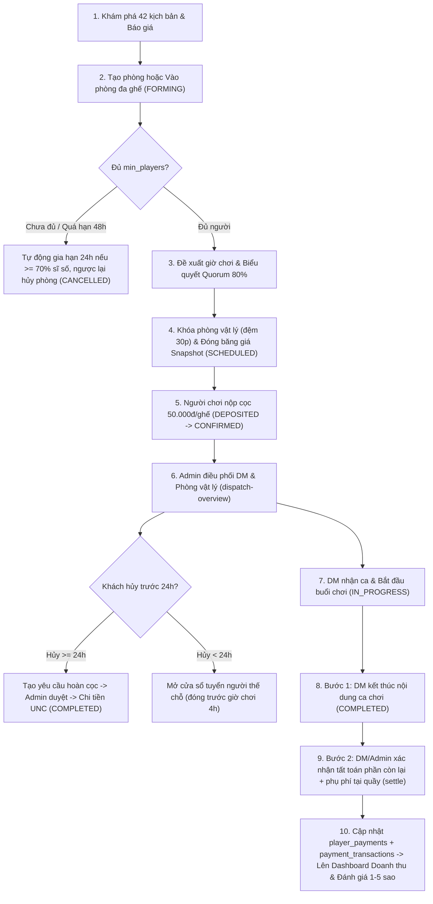

# KỊCH BẢN SÁT V16 — HỆ THỐNG ĐẶT PHÒNG & ĐIỀU PHỐI JUBENSHA

Hệ thống quản lý đặt phòng, ghép đội, xếp lịch, điều phối Quản trò (DM), tính giá động, thanh toán cọc/tất toán và quản trị vận hành cho mô hình câu lạc bộ Kịch Bản Sát (Jubensha). Dự án được xây dựng bằng **PHP 8.3 thuần** (MVC Feature-Driven, PDO Prepared Statements, không dùng Framework), **MySQL 8.4 / MariaDB** và **Vanilla HTML5 / CSS3 / ES Modules**.

---

## 1. THÔNG TIN DEPLOY & LIÊN KẾT NHANH

| Hạng mục | Đường dẫn / Giá trị | Ghi chú |
| :--- | :--- | :--- |
| **Bản Deploy trực tuyến (InfinityFree)** | `http://kichbansat.wuaze.com/` | Chạy trực tiếp trên Apache Shared Hosting + MariaDB |
| **Website Local (Docker / PHP Server)** | `http://localhost:8000` hoặc `http://127.0.0.1:8000` | Same-Origin Front Controller phục vụ cả Frontend + API |
| **Tài liệu API tương tác (Swagger UI)** | `http://localhost:8000/docs` | Nạp trực tiếp từ `backend/public/openapi.json` (OpenAPI 3.0.3, `v16.1.0`, `73` endpoints) |
| **Kiểm tra sức khỏe hệ thống (Healthcheck)** | `http://localhost:8000/api/v1/health` | Kiểm tra kết nối MySQL/PDO, độ trễ truy vấn và runtime PHP |
| **Nhánh Git chính thức** | `feat/truong-backend-stage3` | Repo `nguyenxuanhieu2903/kich-ban-sat-php` |
| **Tài liệu vận hành (SOP) & Bảo vệ** | [CACH_VAN_HANH.md](CACH_VAN_HANH.md) · [TAI_LIEU_VAN_HANH_TOAN_DIEN_HE_THONG.md](docs/TAI_LIEU_VAN_HANH_TOAN_DIEN_HE_THONG.md) · [BO_CAU_HOI_PHAN_BIEN_VA_KICH_BAN_DEMO.md](docs/BO_CAU_HOI_PHAN_BIEN_VA_KICH_BAN_DEMO.md) | Quy trình chuẩn 4 vai trò và kịch bản thuyết trình |

---

## 2. CÁCH HOẠT ĐỘNG & KIẾN TRÚC HỆ THỐNG

### 2.1. Kiến trúc tổng thể (Same-Origin MVC + REST API)

Hệ thống hoạt động theo mô hình **Front Controller hợp nhất** tại `backend/public/index.php`:
- Mọi yêu cầu có tiền tố `/api/v1/*` (và tiền tố tương thích `/api/*`) được chuyển qua chuỗi Middleware (`CorsMiddleware` -> `RateLimitMiddleware` -> `CsrfMiddleware` -> `AuthMiddleware`) tới đúng Controller theo 9 phân hệ nghiệp vụ trong `backend/app/Features/`.
- Mọi yêu cầu tới `/docs` và `/openapi.json` trả về tài liệu Swagger UI và đặc tả OpenAPI 3.0.3 (`73` endpoints).
- Mọi yêu cầu còn lại được định tuyến trực tiếp sang thư mục `frontend/` kèm cơ chế kiểm tra đường dẫn an toàn (chống Path Traversal) và trả đúng `Content-Type`. Nhờ chạy **Same-Origin**, cookie phiên `kbs_session_id` hoạt động ổn định, không bị trình duyệt chặn Cross-Site Cookie.
- Hệ thống tích hợp **PSR-4 Fallback Autoloader** trong `backend/bootstrap/app.php`, giúp mã nguồn chạy được ngay bằng PHP thuần trên mọi môi trường (Docker, Laragon, XAMPP, InfinityFree) kể cả khi không cài `vendor/` của Composer.

### 2.2. Cấu trúc thư mục dự án

```text
kich-ban-sat-php/
├── Dockerfile                         # Image PHP 8.3 CLI + PDO MySQL + thư mục storage chuẩn quyền 775
├── docker-compose.yml                 # Dựng đồng thời MySQL 8.4 (port 3307) + App PHP (port 8000)
├── README.md                          # Tài liệu hướng dẫn cài đặt, deploy, luồng hoạt động và kiểm thử
├── CACH_VAN_HANH.md                   # Sổ tay vận hành chuẩn (SOP) cho 4 vai trò
├── backend/
│   ├── app/
│   │   ├── Core/                      # Application, Router, Request, Response, Middleware, Exceptions
│   │   ├── Features/
│   │   │   ├── Identity/              # Auth, RBAC, AdminUser, AdminReport (Dashboard), AdminAuditLog
│   │   │   ├── GameCatalog/           # 42 kịch bản, cấu hình đạo cụ, bảng giá ngày/tối
│   │   │   ├── GameroomManagement/    # Tạo/vào/rời phòng, điều phối Admin, quản lý phòng vật lý, Cron Jobs
│   │   │   ├── VenueScheduling/       # Đề xuất lịch, biểu quyết Quorum 80%, vòng đời Session 2 bước
│   │   │   ├── DMManagement/          # Phân công, nhận/từ chối và thu hồi Quản trò (DM)
│   │   │   ├── Pricing/               # Tính giá Majority Time Block & Split 50-50, Snapshot giá
│   │   │   ├── Promotion/             # Khuyến mãi Thứ Ba vui vẻ (-30%) & HSSV (-20.000đ, không cộng dồn)
│   │   │   ├── PaymentRefund/         # Đặt cọc 50k/ghế, tất toán quầy, hoàn tiền 4 bước & đối soát giao dịch
│   │   │   └── Notification/          # Thông báo sự kiện thời gian thực và broadcast hệ thống
│   │   ├── Infrastructure/            # DatabaseConnection (PDO Singleton), TransactionManager, Config
│   │   └── Shared/                    # RoomSeatHelper (tính ghế đa chỗ), AuditLogService, Enums
│   ├── bin/                           # cron.php (chạy job hết hạn/nhắc lịch), seed.php (nạp dữ liệu mẫu)
│   ├── bootstrap/app.php              # Khởi tạo cấu hình, nạp .env, autoloader
│   ├── database/
│   │   └── kich_ban_sat_v3_clean.sql  # Bản dump chuẩn 24 bảng (tương thích MySQL 8.4 & MariaDB)
│   ├── public/                        # index.php (Front Controller), openapi.json (OpenAPI 3.0.3)
│   ├── routes/api.php                 # Toàn bộ khai báo REST API routes
│   ├── tests/                         # Bộ kiểm thử PHPUnit (Unit, Integration, Feature)
│   └── .env.example                   # File cấu hình mẫu (không chứa mật khẩu thật)
├── frontend/
│   ├── index.html                     # Trang chủ giới thiệu & kịch bản nổi bật
│   ├── pages/                         # 11 trang chức năng: scenarios, scenario-detail, info, auth,
│   │                                  # lobby, create-room, room-detail, booking-status, profile,
│   │                                  # dm-portal, admin-portal
│   └── src/                           # api-client, logic, pages-js, styles, assets/images (42 poster)
└── docs/                              # Đặc tả kỹ thuật, ADR, ma trận phân quyền, tài liệu phản biện
```

### 2.3. Phân quyền 4 vai trò (RBAC) & Cơ chế bảo mật

| Vai trò | Phạm vi trang giao diện | Quyền hạn nghiệp vụ chính |
| :--- | :--- | :--- |
| **GUEST (Khách)** | `index.html`, `scenarios.html`, `scenario-detail.html`, `info.html`, `auth.html` | Xem danh mục 42 kịch bản, lọc thể loại/sĩ số/18+, xem bảng giá và báo giá dự kiến, đăng ký/đăng nhập. |
| **PLAYER (Người chơi)** | `lobby.html`, `create-room.html`, `room-detail.html`, `booking-status.html`, `profile.html` | Tạo phòng, đăng ký nhiều ghế (`seats`), đề xuất và biểu quyết lịch, thanh toán cọc `50.000 đ/ghế`, tải thẻ HSSV, xem lịch sử phòng, yêu cầu hoàn cọc, đánh giá sau ca chơi. |
| **DM (Quản trò)** | `dm-portal.html` | Xem ca trực được phân công, nhận/từ chối ca, bắt đầu buổi chơi, ghi biên bản hiện trường, báo trễ ca, xử lý No-show, kết thúc ca (Bước 1), xác nhận tất toán phần còn lại + phụ phí tại quầy (Bước 2), duyệt thẻ HSSV tại bàn. |
| **ADMIN (Quản trị)** | `admin-portal.html` (7 phân hệ) | Xem Dashboard doanh thu & biểu đồ, điều phối phòng/DM/phòng vật lý, khóa giữ chỗ Hotline/Walk-in, bật/tắt bảo trì kèm tự động điều chuyển ca, quản lý tài khoản & phân quyền, duyệt/từ chối/chi hoàn cọc (UNC), quản lý danh mục kịch bản/khuyến mãi, xem Audit Logs. |

**Cơ chế bảo mật tích hợp sẵn:**
- **Chống SQL Injection:** 100% truy vấn sử dụng PDO Prepared Statements (`prepare` + `bindValue`/`execute`).
- **Chống XSS:** Chuẩn hóa dữ liệu xuất ra DOM, tách biệt API JSON và lớp hiển thị.
- **Bảo vệ xác thực:** Mật khẩu băm `PASSWORD_BCRYPT`, gọi `session_regenerate_id(true)` sau khi đăng nhập, cookie đặt `HttpOnly` và `SameSite=Lax`.
- **Chống CSRF & Brute-force:** Bắt buộc header `X-CSRF-Token` cho các request thay đổi dữ liệu (`POST/PUT/PATCH/DELETE`), giới hạn tần suất gọi API qua `RateLimitMiddleware`.
- **Chống Race Condition & IDOR:** Khóa bi quan `SELECT ... FOR UPDATE` trong Database Transaction khi vào phòng/thanh toán; người chơi chỉ xem được phiếu thanh toán và hồ sơ phòng thuộc quyền của mình.

---

## 3. LUỒNG HOẠT ĐỘNG NGHIỆP VỤ CHI TIẾT (END-TO-END FLOWS)

### 3.1. Sơ đồ vòng đời một bàn chơi



### 3.2. Chi tiết 6 luồng nghiệp vụ cốt lõi

1. **Luồng Tạo phòng & Ghép đội (`GameRoomController` + `RoomSeatHelper`):**
   - Chủ phòng chọn kịch bản, chi nhánh dự kiến, khung giờ dự kiến và số ghế giữ chỗ (`seats`).
   - Khi người chơi khác vào phòng (`POST /api/v1/rooms/{id}/join`), hệ thống mở transaction với `SELECT ... FOR UPDATE` để chặn vượt `max_players`, đồng thời kiểm tra chống chơi lại kịch bản đã hoàn thành (Anti-Replay) và chống trùng giờ với phòng khác đang tham gia.
2. **Luồng Xếp lịch & Biểu quyết (`SchedulingController` + `RoomSchedulingService`):**
   - Thời gian kết thúc tự động khóa theo thời lượng chuẩn `duration_minutes` của kịch bản (không cho phép chỉnh ngắn bất hợp lý dưới 60 phút).
   - Thành viên bỏ phiếu đồng ý/từ chối trong hạn 12 giờ (`POST /api/v1/proposals/{id}/vote`). Khi đạt ngưỡng **Quorum 80%** (`ceil(sĩ_số * 0.8)`) không có phiếu phản đối (hoặc Admin phê duyệt), hệ thống kiểm tra phòng vật lý trống với khoảng đệm vệ sinh bắt buộc **30 phút** (`BUFFER_MINUTES = 30`).
3. **Luồng Tính giá & Đặt cọc (`PricingService` + `PaymentController`):**
   - Hỗ trợ bảng giá khung giờ Ngày (`09:00–19:59`) và Tối (`20:00–23:00`). Nếu ca chơi vắt qua 2 khung giờ, áp dụng **Majority Time Block Rule** (khung giờ chiếm đa số thời lượng) hoặc **Split 50-50 Tie Rule** (trung bình cộng nếu chia đều 50/50).
   - Ưu đãi Thứ Ba giảm `30%` hoặc ưu đãi HSSV giảm `20.000 đ/người` (chỉ áp dụng khi tài khoản đã được duyệt `student_verified = 1`; không cộng dồn khuyến mãi).
   - Mức đặt cọc cố định **`50.000 đ/ghế`**. Khi thanh toán (`POST /api/v1/payments/deposit` hoặc `/{paymentId}/deposit`), hệ thống ghi nhận đồng thời vào `player_payments` (`PAID`) và `payment_transactions` (`SUCCESS`) kèm `idempotency_key` chống thu trùng.
4. **Luồng Vận hành hiện trường 2 bước của DM (`SessionLifecycleController`):**
   - DM vào `dm-portal.html` nhận ca (`accept`) hoặc từ chối kèm lý do (`reject`).
   - Khi khách đến: DM bấm **Bắt đầu ca** (`start` -> `IN_PROGRESS`), có thể ghi biên bản (`notes`), gửi cảnh báo trễ ca (`overtime-alert`), hoặc xử lý khách vắng mặt (`no-show`: thiếu 1 người DM đóng NPC; thiếu >= 2 người hủy ca tại chỗ, hoàn cọc người đến đúng giờ).
   - Khi kết thúc: tách rõ **Bước 1 — Kết thúc nội dung (`complete`)** để chốt trạng thái `COMPLETED`, và **Bước 2 — Xác nhận tất toán quầy (`settle`)** để thu phần tiền còn lại (`Giá vé - 50.000 đ cọc` + `extra_fee` phụ phí hư hỏng đạo cụ nếu có) và ghi sổ giao dịch `payment_transactions`.
5. **Luồng Hủy phòng & Hoàn cọc (`PaymentRefundRequestController` + `AdminRefundController`):**
   - Người chơi gửi yêu cầu hoàn cọc (`POST /api/v1/payments/refund-request`) bắt buộc điền lý do (`reason`).
   - Hệ thống kiểm tra mốc **24 giờ trước giờ chơi**: từ 24 giờ trở lên đủ điều kiện hoàn 100%; dưới 24 giờ bị giữ cọc trừ khi phòng bị hủy do lỗi hệ thống/cơ sở hoặc Admin đặc cách.
   - Quy trình kế toán 4 trạng thái: `PENDING` -> `APPROVED` / `REJECTED` -> `COMPLETED` (lưu mã chứng từ ủy nhiệm chi `bank_reference_code`).
6. **Luồng Quản trị, Điều phối & Báo cáo Doanh thu (`AdminOperationsController` + `AdminReportController`):**
   - Dashboard quản trị (`admin-portal.html`) hiển thị dữ liệu thời gian thực từ `GET /api/v1/admin/reports/revenue`:
     - `Tổng thu = Tiền cọc đã thu + Tiền tất toán đã thu`
     - `Doanh thu thuần = Tổng thu - Tổng tiền hoàn đã duyệt/đã chi`
     - Biểu đồ chuỗi doanh thu theo ngày (`daily_series`), Top kịch bản mang lại doanh thu cao nhất (`top_scenarios`), phân bổ số phòng theo 6 trạng thái (`room_status_counts`) và số lượng giao dịch thành công (`successful_transactions`).
   - Bảng điều phối tập trung (`GET /api/v1/admin/dispatch-overview`) giúp Admin gán DM, thu hồi DM, đổi phòng vật lý, khóa giữ chỗ Hotline (`offline-block`), và bật bảo trì phòng vật lý kèm tự động điều chuyển các ca tương lai sang phòng trống cùng chi nhánh (`Dynamic Room Rerouting`).

---

## 4. HƯỚNG DẪN CÀI ĐẶT & CHẠY LOCAL

### 4.1. Cách 1 — Chạy nhanh bằng Docker (Khuyến nghị, 1 lệnh duy nhất)

Yêu cầu duy nhất: cài đặt và bật **[Docker Desktop](https://www.docker.com/products/docker-desktop/)**.

```bash
# 1. Tải đúng nhánh dự án từ GitHub
git clone -b feat/truong-backend-stage3 https://github.com/nguyenxuanhieu2903/kich-ban-sat-php.git
cd kich-ban-sat-php

# 2. Dựng container PHP 8.3 + MySQL 8.4 và tự động nạp sẵn CSDL sạch
docker compose up -d --build
```

Đợi **10–15 giây** để MySQL 8.4 hoàn tất nạp `backend/database/kich_ban_sat_v3_clean.sql`, sau đó mở trình duyệt:
- Trang chủ: `http://localhost:8000`
- Tài liệu API (Swagger UI): `http://localhost:8000/docs`
- Healthcheck: `http://localhost:8000/api/v1/health`

**Các lệnh Docker hữu ích:**
```bash
docker compose ps                                # Kiểm tra kbs_mysql (healthy) và kbs_app (Up)
docker compose logs -f                           # Theo dõi log ứng dụng và CSDL
docker compose down                              # Dừng hệ thống (giữ lại dữ liệu DB và ảnh upload)
docker compose down -v && docker compose up -d --build   # Reset sạch CSDL về dữ liệu mẫu ban đầu
```
Kết nối MySQL từ DBeaver / HeidiSQL / MySQL Workbench: Host `127.0.0.1`, Port `3307`, Database `kich_ban_sat_v3`, User `root`, Password `root`.

### 4.2. Cách 2 — Chạy thủ công trên Laragon / XAMPP (Không cần Docker)

1. Khởi động dịch vụ **MySQL 8.x hoặc MariaDB** trong Laragon/XAMPP.
2. Tạo cơ sở dữ liệu tên `kich_ban_sat_v3` với bộ mã `utf8mb4_unicode_ci`.
3. Import tệp `backend/database/kich_ban_sat_v3_clean.sql` (đã chuẩn hóa hoàn toàn `utf8mb4_unicode_ci`, không chứa `utf8mb4_0900_ai_ci` và không có `DEFINER`, chạy mượt trên cả MySQL 8.4 lẫn MariaDB).
4. Tạo file cấu hình cục bộ từ file mẫu:
   ```bash
   cp backend/.env.example backend/.env
   ```
   Kiểm tra lại các thông số trong `backend/.env`:
   ```ini
   APP_ENV=local
   APP_DEBUG=true
   APP_URL=http://127.0.0.1:8000
   DB_HOST=127.0.0.1
   DB_PORT=3306
   DB_DATABASE=kich_ban_sat_v3
   DB_USERNAME=root
   DB_PASSWORD=
   ALLOWED_ORIGINS=http://127.0.0.1:8000,http://localhost:8000,http://127.0.0.1:3000,http://localhost:3000
   ```
5. Khởi chạy máy chủ PHP ngay tại thư mục gốc dự án:
   ```bash
   php -S 127.0.0.1:8000 -t backend/public backend/public/index.php
   ```
6. Truy cập **`http://127.0.0.1:8000`**.

### 4.3. Tài khoản đăng nhập mẫu (Nạp sẵn trong `kich_ban_sat_v3_clean.sql`)

| Vai trò | Họ tên | Email đăng nhập | Mật khẩu | Ghi chú |
| :--- | :--- | :--- | :--- | :--- |
| **Admin** | Nguyễn Xuân Hiếu | `nguyenxuanhieu@gmail.com` | `pass123456!` | Toàn quyền 7 tab `admin-portal.html` |
| **Admin** | Lê Nguyễn Nhật Trường | `lenguyennhattruong@gmail.com` | `pass123456!` | Tài khoản quản trị thứ 2 |
| **DM** | Nguyễn Phạm Y Huỳnh | `nguyenphamyhuynh@gmail.com` | `pass123456@` | Cổng quản trò `dm-portal.html` |
| **DM** | Lê Hữu Châu | `lehuuchau@gmail.com` | `pass123456@` | Còn có `nguyenanhthu@gmail.com`, `nguyenthithaonhu@gmail.com` |
| **Player** | Người chơi 01 | `nguoichoi01@gmail.com` | `pass123456#` | Có sẵn 50 tài khoản từ `nguoichoi01` đến `nguoichoi50` |

### 4.4. Tiến trình chạy ngầm (Background Cron Jobs)

Hệ thống tích hợp cơ chế kiểm tra quá hạn tự động khi người dùng truy cập phòng (Lazy Expiration) và hỗ trợ chạy thủ công/định kỳ bằng CLI:
```bash
php backend/bin/cron.php --job=all
# Hoặc chạy từng job riêng lẻ:
# formation-timeout | proposal-timeout | deposit-timeout | replacement-timeout | dm-timeout | session-reminder
```

---

## 5. HƯỚNG DẪN DEPLOY LÊN INFINITYFREE / APACHE SHARED HOSTING

Website hiện đã được triển khai thử nghiệm tại: **`http://kichbansat.wuaze.com/`**

Để triển khai mới hoặc cập nhật mã nguồn lên InfinityFree (hoặc bất kỳ Apache Shared Hosting nào có PHP >= 8.2 và MariaDB/MySQL):

### Bước 1: Chuẩn bị cấu trúc trong thư mục `htdocs/`
Tải lên 2 thư mục mã nguồn (`backend/`, `frontend/` — **không tải** `vendor/`, `.git/`, `tests/`, `docs/`) cùng 2 tệp định tuyến ở gốc `htdocs/`:

1. **`htdocs/index.php`:**
   ```php
   <?php
   declare(strict_types=1);
   require __DIR__ . '/backend/public/index.php';
   ```
2. **`htdocs/.htaccess`:**
   ```apache
   Options -Indexes
   RewriteEngine On

   # Chặn truy cập trực tiếp vào mã nguồn backend và file cấu hình .env
   RewriteRule ^backend(/|$) - [F,L]
   RewriteRule ^\.env - [F,L]

   # Điều hướng toàn bộ request (frontend và /api/v1/*) qua Front Controller
   RewriteCond %{REQUEST_URI} !^/index\.php$
   RewriteRule ^ index.php [QSA,L]
   ```

### Bước 2: Import cơ sở dữ liệu trên Hosting
1. Tạo Database mới trong Control Panel của InfinityFree và mở **phpMyAdmin**.
2. Chọn tab **Import**, tải lên tệp `backend/database/kich_ban_sat_v3_clean.sql` (đã loại bỏ hoàn toàn `utf8mb4_0900_ai_ci` và `DEFINER=` để tương thích trực tiếp với MariaDB trên hosting).

### Bước 3: Tạo file `htdocs/backend/.env` riêng cho Production
Không đẩy file `.env` lên Git. Tạo trực tiếp file `htdocs/backend/.env` trên File Manager của hosting theo mẫu sau (thay bằng thông số MySQL từ Control Panel):
```ini
APP_NAME="Kich Ban Sat"
APP_ENV=production
APP_DEBUG=false
APP_URL=http://kichbansat.wuaze.com
APP_TIMEZONE=Asia/Ho_Chi_Minh

DB_CONNECTION=mysql
DB_HOST=sqlXXX.infinityfree.com
DB_PORT=3306
DB_DATABASE=if0_xxxxxxxx_kich_ban_sat
DB_USERNAME=if0_xxxxxxxx
DB_PASSWORD=your_hosting_db_password
DB_CHARSET=utf8mb4

ALLOWED_ORIGINS=http://kichbansat.wuaze.com,https://kichbansat.wuaze.com
SESSION_LIFETIME=7200
SESSION_COOKIE_NAME=kbs_session_id
SESSION_COOKIE_SECURE=false
SESSION_COOKIE_HTTPONLY=true
SESSION_COOKIE_SAMESITE=Lax
```
*(Lưu ý: nếu bật HTTPS/SSL cho domain, đổi `APP_URL` sang `https://...` và đặt `SESSION_COOKIE_SECURE=true`.)*

### Bước 4: Xác minh sau khi Deploy
- Đảm bảo 3 thư mục có quyền ghi: `backend/storage/logs`, `backend/storage/rate_limits`, `backend/storage/uploads/student_cards`.
- Kiểm tra `http://<domain>/api/v1/health` trả về `"status": "ok"` và `"database": {"status": "ok"}`.
- Kiểm tra truy cập trực tiếp `http://<domain>/backend/.env` bị chặn với mã **403 Forbidden**.
- Khi cập nhật mã nguồn lần sau, **không ghi đè** tệp `htdocs/backend/.env` trên server.

---

## 6. HƯỚNG DẪN TEST TOÀN DIỆN (TỰ ĐỘNG & THỦ CÔNG)

### 6.1. Kiểm tra nhanh cú pháp PHP & chạy Unit Tests (không ảnh hưởng dữ liệu mẫu)

```bash
# 1. Kiểm tra cú pháp toàn bộ file PHP trong backend/app
find backend/app -name "*.php" -exec php -l {} \;

# 2. Chạy bộ Unit Test PHPUnit (yêu cầu đã chạy composer install trong backend/)
cd backend
php vendor/bin/phpunit --testsuite Unit
```
Kết quả chuẩn đã xác thực trên PHP 8.3.36: **`OK (49 tests, 168 assertions)`**.

*(Lưu ý khi chạy `--testsuite Feature` hoặc toàn bộ PHPUnit: các bài test tích hợp có thể tạo/sửa dữ liệu trong CSDL cấu hình tại `backend/.env`. Hãy sao lưu hoặc import lại `backend/database/kich_ban_sat_v3_clean.sql` sau khi chạy xong để khôi phục bộ dữ liệu demo sạch.)*

### 6.2. Kiểm thử API & Đối soát số liệu trực tiếp bằng `curl`

Mở terminal khi máy chủ đang chạy tại `http://127.0.0.1:8000`:

```bash
# Bước 1: Kiểm tra Healthcheck và OpenAPI Spec
curl -s http://127.0.0.1:8000/api/v1/health
curl -s http://127.0.0.1:8000/api/v1/openapi.json | head -c 300

# Bước 2: Lấy CSRF token và lưu session cookie
CSRF=$(curl -s -c cookies.txt http://127.0.0.1:8000/api/v1/auth/csrf-token | php -r '$j=json_decode(stream_get_contents(STDIN),true); echo $j["data"]["csrf_token"] ?? "";')

# Bước 3: Đăng nhập tài khoản Admin (có CSRF header + Origin hợp lệ)
curl -s -b cookies.txt -c cookies.txt \
  -H "Content-Type: application/json" \
  -H "X-CSRF-Token: $CSRF" \
  -H "Origin: http://127.0.0.1:8000" \
  -d '{"email":"nguyenxuanhieu@gmail.com","password":"pass123456!"}' \
  http://127.0.0.1:8000/api/v1/auth/login

# Bước 4: Kiểm tra Báo cáo Doanh thu & Bảng Điều phối
curl -s -b cookies.txt http://127.0.0.1:8000/api/v1/admin/reports/revenue
curl -s -b cookies.txt http://127.0.0.1:8000/api/v1/admin/dispatch-overview
```

**Số liệu chuẩn của bộ dữ liệu mẫu sạch (`kich_ban_sat_v3_clean.sql`) để đối chiếu:**
- Tổng số phòng chơi: **11 phòng** (`SCHEDULED`: 2, `CONFIRMED`: 1, `IN_PROGRESS`: 1, `COMPLETED`: 4, `CANCELLED`: 3, `FORMING`: 0).
- Tổng số khoản thanh toán đã thu (`player_payments.status = 'PAID'`): **75 bản ghi** = **`6.546.000 đ`** (`Tiền cọc`: `2.550.000 đ` + `Tiền tất toán`: `3.996.000 đ`).
- Tổng số giao dịch thành công (`payment_transactions.status = 'SUCCESS'`): **75 giao dịch** = **`6.546.000 đ`** (khớp 100% 1:1 với bảng `player_payments`).
- Yêu cầu hoàn tiền (`refunds`): **3 bản ghi** (`2 REJECTED` ở Phòng #1 & #2, `1 PENDING` `50.000 đ` ở Phòng #3 để kiểm thử luồng duyệt hoàn tiền).
- Doanh thu thuần ban đầu: **`6.546.000 đ`** (`total_refunded = 0 đ` cho đến khi Admin duyệt yêu cầu `PENDING`).

### 6.3. Kịch bản kiểm thử thủ công End-to-End (5 kịch bản trên trình duyệt)

#### Kịch bản A — Khách vãng lai (`GUEST`)
1. Mở `http://localhost:8000/` -> kiểm tra hiển thị trang chủ, menu và kịch bản nổi bật không lỗi ảnh 404.
2. Vào `Kho kịch bản` (`/pages/scenarios.html`) -> kiểm tra đủ 42 kịch bản, thử lọc theo thể loại/số người/từ khóa.
3. Chọn một kịch bản bất kỳ (`/pages/scenario-detail.html?id=...`) -> kiểm tra thông tin cấu trúc vai, bảng giá ngày/tối và nút mở phòng.

#### Kịch bản B — Người chơi (`PLAYER`: `nguoichoi01@gmail.com` / `pass123456#`)
1. Đăng nhập tại `/pages/auth.html` -> kiểm tra tự chuyển về giao diện người chơi và hiển thị đúng tên tài khoản.
2. Vào `/pages/create-room.html` -> chọn kịch bản, chi nhánh, giờ chơi, số ghế (`seats >= 1`) -> kiểm tra bảng báo giá tự động cập nhật và tạo phòng mới thành công.
3. Vào chi tiết phòng `/pages/room-detail.html?id=...` -> kiểm tra tạo đề xuất lịch (ô giờ kết thúc tự động khóa đúng `duration_minutes`), bỏ phiếu biểu quyết, bấm đóng cọc `50.000 đ/ghế`.
4. Vào `/pages/profile.html` -> kiểm tra lịch sử phòng chơi, thử tải ảnh thẻ HSSV (`jpg/png/webp`), và kiểm tra hiển thị trạng thái hoàn cọc.

#### Kịch bản C — Quản trò (`DM`: `nguyenphamyhuynh@gmail.com` / `pass123456@`)
1. Đăng nhập tài khoản DM -> vào `/pages/dm-portal.html`.
2. Kiểm tra danh sách ca được gán: thử nhận ca (`ACCEPTED`) hoặc từ chối kèm lý do (`REJECTED`).
3. Trên ca `SCHEDULED`: bấm **Bắt đầu ca** (`IN_PROGRESS`) -> nhập biên bản hiện trường -> bấm **Bước 1: Kết thúc ca** (`COMPLETED`) -> bấm **Bước 2: Xác nhận tất toán quầy** (thử nhập thêm `extra_fee` nếu có) -> kiểm tra số liệu doanh thu trên Admin Dashboard tăng tương ứng.

#### Kịch bản D — Quản trị viên (`ADMIN`: `nguyenxuanhieu@gmail.com` / `pass123456!`)
1. Đăng nhập tài khoản Admin -> vào `/pages/admin-portal.html`.
2. **Tab Tổng quan & Doanh thu:** kiểm tra 4 thẻ KPI, biểu đồ cột doanh thu theo ngày (`daily_series`), danh sách Top kịch bản (`top_scenarios`) và biểu đồ trạng thái phòng khớp tuyệt đối với bảng đối soát Mục 6.2.
3. **Tab Điều phối phòng & DM:** kiểm tra đủ 11 phòng, thử gán/đổi DM (chặn trùng giờ DM), gán phòng vật lý (chặn trùng giờ + đệm 30 phút), thử khóa giữ chỗ Hotline (`offline-block`).
4. **Tab Phòng vật lý:** bật chế độ bảo trì 1 phòng có ca tương lai -> kiểm tra hệ thống tự động điều chuyển ca sang phòng trống cùng chi nhánh và phát thông báo.
5. **Tab Hoàn tiền:** kiểm tra yêu cầu `PENDING` `50.000 đ` của Phòng #3 -> bấm **Duyệt hoàn tiền** (`APPROVED`) -> nhập mã UNC bấm **Hoàn tất chi tiền** (`COMPLETED`) -> quay lại Tab Tổng quan kiểm tra `total_refunded = 50.000 đ` và `net_revenue = 6.496.000 đ`.
6. **Tab Nhật ký kiểm toán (Audit Logs):** kiểm tra mọi thao tác vừa làm đều được ghi vết đầy đủ (actor, action, entity, timestamp).

#### Kịch bản E — Kiểm tra Bảo mật & Responsive
1. Đăng nhập bằng `PLAYER` và mở trực tiếp `/api/v1/admin/reports/revenue` -> bắt buộc trả **`403 Forbidden`**.
2. Gửi request `POST /api/v1/auth/login` không kèm header `X-CSRF-Token` -> bắt buộc trả **`403 Forbidden`**.
3. Thu nhỏ trình duyệt về kích thước Mobile `375x812` trên tất cả các trang chính (`index.html`, `scenarios.html`, `lobby.html`, `room-detail.html`, `dm-portal.html`, `admin-portal.html`) -> kiểm tra bố cục không vỡ và không phát sinh thanh cuộn ngang.

---

## 7. TÀI LIỆU KỸ THUẬT BỔ SUNG TRONG REPO

- [CACH_VAN_HANH.md](CACH_VAN_HANH.md): Sổ tay vận hành chi tiết từng thao tác cho Khách, Người chơi, Quản trò và Quản trị viên.
- [docs/TAI_LIEU_VAN_HANH_TOAN_DIEN_HE_THONG.md](docs/TAI_LIEU_VAN_HANH_TOAN_DIEN_HE_THONG.md): Đặc tả kiến trúc vận hành toàn diện 28 điểm nghiệp vụ.
- [docs/ACTOR_BUSINESS_AUDIT.md](docs/ACTOR_BUSINESS_AUDIT.md): Ma trận đối chiếu 4 Actor và 42 yêu cầu chức năng (FR-01 đến FR-42).
- [docs/api/AUTHORIZATION_MATRIX.md](docs/api/AUTHORIZATION_MATRIX.md): Ma trận phân quyền chi tiết theo từng nhóm endpoint API.
- [docs/BO_CAU_HOI_PHAN_BIEN_VA_KICH_BAN_DEMO.md](docs/BO_CAU_HOI_PHAN_BIEN_VA_KICH_BAN_DEMO.md): Kịch bản demo 5 phút và bộ câu hỏi phản biện bảo vệ đồ án.
- [backend/README.md](backend/README.md) & [frontend/README.md](frontend/README.md): Tài liệu kỹ thuật riêng cho từng tầng Backend và Frontend.
