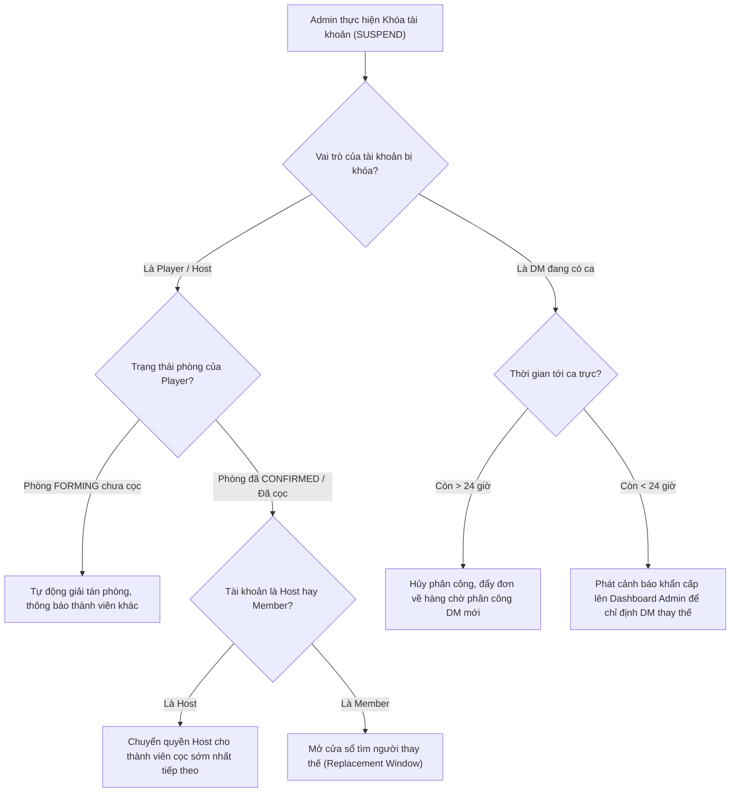
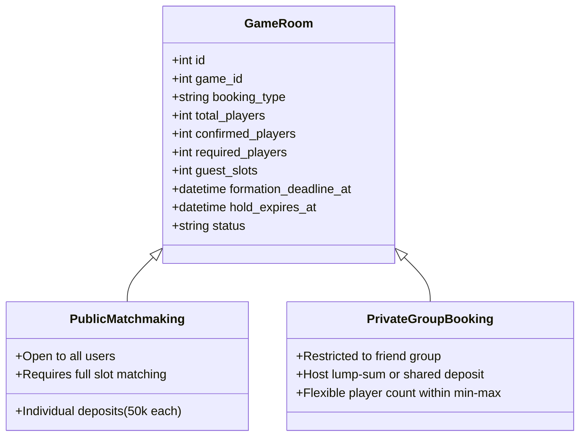
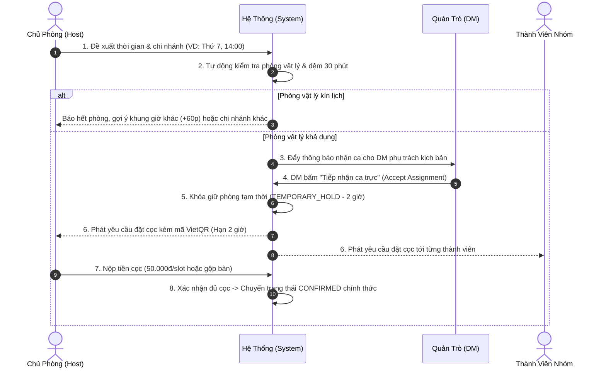
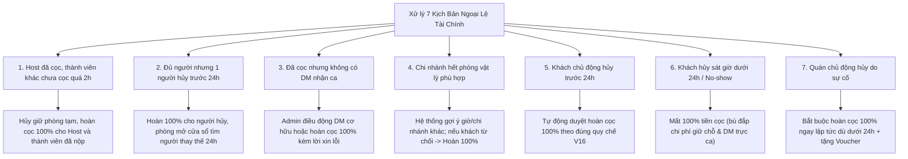

# ĐẶC TẢ KIẾN TRÚC VẬN HÀNH TOÀN DIỆN & CHUẨN HÓA NGHIỆP VỤ HỆ THỐNG KỊCH BẢN SÁT (V16)

Tài liệu này là đặc tả kỹ thuật và nghiệp vụ chính thức, chuẩn hóa toàn diện 28 điểm nghiệp vụ trọng yếu thuộc 5 phân hệ chức năng, định nghĩa chi tiết 4 máy trạng thái (State Machines) độc lập, giải quyết dứt điểm các điểm nghẽn vận hành và xác lập 3 quyết định kiến trúc cốt lõi phục vụ công tác phát triển, kiểm thử và nghiệm thu đồ án tốt nghiệp.

---

## MỤC LỤC

1. [Chốt 3 Quyết Định Nghiệp Vụ Kiến Trúc Cốt Lõi](#1-chot-3-quyet-dinh-nghiep-vu-kien-truc-cot-loi)
2. [Phân Hệ 1: Phân Quyền, Trách Nhiệm & Quản Trị Tài Khoản (Identity & Ownership)](#2-phan-he-1-phan-quyen-trach-nhiem--quan-tri-tai-khoan-identity--ownership)
3. [Phân Hệ 2: Mô Hình Đặt Phòng, Gom Đội & Chuẩn Hóa Vòng Đời (Room & Booking)](#3-phan-he-2-mo-hinh-dat-phong-gom-doi--chuan-hoa-vong-doi-room--booking)
4. [Phân Hệ 3: Xếp Lịch & Quản Lý Tài Nguyên (Scheduling & Resource Management)](#4-phan-he-3-xep-lich--quan-ly-tai-nguyen-scheduling--resource-management)
5. [Phân Hệ 4: Đặt Cọc, Tính Giá, Thanh Toán & 7 Kịch Bản Ngoại Lệ (Payment & Financial)](#5-phan-he-4-dat-coc-tinh-gia-thanh-toan--7-kich-ban-ngoai-le-payment--financial)
6. [Phân Hệ 5: Điều Phối Buổi Chơi Thực Tế & Hệ Thống Thông Báo (Game Session & Notification)](#6-phan-he-5-dieu-phoi-buoi-choi-thuc-te--he-thong-thong-bao-game-session--notification)
7. [Ma Trận Phân Kỳ Triển Khai Kỹ Thuật (P0 - P1 - P2)](#7-ma-tran-phan-ky-trien-khai-ky-thuat-p0---p1---p2)

---

## 1. CHỐT 3 QUYẾT ĐỊNH NGHIỆP VỤ KIẾN TRÚC CỐT LÕI

Để đảm bảo hệ thống phản ánh chính xác thực tế kinh doanh mô hình trò chơi nhập vai giải đố tại bàn (Jubensha O2O - Online to Offline), 3 quyết định nghiệp vụ sau đây được xác lập làm chuẩn bất biến cho toàn bộ mã nguồn Backend, Frontend và Cơ sở dữ liệu:

### Quyết định 1: Hỗ trợ song song cả hai mô hình Public Matchmaking và Private Group Booking
- Khẳng định lựa chọn: Hệ thống hỗ trợ đầy đủ cả hai mô hình đặt phòng thay vì chỉ chọn một:
  1. `PUBLIC` (Gom khách lẻ): Dành cho người chơi đi 1 - 2 người muốn tìm thám tử ghép bàn; hệ thống mở sảnh công khai để người lạ bấm tham gia.
  2. `PRIVATE` (Nhóm bạn riêng tư): Dành cho nhóm bạn đi chung (chiếm 70% doanh số thực tế); Chủ phòng (Host) đại diện đặt bàn, khóa quyền tham gia của người lạ, khai báo số lượng người thực tế đi cùng để chốt lịch nhanh chóng.
- Chỉ số định lượng theo dõi chuẩn:
  - `total_players`: Tổng số người chơi thực tế dự kiến tham gia (phải nằm trong biên độ `[min_players, max_players]` của kịch bản).
  - `confirmed_players`: Số người đã tham gia và xác nhận slot.
  - `required_players`: Số người tối thiểu bắt buộc để mở kịch bản (`min_players`).
  - `guest_slots`: Số slot mở cho khách lẻ ghép vào (trong trường hợp nhóm Private thiếu 1 - 2 người và Host chủ động chọn mở ghép).

### Quyết định 2: Áp dụng cơ chế Đặt cọc linh hoạt (Hybrid Deposit Policy)
- Khẳng định lựa chọn:
  1. Với phòng `PUBLIC`: Bắt buộc từng cá nhân tự nộp tiền cọc 50.000 VNĐ qua cổng VietQR Napas 247 để đảm bảo trách nhiệm cá nhân; ai bùng lịch thì cá nhân đó bị mất cọc theo quy chế 24 giờ.
  2. Với phòng `PRIVATE`: Cung cấp 2 lựa chọn linh hoạt cho Host:
     - Hình thức 1 (Khuyến nghị cho nhóm bạn): Host nộp cọc gộp một lần cho toàn bộ đoàn (`total_players * 50.000 VNĐ`) để hệ thống khóa giữ phòng vật lý tức thì.
     - Hình thức 2: Host gửi link chia sẻ để từng thành viên tự vào thanh toán phần cọc 50.000 VNĐ của mình trong khung thời hạn giữ chỗ (SLA Deposit Window).

### Quyết định 3: Phân định ranh giới 3 tầng rành mạch giữa DM – System – Admin
- Khẳng định lựa chọn:
  1. `DM` (Chuyên môn & Điều phối): Chịu trách nhiệm nhận/từ chối ca trực theo kịch bản thành thạo và chi nhánh phụ trách; check-in khách tại quầy; điều khiển 4 giai đoạn vụ án; ghi chú biên bản và lập báo cáo sự cố (Incident Report). DM không có quyền can thiệp vào tài chính hoặc gán phòng vật lý thủ công.
  2. `System` (Tự động hóa): Tự động kiểm tra tính khả dụng của phòng vật lý; tự động gán phòng phù hợp chủ đề kịch bản và sức chứa; khóa giữ chỗ tạm thời (Temporary Hold); tự động cưỡng chế khoảng đệm vệ sinh cứng 30 phút (`BUFFER_MINUTES = 30`); tự động kích hoạt các tiến trình hủy phòng/hết hạn theo SLA.
  3. `Admin` (Quản trị & Ngoại lệ): Giám sát toàn hệ thống; can thiệp giải quyết xung đột lịch khi quá tải; cưỡng chế chỉ định hoặc thu hồi DM; phê duyệt hoàn tiền các trường hợp bất khả kháng (`force_refund`); đánh dấu bảo trì phòng vật lý; theo dõi nhật ký kiểm toán và báo cáo doanh thu tài chính.

---

## 2. PHÂN HỆ 1: PHÂN QUYỀN, TRÁCH NHIỆM & QUẢN TRỊ TÀI KHOẢN (IDENTITY & OWNERSHIP)

### 2.1. Phân định ranh giới chức năng giữa DM, System và Admin (Điểm 1)
Nhằm loại bỏ hoàn toàn sự chồng chéo quyền hạn, ma trận trách nhiệm RACI (Responsible, Accountable, Consulted, Informed) được xác lập như sau:

| Nghiệp vụ vận hành | DM (Quản Trò) | System (Hệ Thống Lõi) | Admin (Quản Trị Viên) |
| :--- | :---: | :---: | :---: |
| Kiểm tra phòng vật lý trống | Informed | Responsible (Tự động quét CSDL) | Accountable (Giám sát) |
| Khóa giữ phòng tạm thời (Hold) | Informed | Responsible (Khóa 2 giờ chờ cọc) | Accountable |
| Gán phòng vật lý chính thức | Informed | Responsible (Khớp chủ đề & sức chứa) | Accountable (Xử lý xung đột) |
| Thẩm định chuyên môn kịch bản | Responsible (Nhận/từ chối ca) | Consulted (Gợi ý DM theo tag) | Accountable |
| Thu hồi ca trực DM khẩn cấp | Consulted | Informed | Responsible (Thu hồi & đổi người) |
| Thu tiền cọc & Đối soát VietQR | Informed | Responsible (Webhook tự động) | Accountable (Xử lý tra soát) |
| Phê duyệt hoàn tiền đặc cách | No Access | Responsible (Tự động nếu > 24h) | Responsible (Duyệt cờ force_refund) |
| Điều phối 4 giai đoạn vụ án | Responsible (Bấm chuyển vòng) | Accountable (Ghi nhận thời gian) | Informed |

### 2.2. Hệ quả khi tài khoản bị khóa (Account Suspension Lifecycle - Điểm 2)
Khi Quản trị viên kích hoạt chức năng khóa tài khoản (`is_active = 0` hoặc `status = SUSPENDED`), hệ thống lập tức thực thi quy trình dọn dẹp và bảo toàn trạng thái theo các kịch bản:



Quy định tài chính khi tài khoản bị khóa:
- Nếu tài khoản bị khóa có tiền cọc trong phòng chưa diễn ra: Tiền cọc được giữ nguyên ở trạng thái bảo lưu; nếu phòng bị hủy do lỗi từ tài khoản bị khóa, tiền cọc sẽ bị tịch thu sung công quỹ bồi thường chi phí chuẩn bị của quán.
- Nếu phòng bị giải tán do tài khoản bị khóa vi phạm, các thành viên vô can khác trong phòng được tự động hoàn cọc 100% trong vòng 2 giờ làm việc.

### 2.3. Chống trùng lịch và chống spam mở phòng ảo từ Người chơi (Điểm 3)
Nhằm ngăn chặn việc người chơi tạo nhiều phòng ảo gây loãng sảnh chờ hoặc đăng ký tham gia trùng giờ:
1. Quy tắc giới hạn phòng tạo lập: Mỗi tài khoản người chơi chỉ được phép sở hữu tối đa **02 phòng ở trạng thái `FORMING` hoặc `PENDING_SCHEDULE` tại cùng một thời điểm**. Khi cố gắng mở phòng thứ 3, hệ thống trả về mã lỗi `LIMIT_FORMING_ROOMS_EXCEEDED (422)`: "Bạn đang có 2 phòng chờ ghép đội chưa hoàn tất, vui lòng quản lý phòng hiện tại trước khi tạo mới".
2. Quy tắc chống trùng lịch cá nhân (Player Time Overlap Prevention):
   - Trước khi cho phép người chơi `join` vào một phòng mới hoặc xác nhận biểu quyết mốc lịch, hệ thống thực hiện câu truy vấn kiểm tra giao thoa thời gian:
     `SELECT id FROM game_rooms gr JOIN room_participants rp ON gr.id = rp.room_id WHERE rp.user_id = :user_id AND gr.status IN ('CONFIRMED', 'IN_PROGRESS') AND (gr.session_start_at < :new_end_at AND gr.session_end_at > :new_start_at);`
   - Nếu phát hiện trùng giờ, hệ thống từ chối với mã lỗi `PLAYER_SCHEDULE_CONFLICT (409)`: "Bạn đã có lịch chơi kịch bản khác trong khung giờ này, không thể tham gia".

### 2.4. Kiểm soát đặc thù Kịch Bản Sát: Chống chơi lại & Xác nhận Tag 18+ (Điểm 4)
Trò chơi Kịch Bản Sát mang tính chất "trải nghiệm 1 lần duy nhất trong đời" (Once-in-a-lifetime experience). Việc một người đã biết trước hung thủ tham gia lại bàn chơi sẽ phá nát hoàn toàn tính bất ngờ và trải nghiệm của toàn bộ người chơi khác:
1. Cơ chế cảnh báo chống chơi lại (Replay Prevention Warning):
   - Khi người chơi bấm "Tham gia phòng" hoặc Host thêm bạn bè vào danh sách, hệ thống đối soát bảng `game_sessions`:
     `SELECT id, completed_at FROM game_sessions WHERE user_id = :user_id AND game_id = :game_id AND status = 'COMPLETED';`
   - Nếu đã từng hoàn thành kịch bản này:
     - Với phòng `PUBLIC`: Hệ thống **chặn tuyệt đối** tham gia với mã lỗi `GAME_ALREADY_PLAYED (403)`: "Bạn đã từng hoàn thành kịch bản này. Để đảm bảo tính công bằng và bảo mật cốt truyện, bạn không thể tham gia phòng ghép công khai".
     - Với phòng `PRIVATE`: Hệ thống hiển thị hộp thoại cảnh báo (Warning Modal): "Bạn đã từng chơi kịch bản này. Bạn có chắc chắn muốn tham gia cùng nhóm bạn với cam kết không tiết lộ cốt truyện (spoil)?". Nếu người chơi bấm "Tôi cam kết", hệ thống mới ghi nhận.
2. Kiểm soát kịch bản gắn Tag 18+:
   - Các kịch bản có yếu tố kinh dị nặng đô, án mạng bạo lực hoặc tâm lý phức tạp được gắn nhãn `is_18_plus = 1`.
   - Tại bước Tạo phòng / Đặt chỗ: Bắt buộc người chơi phải tích chọn vào ô xác thực: `[x] Tôi xác nhận toàn bộ thành viên tham gia đều từ đủ 18 tuổi trở lên và tự chịu trách nhiệm về nội dung trải nghiệm`.
   - Tại bước Check-in tại quầy: Quản trò (DM) có trách nhiệm đối chiếu Căn cước công dân đối với các trường hợp nghi vấn chưa đủ tuổi. Nếu phát hiện vi phạm, cơ sở có quyền từ chối phục vụ và không hoàn cọc.

---

## 3. PHÂN HỆ 2: MÔ HÌNH ĐẶT PHÒNG, GOM ĐỘI & CHUẨN HÓA VÒNG ĐỜI (ROOM & BOOKING)

### 3.1. Phân định chi tiết Public Matchmaking và Private Group Booking (Điểm 5)
Hệ thống bổ sung trường `booking_type ENUM('PUBLIC', 'PRIVATE') DEFAULT 'PUBLIC'` tại bảng `game_rooms`.



Nguyên tắc quản lý sĩ số cho Private Group:
- Nếu một nhóm bạn có 6 người đăng ký chơi kịch bản có biên độ 6 - 8 người:
  - Khai báo: `total_players = 6`, `required_players = 6`, `confirmed_players = 1` (Host).
  - Hệ thống cho phép Host chốt số lượng nhóm là 6 mà không bắt buộc phải gom đủ 8 người.
  - Trường `guest_slots`: Nếu nhóm 6 người muốn mở thêm 2 chỗ cho người lạ thì đặt `guest_slots = 2`; nếu nhóm muốn chơi riêng tư thì đặt `guest_slots = 0`. Khi `guest_slots = 0`, phòng không hiển thị nút "Tham gia" cho người ngoài trên Sảnh ghép phòng.

### 3.2. Đảo lại trình tự chuẩn: "Duyệt Lịch & Giữ Phòng" trước - "Đặt Cọc" sau (Điểm 6)
Khắc phục triệt để nghịch lý "bắt khách nộp tiền cọc rồi mới đi hỏi DM có rảnh không và phòng vật lý có trống không". Quy trình chuẩn nghiệp vụ được đảo lại như sau:



### 3.3. Chuẩn hóa 4 Máy Trạng Thái Độc Lập (State Machines - Điểm 7)
Thay vì gom chung toàn bộ tiến trình vào một trường `status` đơn lẻ, hệ thống chia tách thành 4 State Machine độc lập bám sát từng thực thể:

#### 1. Booking State Machine (Vòng đời Đặt chỗ / Phòng chơi):
- Các trạng thái: `FORMING` -> `READY_FOR_BOOKING` -> `PENDING_SCHEDULE` -> `PENDING_DEPOSIT` -> `CONFIRMED` -> `IN_PROGRESS` -> `COMPLETED`.
- Trạng thái ngoại lệ: `CANCELLED` (Hủy phòng), `EXPIRED` (Hết hạn gom/cọc), `REJECTED` (DM/Admin từ chối), `DISBANDED` (Giải tán khẩn cấp).

#### 2. Payment State Machine (Vòng đời Thanh toán phòng):
- Các trạng thái: `UNPAID` (Chưa nộp) -> `DEPOSIT_PARTIAL` (Đã có thành viên cọc) -> `DEPOSIT_PAID` (Đã đủ 100% tiền cọc bàn) -> `SETTLED` (Đã quyết toán đủ phần tiền còn lại tại quầy sau ca chơi).

#### 3. Session State Machine (Vòng đời Phiên chơi tại cơ sở):
- Các trạng thái: `WAITING_CHECKIN` (Chờ khách tới quầy) -> `CHECKED_IN` (Đã điểm danh đủ) -> `IN_PROGRESS` (Đang diễn ra 4 vòng án) -> `POST_GAME_SUMMARY` (Công bố kết quả) -> `COMPLETED` (Hoàn tất phiên chơi).

#### 4. Refund State Machine (Vòng đời Hoàn tiền cọc):
- Các trạng thái: `NONE` -> `REQUESTED` (Khách gửi yêu cầu) -> `APPROVED` (Hệ thống duyệt tự động hoặc Admin duyệt) -> `PROCESSING` (Đang thực hiện lệnh chuyển khoản) -> `COMPLETED` (Đã hoàn tất chuyển tiền) hoặc `REJECTED` (Từ chối hoàn tiền kèm lý do vi phạm mốc 24h).

### 3.4. Xóa bỏ tình trạng "Vào phòng mù" cho khách lẻ (Điểm 8)
- Tại màn hình Tạo phòng (`create-room.html`): Cho phép Host chọn ngay **Chi nhánh dự kiến** (`venue_id`) và **Khung giờ mong muốn** (Ví dụ: Chi nhánh Quận 1, Chiều Thứ 7 từ 14:00 - 18:00).
- Trên Sảnh ghép phòng (`lobby.html`): Thẻ phòng hiển thị đầy đủ thông tin:
  - Tên kịch bản & thể loại.
  - Chi nhánh tổ chức (Quận 1 hoặc Bình Thạnh).
  - Khung giờ dự kiến (để khách lẻ biết mình có rảnh vào giờ đó hay không trước khi bấm Tham gia).
  - Số lượng vị trí: Ví dụ `4/6 slot (Cần thêm 2 người)`.

### 3.5. Xử lý bế tắc trong biểu quyết mốc lịch (Điểm 9)
Nhằm tránh tình trạng 1 người chơi bỏ quên không biểu quyết làm treo phòng vô thời hạn:
1. Quy định thời hạn biểu quyết (Voting SLA): Thời hạn tối đa cho một đợt biểu quyết là **12 giờ** kể từ lúc đề xuất được tạo.
2. Quy tắc đa số tuyệt đối và xử lý phiếu từ chối:
   - Nếu trong vòng 12 giờ, đạt $\ge 80\%$ thành viên đồng thuận và không có ai từ chối: Đề xuất tự động được thông qua.
   - Nếu có đúng **01 người bấm Từ chối (`VOTE_NO`)**: Hệ thống không hủy phòng mà mở hộp thoại cho người đó:
     - Lựa chọn A: "Đề xuất một khung giờ khác cho cả phòng biểu quyết lại".
     - Lựa chọn B: "Rút khỏi phòng này để nhường chỗ cho người khác phù hợp lịch hơn" (Người rút lui được trả lại trạng thái tự do, phòng mở lại 1 slot trống cho Sảnh ghép).
   - Nếu có từ **02 người trở lên bấm Từ chối**: Đề xuất lịch bị hủy (`PROPOSAL_REJECTED`), trạng thái phòng quay về `FORMING` để Host thảo luận và mở đề xuất mới.

### 3.6. Quy trình Rời phòng, Chuyển quyền Host & Tìm người thế chỗ (Điểm 10)
1. Trường hợp rời phòng ở giai đoạn `FORMING` (Chưa nộp cọc):
   - Nếu Thành viên thường rời phòng: Giảm sĩ số phòng đi 1, mở lại slot trên Sảnh ghép.
   - Nếu Chủ phòng (Host) rời phòng: Hệ thống tự động chuyển quyền Host cho thành viên tham gia phòng sớm nhất tiếp theo (`ORDER BY joined_at ASC LIMIT 1`). Nếu trong phòng không còn ai, phòng tự động chuyển sang `DISBANDED`.
2. Trường hợp rút lui sau khi đã chốt lịch và nộp cọc (`CONFIRMED`):
   - Thành viên rút lui trước giờ chơi $\ge 24$ giờ: Được duyệt hoàn cọc tự động 100%. Phòng chuyển sang trạng thái `NEED_SUBSTITUTE` (Tìm người thay thế).
   - Hệ thống mở "Cửa sổ tìm người thay thế" (Replacement Window) có thời hạn:
     `SLA_SUBSTITUTE = MIN(24h, session_start_at - NOW())`
   - Vị trí trống được đẩy lên đầu Sảnh ghép phòng với nhãn đặc biệt: `[Cần Người Thế Chỗ Gấp]`.
   - Khi có thành viên mới tham gia và nộp cọc 50.000đ thành công, trạng thái phòng lập tức khôi phục về `CONFIRMED`.

### 3.7. Thay đổi số người trong biên độ min - max sau khi chốt lịch (Điểm 11)
Một kịch bản thường có khoảng người chơi linh hoạt (ví dụ: Án Mạng Trang Viên từ 6 đến 8 người; Biệt Thự Huyết Tộc từ 5 đến 7 người).
1. Thêm người (Add Player):
   - Điều kiện: Số lượng hiện tại chưa đạt `max_players` và thời điểm thêm người cách giờ chơi $\ge 12$ giờ.
   - Host bấm "Thêm thành viên", nhập email/tên bạn bè. Thành viên mới nộp bổ sung 50.000đ tiền cọc.
   - Hệ thống cập nhật lại bảng phân bổ nhân vật và tính lại giá quyết toán tại quầy.
2. Bớt người (Remove Player):
   - Điều kiện: Số lượng còn lại sau khi bớt không được tụt xuống dưới `min_players`.
   - Nếu bớt trước 24 giờ: Người rút lui được hoàn cọc 100%.
   - Nếu bớt dưới 24 giờ: Người rút lui bị mất cọc 50.000đ; tiền cọc này không được trừ vào tổng tiền vé của các thành viên còn lại mà được cơ sở giữ lại bù đắp chi phí in ấn tài liệu kịch bản thừa.

### 3.8. Nghiệp vụ Đổi lịch chơi (Reschedule - Điểm 12)
Nhóm đã đặt cọc thành công (`CONFIRMED`) được quyền đổi lịch theo chính sách:
1. Điều kiện đổi lịch:
   - Phải gửi yêu cầu đổi lịch trước thời điểm bắt đầu phiên chơi tối thiểu **24 giờ**.
   - Mỗi phòng chơi được miễn phí đổi lịch **01 lần duy nhất**. Từ lần đổi lịch thứ hai trở đi, áp dụng phí đổi lịch 100.000 VNĐ/phòng (khấu trừ vào tiền quyết toán).
2. Quy trình đổi lịch:
   - Host chọn khung giờ và phòng mới.
   - Hệ thống kiểm tra phòng vật lý trống và phân bổ lại DM.
   - Toàn bộ số tiền cọc cũ được chuyển sang bảo lưu cho khung giờ mới, không làm gián đoạn trạng thái thanh toán.
   - Nếu đổi lịch dưới 24 giờ: Hệ thống từ chối đổi lịch tự động; nhóm bắt buộc phải liên hệ Hotline cơ sở để Admin xem xét hỗ trợ theo tình hình thực tế phòng trống.

### 3.9. Cơ chế Hết hạn tự động (Timeouts & SLAs - Điểm 13)
Cấu hình 3 mốc thời gian tự động xử lý (Automated Cron SLAs) tại `BackgroundJobService.php`:
1. `FORMATION_TIMEOUT`: Sau **48 giờ** kể từ lúc tạo, nếu phòng ở trạng thái `FORMING` không đủ số lượng người tối thiểu (`required_players`), hệ thống tự động hủy phòng (`EXPIRED`) và gửi thông báo cho các thành viên.
2. `HOLD_DEPOSIT_TIMEOUT`: Sau khi đề xuất lịch được duyệt và phòng chuyển sang `PENDING_DEPOSIT`, các thành viên có đúng **02 giờ (120 phút)** để hoàn tất thanh toán cọc VietQR. Hết 2 giờ nếu chưa đủ cọc, phòng vật lý bị giải phóng, đề xuất bị hủy để tránh chiếm dụng phòng của khách khác.
3. `DM_RESPONSE_TIMEOUT`: Sau khi hệ thống đẩy thông báo cho DM phụ trách, DM có **04 giờ** (hoặc **60 phút** nếu đặt lịch sát giờ trong ngày) để bấm "Nhận ca". Nếu quá hạn DM không phản hồi, hệ thống tự động thu hồi ca và chuyển tiếp lời mời cho DM tiếp theo trong danh sách xoay tua.

### 3.10. Xử lý độ lệch dữ liệu truyền thông (Điểm 14)
- Vấn đề: Giao diện quảng bá "Kho 42 Kịch Bản" nhưng CSDL chỉ có 3 kịch bản hạt giống.
- Giải pháp chuẩn hóa:
  1. Cập nhật seeder `V3DataSeeder.php` bổ sung thêm danh mục lên **12 kịch bản hoàn chỉnh** đại diện cho đầy đủ các trường phái: Âu cổ, Cổ trang Á Đông, Kinh dị giật gân, Trinh thám hiện đại, Học đường, Cơ chế hài hước.
  2. Với các kịch bản còn lại trên giao diện catalog, hiển thị nhãn trạng thái rõ ràng: `[Đang Hoạt Động]` (cho 12 kịch bản sẵn sàng đặt bàn) và `[Sắp Ra Mắt - Coming Soon]` (cho các kịch bản đang trong quá trình dịch thuật và thử nghiệm đạo cụ). Điều này vừa giữ nguyên quy mô thương hiệu 42 kịch bản, vừa bảo đảm tính trung thực tuyệt đối khi đặt phòng.

---

## 4. PHÂN HỆ 3: XẾP LỊCH & QUẢN LÝ TÀI NGUYÊN (SCHEDULING & RESOURCE MANAGEMENT)

### 4.1. Cấm tự động giảm thời gian đệm dọn phòng về 0 phút (Điểm 15)
- Phân tích rủi ro: Đặc thù kịch bản sát sử dụng lượng lớn đạo cụ (chìa khóa, thư tín mật, vũ khí giả, lọ độc dược, trang phục). Việc thu dọn hiện trường, đặt lại vị trí manh mối, thay đổi mật mã hòm thư và xịt khử khuẩn phòng chơi bắt buộc phải mất từ 20 đến 30 phút. Thuật toán tự động hạ đệm về 0 phút trước đây sẽ khiến khách ca sau bước vào một căn phòng bừa bãi, lộ hết manh mối vụ án trước.
- Quy tắc chuẩn hóa:
  - Giữ cứng giá trị khoảng đệm dọn phòng: `BUFFER_MINUTES = 30` (Bất biến).
  - Công thức kiểm tra xung đột giữa ca mới $[S_{new}, E_{new}]$ và ca đã chốt $[S_{exist}, E_{exist}]$:
    `CONFLICT = NOT (E_new + 30 <= S_exist OR S_new >= E_exist + 30)`
  - Nếu tất cả các phòng vật lý tại chi nhánh đều bị xung đột: Hệ thống **tuyệt đối không hạ buffer về 15p hay 0p**, mà trả về danh sách gợi ý:
    - Gợi ý 1: Khung giờ sớm hơn (ví dụ trước đó 1 tiếng).
    - Gợi ý 2: Khung giờ muộn hơn (ngay sau khi ca trước hoàn tất cộng thêm 30 phút dọn phòng).
    - Gợi ý 3: Chuyển sang cơ sở chi nhánh khác còn phòng trống.

### 4.2. Ràng buộc Chuyên môn và Địa bàn của Quản trò (DM Routing - Điểm 16)
Quản trò không thể dẫn một kịch bản mà mình chưa đọc cốt truyện, và không thể dịch chuyển tức thời giữa 2 chi nhánh cách nhau 10km.
1. Ma trận kỹ năng kịch bản (DM Game Competency):
   - Bảng `dm_game_skills`: Lưu trữ danh sách `(dm_id, game_id, certified_level)`. Chỉ những DM đã được quản lý đào tạo và chứng nhận (`certified_level >= 1`) mới nhận được thông báo mời dẫn kịch bản tương ứng.
2. Ràng buộc địa bàn và ca trực liền kề:
   - Mỗi DM có chi nhánh đăng ký trực cố định trong ngày (`venue_id`).
   - Khoảng cách di chuyển giữa 2 chi nhánh: Nếu một DM được điều động sang chi nhánh khác giữa 2 ca chơi, hệ thống bắt buộc phải có khoảng đệm di chuyển tối thiểu **60 phút** giữa giờ kết thúc ca 1 và giờ bắt đầu ca 2:
     `S_ca2 >= E_ca1 + 60 phút`

### 4.3. Khớp Kịch bản với Phòng vật lý chuyên đề (Theme & Capacity Matching - Điểm 17)
Không thể xếp kịch bản "Án Mạng Trang Viên Anh Quốc" vào "Phòng Cổ Trang Trung Hoa", và không thể nhét bàn 8 người vào phòng có sức chứa tối đa 6 người.
- Thuật toán gán phòng vật lý tự động tại `RoomSchedulingService.php` tuân thủ 3 điều kiện lọc nghiêm ngặt:
  1. Điều kiện 1 - Sức chứa: `physical_rooms.capacity >= game_rooms.total_players`.
  2. Điều kiện 2 - Chủ đề chuyên môn: Khớp trường `physical_rooms.theme_code` với `games.theme_code` (hoặc ưu tiên phòng đa năng `GENERAL` nếu phòng chuyên đề kín lịch).
  3. Điều kiện 3 - Trạng thái hoạt động: `physical_rooms.is_active = 1` và `physical_rooms.is_maintenance = 0`.

### 4.4. Giờ hoạt động của Chi nhánh (Operating Hours Enforcement - Điểm 18)
- Chi nhánh mở cửa từ **08:30 sáng** và đóng cửa kết thúc ca chơi muộn nhất vào lúc **23:30 tối**.
- Do đặc thù thời lượng kịch bản kéo dài từ 210 đến 240 phút (3.5 đến 4.0 tiếng):
  - Khung giờ bắt đầu ca chơi sớm nhất cho phép đặt: **09:00 sáng**.
  - Khung giờ bắt đầu ca chơi muộn nhất cho phép đặt: **19:00 tối** (để đảm bảo kết thúc trước 23:00, dành 30 phút dọn dẹp trước giờ đóng cửa cơ sở 23:30).
  - Nếu người chơi cố tình chọn giờ bắt đầu lúc 20:30 (dẫn đến giờ kết thúc là 00:30 sáng hôm sau), hệ thống từ chối ngay lập tức: `OPERATING_HOURS_EXCEEDED (422)`: "Thời lượng kịch bản kéo dài 4 tiếng sẽ vượt quá giờ đóng cửa của chi nhánh (23:30). Khung giờ bắt đầu muộn nhất là 19:00".

### 4.5. Đồng bộ Lịch đặt qua Hotline / Khách vãng lai tại quầy (Điểm 19)
Khách hàng lớn tuổi hoặc nhóm cơ quan thường gọi điện trực tiếp qua Hotline để đặt phòng thay vì tạo tài khoản trên web.
- Xây dựng tính năng "Khóa Phòng Thủ Công" (Manual Offline Block) dành cho Admin/Lễ tân:
  - Endpoint: `POST /api/v1/admin/rooms/offline-block`
  - Các tham số: `venue_id`, `physical_room_id`, `start_at`, `end_at`, `customer_name`, `customer_phone`, `notes`.
  - Khi thực hiện lệnh này, hệ thống sinh một bản ghi giữ chỗ ưu tiên trong CSDL, lập tức loại trừ phòng vật lý đó khỏi thuật toán tìm phòng trống của website, triệt tiêu 100% rủi ro trùng phòng giữa khách online và khách gọi điện hotline.

### 4.6. Quy trình Bảo trì Phòng vật lý & Tạm đóng Chi nhánh (Điểm 20)
Khi phát sinh sự cố cơ sở vật chất (hỏng máy lạnh, vỡ đạo cụ, mất điện nước):
1. Admin kích hoạt trạng thái bảo trì: Chuyển cờ `is_maintenance = 1` tại bảng `physical_rooms` kèm khoảng thời gian dự kiến sửa chữa.
2. Xử lý các lịch chơi đã `CONFIRMED` bị ảnh hưởng:
   - Bước 1 (Tự động điều chuyển phòng): Hệ thống quét các phòng vật lý khác cùng chi nhánh có cùng sức chứa và chủ đề tương thích để tự động gán thay thế và gửi SMS/Email thông báo cho khách.
   - Bước 2 (Trường hợp bất khả kháng không còn phòng khác): Hệ thống phát cảnh báo đỏ lên Dashboard Admin. Admin bấm "Hủy do sự cố cơ sở", hệ thống tự động hoàn cọc 100% cho toàn bộ khách hàng và gửi voucher đền bù giảm giá 20% cho lần chơi kế tiếp.

---

## 5. PHÂN HỆ 4: ĐẶT CỌC, TÍNH GIÁ, THANH TOÁN & 7 KỊCH BẢN NGOẠI LỆ (PAYMENT & FINANCIAL)

### 5.1. Cơ chế Đặt cọc linh hoạt (Điểm 21)
1. Mức cọc tiêu chuẩn: Cố định **50.000 VNĐ / người chơi**.
2. Phương thức nộp cọc:
   - Với phòng `PUBLIC`: Từng cá nhân thanh toán 50.000 VNĐ qua mã QR cá nhân hóa mang cú pháp `KBS {room_id} {user_id}`.
   - With phòng `PRIVATE`: Host có nút tùy chọn `[x] Nộp cọc trọn gói cho cả nhóm`. Hệ thống tính tổng tiền `total_players * 50.000 VNĐ` và sinh mã VietQR gộp mang cú pháp `KBS {room_id} GROUP`.

### 5.2. Định nghĩa chi tiết 7 Kịch bản Ngoại lệ Đặt cọc & Hoàn tiền (Điểm 21 chi tiết)



Quy định tài chính cụ thể cho từng kịch bản:
- Kịch bản 1: Quá hạn 2 giờ nộp cọc mà phòng chưa thu đủ 100% tiền cọc: Tiến trình `BackgroundJob` giải phóng phòng vật lý, tự động hoàn trả 100% số tiền cho những thành viên đã chuyển khoản trước đó.
- Kịch bản 2: Khi 1 người rút lui trước 24h: Người đó nhận lại 50.000đ; phòng chuyển sang `NEED_SUBSTITUTE`. Nếu trong vòng 24h tiếp theo không có người thay thế và nhóm không muốn bù người, cả nhóm có quyền hủy buổi chơi và được hoàn 100% tiền cọc.
- Kịch bản 3: Đã cọc nhưng đến hạn DM không nhận ca: Admin có trách nhiệm điều động Quản trò cơ hữu của trung tâm. Nếu vẫn không có người, trung tâm hủy phòng và bồi thường hoàn tiền 100%.
- Kịch bản 4: Hết phòng vật lý do sự cố trùng lặp: Hoàn cọc 100% tức thì nếu khách không đồng ý đổi sang giờ khác.
- Kịch bản 5: Khách báo hủy trước 24h: Hệ thống chuyển trạng thái `AUTO_REFUND_APPROVED` và chuyển khoản trả khách trong vòng 24 giờ.
- Kịch bản 6: Khách báo hủy dưới 24h hoặc không đến (No-show): Tiền cọc chuyển sang trạng thái `FORFEITED` (Tịch thu). Tiền này được hạch toán: 50% bồi dưỡng cho Quản trò đã chuẩn bị đạo cụ và giữ ca trực, 50% bù đắp chi phí phòng trống của cơ sở.
- Kịch bản 7: Trung tâm chủ động hủy do mất điện, hỏa hoạn, bảo trì: Bắt buộc hoàn cọc 100% vô điều kiện cho tất cả người chơi kể cả trước giờ chơi 30 phút.

### 5.3. Tách bạch Vòng đời Hoàn tiền (Refund Lifecycle - Điểm 22)
Không gộp chung vào một biến cờ mập mờ, quy trình hoàn tiền tuân thủ nghiêm ngặt 4 bước:
1. `REQUESTED`: Người chơi gửi yêu cầu hủy và hoàn cọc trên hệ thống kèm thông tin số tài khoản ngân hàng và lý do.
2. `APPROVED` / `REJECTED`: Hệ thống tự động phê duyệt nếu thời gian cách giờ chơi $\ge 24$ giờ, hoặc Admin phê duyệt đặc cách nếu dưới 24 giờ; nếu vi phạm quy chế thì chuyển sang `REJECTED` kèm thông báo lý do chính thức.
3. `PROCESSING`: Kế toán trung tâm tiếp nhận danh sách các đơn đã `APPROVED`, thực hiện lệnh ủy nhiệm chi qua cổng ngân hàng.
4. `COMPLETED`: Giao dịch hoàn tiền thành công, hệ thống lưu mã tham chiếu ngân hàng (Bank Reference Code) và gửi thông báo xác nhận cho người chơi.

### 5.4. Cơ chế Xác nhận Cọc tự động qua VietQR & Webhook (Điểm 23)
- Cơ chế chính (Tự động thời gian thực): Sử dụng dịch vụ Webhook ngân hàng (SePay / Casso / Napas). Khi người chơi chuyển khoản đúng cú pháp và số tiền, ngân hàng đẩy Webhook về endpoint `/api/v1/payments/webhook`. Hệ thống đối soát mã giao dịch, tự động gạch nợ và chuyển trạng thái thanh toán sang `PAID` trong vòng 3 - 5 giây mà không cần con người can thiệp.
- Cơ chế dự phòng (Admin Manual Verify): Nút "Duyệt cọc thủ công" của Admin chỉ được sử dụng khi:
  - Khách hàng chuyển khoản quên ghi nội dung chuyển khoản hoặc ghi sai mã phòng.
  - Sự cố gián đoạn đường truyền mạng giữa ngân hàng và hệ thống. Admin có quyền đối soát biên lai chuyển khoản và bấm duyệt để cứu phòng cho khách.

### 5.5. Ranh giới tính giá khi Ca chơi vắt qua 2 khung giờ (Điểm 24)
Bảng giá của trung tâm phân định 3 khung giờ: Ca Sáng (09:00 - 13:00: 180.000đ), Ca Chiều (13:00 - 18:00: 220.000đ), Ca Tối (18:00 - 23:00: 250.000đ).
- Vấn đề: Một kịch bản 4 tiếng bắt đầu lúc 11:30 và kết thúc lúc 15:30 (vắt từ Ca Sáng sang Ca Chiều), hoặc bắt đầu lúc 16:30 và kết thúc lúc 20:30 (vắt từ Ca Chiều sang Ca Tối) thì tính theo mức giá nào?
- Quy tắc tính giá chuẩn hóa (Majority Time Block Rule):
  - Giá vé được xác định theo **Khung giờ chiếm đa số thời lượng của buổi chơi** ($\ge 50\%$ tổng thời lượng).
  - Ví dụ 1: Ca chơi từ 11:30 đến 15:30 (Tổng 240 phút):
    - Thời gian thuộc Ca Sáng (11:30 - 13:00): 90 phút.
    - Thời gian thuộc Ca Chiều (13:00 - 15:30): 150 phút (Chiếm 62.5%).
    -> Áp dụng mức giá của Ca Chiều: **220.000 VNĐ / vé**.
  - Ví dụ 2: Ca chơi từ 16:00 đến 20:00 (Tổng 240 phút):
    - Thời gian thuộc Ca Chiều (16:00 - 18:00): 120 phút (50%).
    - Thời gian thuộc Ca Tối (18:00 - 20:00): 120 phút (50%).
    -> Trường hợp tỷ lệ bằng nhau 50 - 50: Áp dụng mức giá trung bình cộng giữa hai khung giờ: $(220.000 + 250.000) / 2 = \mathbf{235.000\text{ VNĐ / vé}}$ nhằm bảo đảm quyền lợi hài hòa giữa khách hàng và quán.

### 5.6. Quy trình & Phạm vi áp dụng ưu đãi HSSV (Điểm 25)
1. Thời điểm nộp & duyệt thẻ: Người chơi tải ảnh thẻ sinh viên lên trang cá nhân (`/pages/profile.html`). Admin duyệt trước khi chốt giá. Nếu đến giờ chơi Admin chưa kịp duyệt, Quản trò (DM) tại quầy check-in có quyền kiểm tra thẻ vật lý trực tiếp và bấm "Xác nhận HSSV tại quầy" trên ứng dụng DM Portal.
2. Phạm vi chiết khấu: Giảm 20.000 VNĐ **cho riêng từng cá nhân có thẻ hợp lệ**, không áp dụng giảm cho cả bàn nếu các thành viên khác không có thẻ.
3. Quy tắc cộng dồn: Không áp dụng cộng dồn với chương trình "Thứ Ba Vui Vẻ" (giảm 30%). Hệ thống tự động chọn mức ưu đãi có lợi nhất cho người chơi.

### 5.7. Xác nhận quyết toán phần tiền còn lại tại quầy (Điểm 26)
Sau khi buổi chơi kết thúc, tổng số tiền còn lại phải thanh toán được tính:
`TIỀN_CÒN_LẠI = TỔNG_TIỀN_VÉ_SAU_ƯU_ĐÃI - TỔNG_TIỀN_CỌC_ĐÃ_NỘP`
1. Quyền xác nhận: Duy nhất **Quản trò (DM) phụ trách ca trực** hoặc **Thu ngân chi nhánh** có quyền bấm nút "Xác Nhận Đã Thu Đủ Tiền" trên giao diện Session Controller sau khi khách đã quét mã thanh toán nốt phần tiền còn lại tại quầy lễ tân.
2. Xử lý trạng thái:
   - Khi bấm xác nhận, buổi chơi chuyển từ `POST_GAME_SUMMARY` sang `COMPLETED`, đồng thời bản ghi thanh toán chuyển sang `SETTLED`.
   - Nếu buổi chơi kết thúc mà khách chưa tất toán xong (do tranh chấp hoặc lỗi ngân hàng): Phiên chơi bị giữ ở trạng thái `PAYMENT_DISPUTE` (Chờ đối soát), hệ thống phát cờ cảnh báo vàng để Quản lý cơ sở xử lý trước khi đóng sổ ca trực.

---

## 6. PHÂN HỆ 5: ĐIỀU PHỐI BUỔI CHƠI THỰC TẾ & HỆ THỐNG THÔNG BÁO (GAME SESSION & NOTIFICATION)

### 6.1. Nghiệp vụ Quản trò tại hiện trường & Phân bổ Thời lượng 240 phút chuẩn (Điểm 27)
1. Sửa mâu thuẫn thời lượng 210 phút vs 240 phút:
   Phân bổ lại thời lượng 4.0 tiếng (240 phút) chuẩn khoa học cho kịch bản điều tra chuyên sâu:
   - **Giai đoạn 0: Check-in, phổ biến luật chơi & Phân phát kịch bản** (20 phút).
   - **Vòng 1: Đọc cốt truyện & Giới thiệu nhân vật, trả lời câu hỏi khởi động** (40 phút).
   - **Vòng 2: Mở hiện trường đợt 1, chất vấn & Bằng chứng ban đầu** (60 phút).
   - **Vòng 3: Khám xét cá nhân, chứng cứ bí mật đợt 2 & Tranh luận bàn tròn** (60 phút).
   - **Vòng 4: Bỏ phiếu tìm hung thủ & Tuyên án** (45 phút).
   - **Giai đoạn 5: DM tiết lộ chân tướng vụ án, tổng kết & Chụp ảnh lưu niệm** (15 phút).
   - Tổng cộng: $20 + 40 + 60 + 60 + 45 + 15 = \mathbf{240\text{ phút (Đúng 4 tiếng tròn)}}$.

2. Bảng điều khiển Quản trò (DM In-game Console):
   - Màn hình đồng hồ đếm ngược từng vòng điều tra (Investigation Timer).
   - Nút phát hiệu ứng âm thanh và nhạc nền theo không khí từng giai đoạn.
   - Ghi chú biên bản hiện trường (`saveNotes`): Ghi nhận manh mối phát hiện, đánh giá thái độ nhập vai của từng người chơi.
   - **Báo cáo sự cố (Incident Report):** Cho phép DM ghi nhận các vi phạm như: khách làm hỏng đạo cụ (tính phí bồi thường), khách gian lận hoặc tiết lộ cốt truyện trước giờ.

3. Quy trình xử lý Khách không đến (No-show) hoặc Đi trễ:
   - Thời gian chờ trễ tối đa: **20 phút**. Quá 20 phút, DM có quyền bắt đầu phiên chơi.
   - Xử lý No-show: Nếu thiếu 1 người khiến kịch bản không thể vận hành bình thường:
     - Phương án A (Ưu tiên): Quản trò (DM) trực tiếp kiêm nhiệm đọc tập kịch bản của nhân vật vắng mặt dưới vai trò "Nhân vật hỗ trợ NPC" để các thám tử khác tiếp tục phá án.
     - Phương án B: Điều phối nhân viên thực tập của quán đóng thế vai.
     - Khách bùng lịch bị tịch thu 100% tiền cọc và bị đánh dấu 1 điểm cảnh cáo trên hồ sơ tài khoản.

### 6.2. Hệ thống Thông báo và Nhắc lịch Hai chiều (Điểm 28)
Mở rộng kênh thông báo (Web In-App Notification & Email/SMS) đa chiều tới Người chơi tại 6 mốc bắt buộc:
1. `ROOM_FULL`: Thông báo khi phòng ghép đã đủ người, nhắc Host mở biểu quyết lịch.
2. `SCHEDULE_CONFIRMED`: Thông báo khi DM đã nhận ca và phòng vật lý đã được khóa giữ, gửi kèm mã QR đặt cọc.
3. `REMINDER_24H`: Thông báo tự động gửi trước giờ chơi đúng **24 giờ**: "Buổi chơi của bạn sẽ diễn ra vào ngày mai lúc [Giờ] tại Chi nhánh [Địa chỉ]. Đây là hạn chót để đổi lịch hoặc hủy hoàn cọc miễn phí".
4. `DM_ASSIGNED_CHANGED`: Thông báo tên Quản trò phụ trách buổi chơi và thông tin liên hệ.
5. `ROOM_CANCELLED_REFUND`: Thông báo lý do khi phòng bị hủy và tiến độ xử lý hoàn tiền cọc.
6. `POST_GAME_RATING`: Thông báo mời đánh giá chất lượng dẫn truyện của DM và chất lượng cơ sở vật chất sau khi kết thúc buổi chơi.

---

## 7. MA TRẬN PHÂN KỲ TRIỂN KHAI KỸ THUẬT (P0 - P1 - P2)

Toàn bộ 28 hạng mục được phân rã thành 3 giai đoạn triển khai khoa học, đảm bảo tiến độ và chất lượng kỹ thuật cao nhất:

```mermaid
gantt
    title Lộ Trình Triển Khai Nâng Cấp Hệ Thống Kịch Bản Sát V16
    dateFormat  YYYY-MM-DD
    section Giai đoạn P0
    Phân quyền DM - System - Admin & Chốt 3 quyết định :done, p0_1, 2026-11-20, 2d
    Mô hình Public & Private Group Booking             :done, p0_2, 2026-11-22, 2d
    Đảo luồng Lịch trước - Cọc sau & 4 State Machines :active, p0_3, 2026-11-24, 2d
    Cơ chế cọc linh hoạt & 7 Kịch bản ngoại lệ        :active, p0_4, 2026-11-24, 2d
    Buffer cứng 30 phút dọn phòng & SLAs Timeout       :p0_5, after p0_3, 2d
    section Giai đoạn P1
    Gắn chi nhánh & khung giờ lúc tạo phòng            :p1_1, after p0_5, 2d
    Quy trình rời phòng, Host transfer & Thế chỗ       :p1_2, after p1_1, 2d
    DM Console: Check-in, Timer 240p & Incident Report :p1_3, after p1_2, 2d
    Xác nhận tất toán quầy & Thông báo nhắc 24h       :p1_4, after p1_3, 2d
    section Giai đoạn P2
    Mở rộng kho kịch bản (12 kịch bản hoàn chỉnh)     :p2_1, after p1_4, 2d
    Khóa phòng thủ công Hotline / Walk-in             :p2_2, after p2_1, 1d
    Quy tắc giá vắt khung giờ, HSSV, Chống chơi lại   :p2_3, after p2_2, 2d
    Báo cáo tài chính chuyên sâu & Đo lường KPI        :p2_4, after p2_3, 1d
```

### Chi tiết các gói công việc:

#### Gói P0 (Ưu tiên tối cao - Kiến trúc nền tảng):
- Sửa dứt điểm ranh giới DM – System – Admin.
- Tách bạch `booking_type` (PUBLIC vs PRIVATE) và hệ thống chỉ số sĩ số.
- Đảo trình tự: Thống nhất lịch & Giữ phòng trước -> Mới phát sinh yêu cầu nộp cọc.
- Hoàn thiện 4 State Machine độc lập.
- Thiết lập quy tắc giữ cứng 30 phút dọn phòng (`BUFFER_MINUTES = 30`).
- Mã hóa 7 kịch bản ngoại lệ đặt cọc và hoàn tiền.

#### Gói P1 (Ưu tiên cao - Vận hành cốt lõi):
- Cho phép gắn địa điểm và khung giờ dự kiến ngay tại form tạo phòng để xóa bỏ tình trạng "vào phòng mù".
- Triển khai chức năng sao chép link mời bạn bè (`invite_token`).
- Nâng cấp DM Portal: Check-in khách, đồng hồ đếm ngược 240 phút (6 giai đoạn), biên bản hiện trường và báo cáo sự cố.
- Triển khai nghiệp vụ chuyển quyền Host và cửa sổ tìm người thay thế khi có thành viên rút lui.
- Triển khai thông báo tự động nhắc lịch trước 24 giờ.

#### Gói P2 (Ưu tiên trung bình - Hoàn thiện trải nghiệm & Nghiệp vụ mở rộng):
- Nạp bổ sung 12 kịch bản đa dạng thể loại vào CSDL qua seeder.
- Xây dựng tính năng khóa phòng thủ công cho khách gọi điện hotline / khách vãng lai.
- Triển khai quy tắc tính giá khi ca chơi vắt qua hai khung giờ (Majority Time Block Rule).
- Hoàn thiện kiểm soát chống chơi lại kịch bản cũ và xác thực tag 18+.
- Bổ sung quy trình bảo trì phòng vật lý và tự động điều chuyển phòng.

---

Tài liệu này đóng vai trò kim chỉ nam thống nhất, ràng buộc mọi thành phần mã nguồn Backend (PHP/PDO), Frontend (Vanilla JS Modules) và Cơ sở dữ liệu (MySQL 8.4) nhằm bảo đảm hệ thống vận hành trơn tru, logic chặt chẽ và đạt chuẩn xuất sắc tuyệt đối trong buổi bảo vệ đồ án tốt nghiệp.
