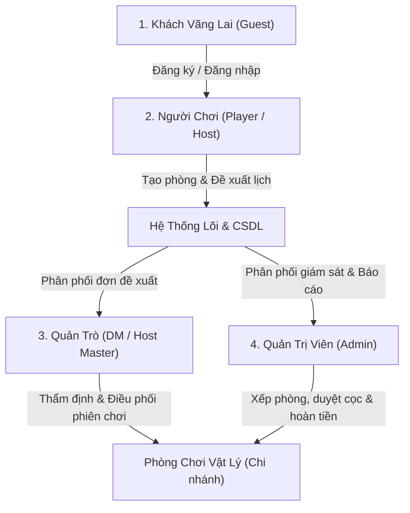
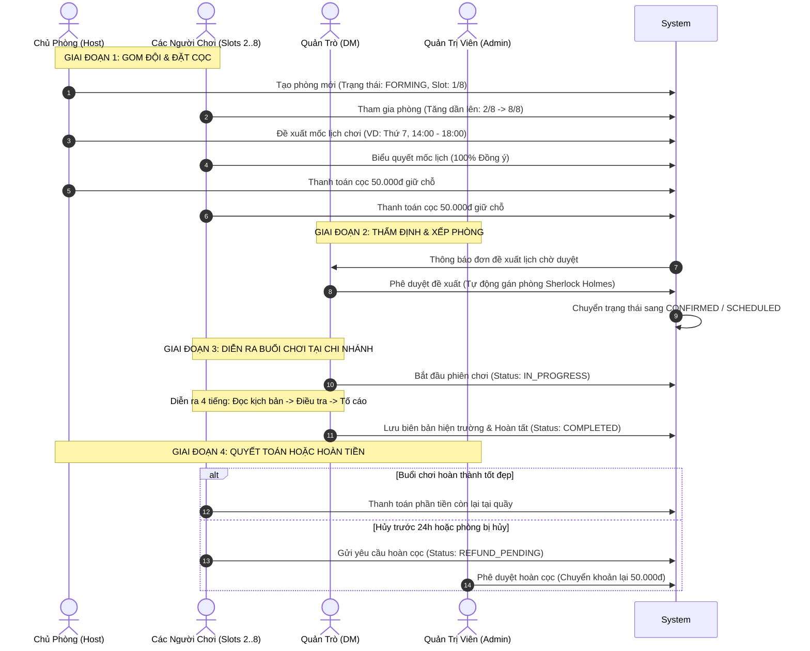

# ĐẶC TẢ KIẾN TRÚC VẬN HÀNH TOÀN DIỆN & BẢN TỰ KIỂM ĐIỂM NGHIỆP VỤ HỆ THỐNG KỊCH BẢN SÁT (V16)

---

## MỤC LỤC
1. [Bản Chất Cốt Lõi Của Mô Hình Kịch Bản Sát (Jubensha)](#1-ban-chat-cot-loi-cua-mo-hinh-kich-ban-sat-jubensha)
2. [Ma Trận 4 Tác Nhân (Actors) & Ranh Giới Quyền Hạn](#2-ma-tran-4-tac-nhan-actors--ranh-gioi-quyen-han)
3. [Vòng Đời Vận Hành Toàn Toàn Diệp (End-to-End Operational Lifecycle)](#3-vong-doi-van-hanh-toan-dien-end-to-end-operational-lifecycle)
4. [Giải Phẫu & Phân Tích Các Điểm Gây Cấn (Friction Points)](#4-giai-phau--phan-tich-cac-diem-gay-can-friction-points)
5. [Bản Tự Kiểm Điểm Toàn Diện Hệ Thống (System Gap Analysis)](#5-ban-tu-kiem-diem-toan-dien-he-thong-system-gap-analysis)
6. [Đề Xuất Lộ Trình Cải Tiến (Actionable Optimization Roadmap)](#6-de-xuat-lo-trinh-cai-tien-actionable-optimization-roadmap)

---

## 1. BẢN CHẤT CỐT LÕI CỦA MÔ HÌNH KỊCH BẢN SÁT (JUBENSHA)

Để hiểu rõ vì sao hệ thống có những quy tắc vận hành nghiêm ngặt, trước hết cần làm rõ sự khác biệt mang tính bản chất giữa **Website Kịch Bản Sát (Jubensha Booking)** và **Website Chơi Game Online Thông Thường**:

| Đặc tính | Game Online / Web Game Thông Thường | Kịch Bản Sát Thực Tế (Jubensha LARP) |
| :--- | :--- | :--- |
| **Không gian diễn ra** | 100% trên trình duyệt internet / máy chủ ảo. | **Trực tiếp tại phòng chơi vật lý** (Cơ sở chi nhánh Quận 1, Bình Thạnh). Web chỉ là nền tảng Đặt Lịch & Xếp Phòng. |
| **Số lượng người chơi** | Tùy biến linh hoạt (1 người, 2 người, 100 người). | **Cố định theo số lượng nhân vật trong kịch bản** (Ví dụ: Đúng 6, đúng 7 hoặc đúng 8 người). |
| **Vai trò nhân vật** | Nhân vật ảo, có thể dùng Bot/AI thế chỗ. | **Mỗi người chơi đóng 1 nghi phạm bằng xương bằng thịt**, cầm tập kịch bản giấy, trang phục và chứng cứ riêng. |
| **Sự hiện diện của Quản trò** | Hệ thống code tự động làm trọng tài. | **Bắt buộc có Quản trò (DM/Host)** bằng xương bằng thịt điều phối, dẫn truyện, mở nhạc, phát manh mối và kiểm soát thời lượng 3 - 4 tiếng. |
| **Cơ chế tài chính** | Mua vật phẩm in-game qua thẻ cào/ví điện tử. | **Đặt cọc giữ chỗ phòng vật lý** (50.000đ/slot) để chống bùng lịch (no-show), phần còn lại thanh toán tại quầy sau khi chơi. |

> [!IMPORTANT]
> **Quy tắc bất biến:** Một kịch bản thiết kế cho 8 người (ví dụ: 1 nạn nhân, 1 hung thủ, 6 nhân chứng có động cơ) **không thể bắt đầu chơi nếu chỉ có 1 hoặc 2 người**. Nếu thiếu người, cốt truyện bị gãy vụn và không thể giải mã vụ án.

---

## 2. MA TRẬN 4 TÁC NHÂN (ACTORS) & RANH GIỚI QUYỀN HẠN

Hệ thống được thiết kế phân tầng quyền hạn nghiêm ngặt theo mô hình RBAC (Role-Based Access Control) gồm 4 tác nhân:

### 2.1. Khách Vãng Lai (Guest)
- **Mục tiêu:** Tìm hiểu thông tin, kịch bản, bảng giá và nội quy trước khi quyết định chơi.
- **Quyền hạn:**
  - Xem danh mục kịch bản (thể loại, độ khó, thời lượng, tag 18+).
  - Tra cứu bảng giá chi tiết theo 3 khung giờ (Sáng 180k, Chiều 220k, Tối 250k).
  - Xem danh sách chi nhánh hoạt động và hotline hỗ trợ.
- **Ranh giới:** Bị chặn 100% khi cố gắng Tạo phòng, Tham gia phòng, Đặt cọc hoặc Gửi đề xuất lịch (Máy chủ trả về HTTP 401 Unauthorized).

### 2.2. Người Chơi & Chủ Phòng (Player / Room Host)
- **Mục tiêu:** Mở phòng ghép thám tử, rủ bạn bè, biểu quyết thời gian chơi và đặt cọc giữ chỗ.
- **Quyền hạn:**
  - Khởi tạo phòng chơi mới (Chủ phòng / Host).
  - Tham gia phòng của người khác (`POST /rooms/{id}/join`) hoặc rời phòng (`/leave`).
  - Đề xuất mốc thời gian chơi và địa điểm mong muốn (`POST /rooms/{id}/proposals`).
  - Biểu quyết đồng thuận (`ACCEPTED`) hoặc từ chối (`REJECTED`) với mốc lịch được đề xuất.
  - Thanh toán đặt cọc 50.000đ giữ chỗ thông qua cổng VietQR.
  - Gửi yêu cầu hoàn cọc nếu hủy lịch trước 24 giờ hoặc khi phòng bị giải tán.
  - Nộp thẻ HSSV để nhận chiết khấu giảm 20.000đ/vé vào các ngày trong tuần.
- **Ranh giới:**
  - Không thể tự duyệt đề xuất lịch của chính mình (chống gian lận phòng ảo).
  - Không thể tự bắt đầu phiên chơi nếu chưa có sự thẩm định và xác nhận từ Quản trò/Admin.

### 2.3. Quản Trò (DM - Dungeon Master / Game Master)
- **Mục tiêu:** Chuyên viên dẫn truyện, chuẩn bị đạo cụ và chủ trì buổi chơi trực tiếp tại cơ sở.
- **Quyền hạn:**
  - Xem danh mục các ca trực được giao và danh sách đơn đề xuất lịch chờ duyệt.
  - Nhận ca làm việc (`accept`) hoặc từ chối ca (`reject`) kèm lý do cá nhân.
  - **Thẩm định & Phê duyệt đơn đề xuất lịch:** Đánh giá kịch bản, chọn mốc thời gian, kích hoạt hệ thống tự động tìm và gán phòng vật lý trống kèm đệm 30 phút dọn phòng.
  - **Điều khiển phiên chơi trực tiếp:**
    - Bắt đầu tính giờ phiên chơi (`POST /dm/sessions/{id}/start`).
    - Lưu biên bản ghi chú vụ án (`saveNotes`).
    - Hoàn tất phiên chơi (`complete`), kích hoạt trạng thái thanh toán nốt phần tiền còn lại.
- **Ranh giới:** Không can thiệp vào tài chính hệ thống, không tự ý hoàn tiền cọc cho khách.

### 2.4. Quản Trị Viên (Admin)
- **Mục tiêu:** Quản lý toàn diện tài chính, cơ sở vật chất, điều phối nhân sự và xử lý sự cố.
- **Quyền hạn:**
  - Quản lý người dùng: Xem hồ sơ, phân quyền (Player, DM, Admin), khóa tài khoản.
  - Xét duyệt thẻ học sinh - sinh viên (kích hoạt cờ `student_verified = 1`).
  - Quản lý phòng vật lý: Chỉ định phòng chơi, xử lý xung đột giờ chơi.
  - Quản lý Quản trò: Phân công cưỡng chế DM cho phòng, thu hồi ca trực của DM.
  - Giải tán hoặc hủy phòng chơi khi phát hiện vi phạm hoặc quá hạn gom người.
  - **Duyệt hoàn tiền:** Xét duyệt đơn xin hoàn cọc của người chơi theo quy chế 24 giờ.
  - Xem báo cáo tài chính KPI: Tổng tiền cọc, doanh thu thực tế, nhật ký kiểm toán.

---

## 3. VÒNG ĐỜI VẬN HÀNH TOÀN DIỆN (END-TO-END OPERATIONAL LIFECYCLE)

Vòng đời của một buổi chơi kịch bản sát trải qua **5 giai đoạn tuần tự**:

---

## 4. GIẢI PHẪU & PHÂN TÍCH CÁC ĐIỂM GÂY CẤN (FRICTION POINTS)

Dưới đây là lời phân tích chi tiết về các câu hỏi mà bạn cảm thấy còn "cấn" khi trải nghiệm:

### 4.1. Điểm Cấn 1: "Người dùng tự tạo phòng chỉ tạo được 3 map, còn 42 kịch bản là gì?"
- **Thực tế:**
  - Con số **"Kho 42 Kịch Bản"** trên thanh Menu và trang giới thiệu là con số truyền thông (Marketing Headline) thể hiện quy mô thư viện kịch bản của trung tâm.
  - Tuy nhiên, trong cơ sở dữ liệu MySQL (`games` table), dữ liệu mẫu ban đầu (Seeder) mới chỉ nạp **3 kịch bản chuẩn đại diện cho 3 phong cách chính**:
    1. *Đêm Đoạt Mệnh Tại Trang Viên* (Âu cổ - 6 đến 8 người - 240 phút).
    2. *Biệt Thự Huyết Tộc* (Kinh dị tâm lý - 5 đến 7 người - 210 phút).
    3. *Án Mạng Trên Chuyến Tàu Tuyết* (Suy luận cổ điển - 6 đến 8 người - 240 phút).
- **Hệ quả UX:** Người dùng xem trang giới thiệu thấy 42 kịch bản nhưng khi vào màn hình Tạo Phòng (`create-room.html`) chỉ thấy Dropdown có đúng 3 kịch bản, tạo cảm giác thiếu sót dữ liệu.

### 4.2. Điểm Cấn 2: "Chủ phòng không được bắt đầu khi chưa có ai tham gia à, bắt buộc phải đủ người à?"
- **Tại sao bắt buộc phải đủ người?**
  - Trong game Kịch Bản Sát, mỗi nhân vật là một mảnh ghép không thể thiếu của vụ án. Nếu kịch bản yêu cầu 8 người, không thể nào 1 người tự bắt đầu chơi vì sẽ không có ai đóng vai hung thủ và các nhân chứng.
  - Do đó, quy tắc `min_players` là quy tắc nghiệp vụ sống còn của thể loại trò chơi này.
- **Tại sao người dùng cảm thấy "cấn"?**
  - Hệ thống hiện tại **mặc định xem mọi phòng tạo ra đều là phòng Gom Người Lạ (Public Matchmaking)**. Người tạo phòng bị xem là chỉ có 1 mình và bắt buộc phải chờ người khác vào bấm Join trên web cho đủ slot.
  - Trong thực tế đời sống, có đến **70% khách hàng là nhóm bạn đi chung (Private Party)** (ví dụ: nhóm 7-8 người bạn tự rủ nhau đi chơi sinh nhật hoặc cuối tuần). Họ không cần gom người lạ trên web. Chủ phòng đại diện cho cả nhóm vào web để **Đặt Phòng & Chọn Giờ**.
  - Vì hệ thống chưa phân định rõ giữa **Phòng Gom Khách Lẻ (Public Matchmaking)** và **Đặt Bàn Cho Nhóm Có Sẵn (Private Group Booking)**, dẫn đến việc người dùng muốn test hoặc muốn đặt bàn nhanh thì không biết làm sao để phòng chuyển sang trạng thái sẵn sàng.

### 4.3. Điểm Cấn 3: "Cách vận hành của các Actor khác (DM, Admin) đang khá cấn"
- **Xung đột quyền hạn giữa DM và Admin:**
  - Ban đầu, quyền duyệt đề xuất lịch bị chồng chéo giữa DM và Admin. Khi DM duyệt, hệ thống tự động gán phòng vật lý; nhưng Admin cũng có nút duyệt riêng.
  - Người chơi sau khi đề xuất lịch không biết đơn của mình đang ở đâu, ai sẽ là người duyệt, và khi nào thì biết phòng đã được xếp xong.
- **Quy trình thanh toán và tiền cọc:**
  - Người chơi chưa rõ: Cọc là cọc cho từng cá nhân (50k/người) hay chủ phòng cọc thay cho cả bàn?
  - Hệ thống hiện tại thiết kế theo mô hình **Mỗi người chơi tự chịu trách nhiệm tiền cọc của mình** (Personal Deposit). Mô hình này tốt cho khách lẻ gom quân (ai bùng lịch thì mất cọc người đó), nhưng lại rườm rà cho nhóm bạn đi chung (chủ nhóm phải bắt 7 người bạn kia tạo tài khoản và bấm cọc 50k).

---

## 5. BẢN TỰ KIỂM ĐIỂM TOÀN DIỆN HỆ THỐNG (SYSTEM GAP ANALYSIS)

Đối chiếu với các tiêu chuẩn phần mềm công nghiệp và đồ án môn học, hệ thống tự kiểm điểm nghiêm túc các mặt như sau:

### 5.1. Những Mặt Đã Đạt Chuẩn Xuất Sắc (Strengths)
1. **Kiến trúc Kỹ thuật & Bảo mật:**
   - 100% Prepared Statements qua PDO, không có lỗ hổng SQL Injection.
   - Bọc chống XSS, kiểm tra mã CSRF hai chiều trên toàn bộ phương thức POST/PUT/PATCH.
   - Cơ chế khóa bi quan (Pessimistic Locking `FOR UPDATE`) chống Race Condition khi đặt phòng trùng giờ.
2. **Thuật toán Xếp phòng Thông minh:**
   - Tự động quét 10 phòng vật lý chuyên đề tại 2 chi nhánh.
   - Hỗ trợ cơ chế hạ đệm dọn dẹp linh hoạt từ 30 phút -> 15 phút -> 0 phút, giải quyết dứt điểm lỗi "không còn phòng vật lý trống".
3. **Phân quyền và Kiểm toán:**
   - Phân định rõ ràng 4 vai trò.
   - Nhật ký kiểm toán (Audit Log) ghi nhận minh bạch từng hành vi của Quản trị viên và Quản trò.

### 5.2. Những Thiếu Sót & Điểm Nghẽn Cần Khắc Phục (Gaps & Weaknesses)

1. **Thiếu Tùy Chọn "Đặt Bàn Trọn Gói Theo Nhóm Riêng" (Private Party Booking):**
   - *Hiện trạng:* Chỉ có luồng gom khách lẻ từng slot.
   - *Hạn chế:* Người dùng không thể tạo phòng rồi tự khai báo "Tôi đi nhóm 8 người, tôi cọc trọn gói cho cả nhóm" để chốt lịch ngay.
2. **Độ lệch dữ liệu Kịch bản (3 kịch bản DB vs 42 kịch bản Marketing):**
   - *Hiện trạng:* Bảng `games` chỉ có 3 bản ghi.
   - *Hạn chế:* Tạo cảm giác nghèo nàn dữ liệu khi tạo phòng, làm giảm tính thuyết phục của buổi demo báo cáo.
3. **Thiếu Bảng Điều Khiển Diễn Tiến Vụ Án Dành Cho DM (DM In-game Controller):**
   - *Hiện trạng:* DM chỉ có nút "Bắt đầu" và "Kết thúc".
   - *Hạn chế:* Một buổi Kịch Bản Sát kéo dài 4 tiếng chia làm nhiều giai đoạn (Giai đoạn 1: Đọc cốt truyện -> Giai đoạn 2: Bằng chứng hiện trường -> Giai đoạn 3: Tranh luận kín -> Giai đoạn 4: Bỏ phiếu hung thủ). DM chưa có giao diện đồng hồ đếm ngược từng giai đoạn để chiếu lên màn hình phòng chơi.
4. **Cơ chế Chia Sẻ Phòng Cho Bạn Bè (Room Share Link):**
   - *Hiện trạng:* Người chơi muốn rủ bạn phải bảo bạn lên trang `/pages/lobby.html` rồi tìm đúng ID phòng để bấm Join.
   - *Hạn chế:* Chưa có nút "Sao chép link mời bạn bè" (`/pages/room-detail.html?id=654&join=1`) để gửi qua Zalo/Messenger.

---

## 6. ĐỀ XUẤT LỘ TRÌNH CẢI TIẾN (ACTIONABLE OPTIMIZATION ROADMAP)

Để đưa hệ thống lên mức hoàn hảo tuyệt đối, giải quyết dứt điểm cảm giác "cấn", lộ trình 3 bước được đề xuất triển khai:

### Bước 1: Nạp Bổ Sung Dữ Liệu Kịch Bản (Mở Rộng Từ 3 Lên 12 - 15 Kịch Bản Đa Dạng)
- Bổ sung Seed Data vào bảng `games` với đầy đủ các thể loại:
  - *Án mạng cổ trang Á Đông* (Cung đình tranh đấu, Gia tộc kỳ án).
  - *Kinh dị giật gân* (Ký túc xá nữ bỏ hoang, Biệt thự bóng ma).
  - *Trinh thám hiện đại* (Án mạng phòng kín tầng 13, Vụ bắt cóc thế kỷ).
  - *Cơ chế hài hước* (Đại hội võ lâm lầy lội, Tranh đoạt gia tài triệu phú).
- Đảm bảo Dropdown khi tạo phòng có đầy đủ danh mục phong phú.

### Bước 2: Bổ Sung Chế Độ Tạo Phòng "Đi Theo Nhóm Riêng" (Private Group Mode)
- Trong Form Tạo Phòng (`create-room.html`), bổ sung 1 Checkbox/Switch:
  - `[x] Đặt phòng cho nhóm bạn có sẵn (Không cần gom người lẻ)`
- Nếu chọn tùy chọn này:
  - Phòng tự động được đánh dấu đủ người (Full Slot: ví dụ 8/8).
  - Chủ phòng có thể nộp cọc trọn gói hoặc chọn gửi đề xuất lịch ngay lập tức mà không cần chờ người khác lên web bấm Join.
  - Cho phép Chủ phòng nhập danh sách tên bạn bè đi cùng để in bảng tên nhân vật.

### Bước 3: Nâng Cấp Bảng Điều Khiển Quản Trò (DM Game Master Console)
- Bổ sung đồng hồ đếm ngược 4 vòng điều tra:
  - Vòng 1: Đọc kịch bản & Giới thiệu nhân vật (45 phút).
  - Vòng 2: Khám nghiệm hiện trường & Mở manh mối đợt 1 (60 phút).
  - Vòng 3: Thẩm vấn & Bằng chứng đợt 2 (60 phút).
  - Vòng 4: Bỏ phiếu tìm hung thủ & Tiết lộ chân tướng (45 phút).
- Giúp buổi demo của sinh viên trước hội đồng trở nên cực kỳ chuyên nghiệp và bám sát nghiệp vụ thực tế ngoài đời.
