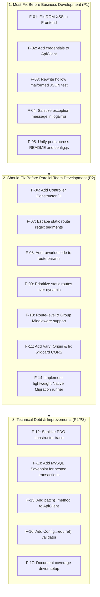

# FOUNDATION SOURCE CODE AUDIT REPORT
## Kịch Bản Sát V16 — Principal Architect Code Review & Verification

---

- **Audit Date:** 2026-11-16
- **Auditor Role:** Senior Principal Software Architect, Application Security Engineer & QA Lead
- **Target System:** Kịch Bản Sát V16 (Web-based Tabletop RPG Booking Platform)
- **Repository Root:** `D:\LapTrinhWeb\Project\Booking_kich-ban-sat_PHP`
- **Current Git Branch:** `develop`
- **Commit Baseline:** `300de3f` (*test: verify project foundation integration*)
- **Audit Decision:** **PASS WITH CONDITIONS**

---

## 1. Executive Summary

### 1.1. Overall Audit Status
An independent, deep-dive architectural, security, and quality audit was conducted on the Kịch Bản Sát V16 Foundation. The repository demonstrates a disciplined initial scaffolding adhering to pure Native PHP (8.4.27) MVC and Vanilla JavaScript (ES Modules), with zero unauthorized external frameworks (no Laravel, Symfony, React, Vue, or Docker).

However, while basic end-to-end connectivity and happy paths are operational, the codebase contains critical architectural limitations, security exposures, documentation discrepancies, and a hollow unit test that must be remediated prior to parallel business feature implementation by the 6-member engineering team.

### 1.2. Architecture Quality Assessment
- **Strengths:** Clean directory hierarchy, strict typing (`declare(strict_types=1)`), lightweight PSR-4 autoloading, PSR-7-like immutable-style abstractions for Request/Response, onion-style middleware pipeline.
- **Deficiencies:**
  1. **Lack of Dependency Injection:** `Application::invokeHandler()` instantiates controllers using parameterless `new $class()`, preventing constructor dependency injection (Services, Repositories).
  2. **Global-Only Middleware:** Middleware can only be attached globally to the Application; there is no support for route-level or portal-level middleware (`auth:player`, `auth:dm`, `auth:admin`).
  3. **Router Deficiencies:** Regex route compilation lacks escaping for static path segments, route parameter values are not URL-decoded, and routes lack specificity prioritization (first-registered wins, allowing dynamic routes to shadow static endpoints).

### 1.3. Security Assessment
- **OWASP Risks Identified:**
  - **A03:2021 — Injection (DOM XSS):** Frontend `HealthPage` injects unescaped error messages, server details, and API responses directly into `innerHTML`.
  - **A09:2021 — Security Logging and Monitoring Failures:** `ExceptionHandler::logError()` logs raw `$e->getMessage()` without sanitization, leaking sensitive error messages to STDOUT/system log.
  - **A01:2021 — Broken Access Control / CORS Reflection:** `CorsMiddleware` dynamically reflects the incoming `Origin` header with `Access-Control-Allow-Credentials: true` if wildcard `*` is configured.
  - **CORS Cache Poisoning:** Responses lack the `Vary: Origin` header.
  - **PDO Stack Trace Credential Exposure:** Catching `PDOException` in `ConnectionFactory` preserves raw credentials in function call arguments within the exception chain unless arguments are suppressed.

### 1.4. Testing Assessment
- **Automated Tests:** 18 tests execute successfully with 53 assertions across 4 test suites.
- **Hollow Test Finding:** `RequestResponseTest::testCaptureDetectsMalformedJson()` is completely hollow—it does not call `Request::capture()`, but instead decodes invalid JSON and manually throws `BadRequestException` inside the test body.
- **Coverage Status:** **BLOCKED** from measurement. No code coverage driver (`Xdebug` or `PCOV`) is installed in the local PHP 8.4 runtime. Assertion count must not be conflated with line/branch coverage.

### 1.5. Team Readiness Assessment
- **Port Discrepancy Blocker:** `README.md` and `.env.example` instruct developers to run the backend on port `8000`, while `frontend/src/utils/config.js` is hardcoded to port `8080`. Following the official README causes immediate frontend network failure.
- **Missing Migration Strategy:** Database migrations and seeders are unconfigured (`.gitkeep` only), leaving the 6-person team without a standardized schema evolution mechanism.
- **Session Auth Missing in Frontend Client:** `api-client.js` omits `credentials: 'include'`, which will silently drop session cookies across cross-origin requests.

### 1.6. Recommendation Summary
The Foundation is structurally viable and respects the core constraints of V16. Proceeding to Phase 1 (Business Feature Development) is recommended **only after resolving the 2 High (P1) architectural and security blockers** and aligning configuration ports.

---

## 2. Audit Scope & Methodology

### 2.1. Repository Baseline
- **Path:** `D:\LapTrinhWeb\Project\Booking_kich-ban-sat_PHP`
- **Active Branch:** `develop`
- **Baseline Commit:** `300de3f` (*test: verify project foundation integration*)
- **Total Tracked Files Inspected:** 42 files (23 PHP, 5 JS, 3 CSS, 1 HTML, 1 JSON, 1 XML, 8 Markdown/Docs).
- **Working Tree State:** Clean (no uncommitted modifications).

### 2.2. Commands Executed & Verified Evidence

| Category | Command Executed | Result | Status |
|---|---|---|---|
| Runtime Audit | `php -v; composer -V; node -v` | PHP 8.4.27, Composer 2.11-dev, Node 24.22.1 | VERIFIED |
| Static Linting | `php -l` on all 23 backend PHP files | 23 files checked, 0 syntax errors | VERIFIED |
| Composer Integrity | `composer validate` | `./composer.json is valid` | VERIFIED |
| JS Linting | `node --check` on 5 frontend JS files | 5 files checked, 0 syntax errors | VERIFIED |
| Automated Tests | `phpunit` | 18 tests, 53 assertions, 0 failures | VERIFIED |
| Code Coverage | `phpunit --coverage-text` | Test runner warning: No code coverage driver | BLOCKED |
| Git History Audit | `git log -p`, `git status`, `git branch -a` | 6 atomic commits, clean working tree, no remote | VERIFIED |
| DB Verification | `php backend/database/verify-connection.php` | Fails without `.env` (masks password in error output) | VERIFIED |

### 2.3. Audit Limitations
1. Code coverage could not be captured numerically due to missing PCOV/Xdebug extension in Windows PHP 8.4.27 CLI.
2. Live database connection requires local developer `.env` file containing valid MySQL credentials (absent from fresh clone by design).

---

## 3. Architecture Audit

### 3.1. Backend Core Architecture

The backend implements a lightweight MVC structure located under `backend/app/Core/`:

```text
Request (HTTP Superglobals)
   │
   ▼
Application (Pipeline Runner)
   │
   ├─► CorsMiddleware (Preflight & Origin Check)
   │
   └─► Router (Regex Matching)
          │
          ▼
       Handler / Controller
          │
          ▼
       Response (JSON & Security Headers)
```

#### Router (`App\Core\Router`)
- **Method Matching:** Strict comparison against normalized uppercase method string. Correct.
- **URI Normalization:** Trims trailing slashes via `Request::normalizePath()`. Root path `/` preserved.
- **Defect 1 — Static Segment Escaping:** In `compileRoute()`, regex compiling only replaces `{param}` patterns. Static characters such as `.`, `+`, `-`, `(` are not escaped via `preg_quote()`. A route defined as `/api/v1.0/health` would compile to `#^/api/v1.0/health$#u`, where `.` acts as a wildcard matching any character (e.g., `/api/v1X0/health`).
- **Defect 2 — Lack of URL Decoding:** Captured route parameters (`$matches[$paramName]`) are stored raw. For example, a request to `/api/rooms/ph%C3%B2ng-1` yields `$request->param('id') === 'ph%C3%B2ng-1'` instead of the decoded UTF-8 string `phòng-1`.
- **Defect 3 — Route Collision & Precedence:** Routes are evaluated sequentially. A parameterized route registered before a static route will intercept the static route:
  - Example: `GET /api/rooms/{id}` registered before `GET /api/rooms/search` will match `GET /api/rooms/search` with `id = 'search'`.
  - There is no static-over-dynamic route sorting or weight resolution.
- **Defect 4 — Extensibility:** Route groups (prefixes, shared middlewares) are not supported. As the platform expands across 3 portals (Player, DM, Admin), `routes/api.php` will become a monolithic file.

#### Request & Response (`App\Core\Request`, `App\Core\Response`)
- **JSON Parsing:** Robust decoding of `php://input` when Content-Type contains `application/json`. Throws `BadRequestException` on invalid JSON syntax.
- **Request Superglobals:** Properly maps `$_SERVER`, `getallheaders()`, and input stream.
- **Content-Type Header Access Inconsistency:** In `Request::capture()` line 79:
  ```php
  $contentType = $server['CONTENT_TYPE'] ?? $headers['Content-Type'] ?? $headers['content-type'] ?? '';
  ```
  `$headers` is not yet normalized to lowercase at this line (normalization occurs in `__construct`), creating casing sensitivity depending on SAPI.
- **PUT/PATCH Body Params:** For non-JSON requests, `$bodyParams` only falls back to `$_POST`. PHP natively does not populate `$_POST` on `PUT` or `PATCH` requests; form-encoded data on PUT/PATCH is lost.
- **Response Headers:** Secure defaults applied (`X-Content-Type-Options: nosniff`, `X-Frame-Options: DENY`, `X-XSS-Protection: 1; mode=block`, `Referrer-Policy: strict-origin-when-cross-origin`).
- **Missing CSP:** `Content-Security-Policy` is absent from response defaults.

#### Application & Middleware (`App\Core\Application`)
- **Pipeline Implementation:** Utilizes standard `array_reduce` with reversed stack, correctly executing middleware pre-handlers in registration order and post-handlers in reverse order.
- **Controller Invocation Limitation:** In `Application::invokeHandler()`:
  ```php
  $class = $handler[0];
  $method = $handler[1];
  $instance = new $class();
  $result = $instance->$method($request, ...array_values($params));
  ```
  Calling `new $class()` without arguments forces controllers to have zero-argument constructors. This prevents constructor Dependency Injection. If controllers cannot receive Services or Repositories via DI, developers will be forced to instantiate dependencies directly inside actions or rely on static singletons, violating SOLID principles.
- **Scope Limitation:** Middleware can only be registered globally on `Application`. There is no mechanism to attach middleware to specific routes or route groups (e.g. portal authentication guards).

#### Exception Handling (`App\Core\Exceptions\ExceptionHandler`)
- Centralized exception interception converts all throwables into standard JSON responses:
  `{"success": false, "error": {"code": "...", "message": "..."}}`.
- Production Masking: When `APP_DEBUG=false`, internal exceptions return generic `Internal Server Error` (status 500) and conceal stack traces and filenames.
- Debug Leakage: When `APP_DEBUG=true`, raw exception messages and file paths are sent to the client.

---

## 4. Database & Infrastructure Audit

### 4.1. PDO Configuration (`App\Infrastructure\Database\ConnectionFactory`)
- **Strict Error Handling:** `PDO::ATTR_ERRMODE => PDO::ERRMODE_EXCEPTION` is explicitly configured.
- **Prepared Statements:** `PDO::ATTR_EMULATE_PREPARES => false` ensures queries use native MySQL server-side prepared statements, eliminating SQL injection for parameter-bound queries.
- **Persistent Connections:** `PDO::ATTR_PERSISTENT => false` prevents state bleeding across requests.
- **Encoding:** Explicitly sets `utf8mb4` and runs `SET NAMES 'utf8mb4' COLLATE 'utf8mb4_unicode_ci'` upon connection.

### 4.2. Credential Security in Exceptions
- In `ConnectionFactory.php:45-54`:
  ```php
  } catch (PDOException $e) {
      $safeHost = htmlspecialchars($host, ENT_QUOTES, 'UTF-8');
      $safeDb = htmlspecialchars($database, ENT_QUOTES, 'UTF-8');
      throw new DatabaseException(
          sprintf('Failed to connect to database [%s] on host [%s:%d]: %s', $safeDb, $safeHost, $port, $e->getMessage()),
          (int) $e->getCode(),
          $e
      );
  }
  ```
- **Finding:** While the author avoided concatenating `$password` directly into the string, `$e` is passed as the `$previous` exception. In PHP, `PDO::__construct($dsn, $user, $password, ...)` contains the plain-text password in its stack trace arguments. If `DatabaseException` is caught and its trace string or chain is printed (or logged without argument scrubbing), the password is fully exposed.
- **Misplaced Escaping:** Calling `htmlspecialchars()` on `$safeHost` and `$safeDb` inside an infrastructure database exception is an abstraction leak—HTML escaping belongs to presentation, not database exceptions.

### 4.3. Transaction Management (`App\Infrastructure\Database\DatabaseConnection`)
- `DatabaseConnection::transaction(callable $callback, ?PDO $pdo = null)` executes callbacks in a transaction boundary.
- **Nested Transaction Handling:** Detects `$connection->inTransaction()` and skips `beginTransaction()`. This avoids MySQL error 1305 / implicit commit when nesting transactions.
- **Deficiency:** MySQL does not support true nested transactions. If an inner service throws an exception and catches it internally, the outer transaction remains active, which can result in partial commits. Implementing MySQL `SAVEPOINT` support is recommended for nested transactional workflows (Booking deposit + Room lock + Player state update).
- **Isolation Level:** No isolation level is specified (defaults to MySQL `REPEATABLE READ`). For high-concurrency booking actions with seat reservations, `SELECT ... FOR UPDATE` patterns must be established in Repositories.

### 4.4. Configuration Management (`App\Infrastructure\Config\Config`)
- Parses `.env` lines with type casting (`true`, `false`, `null`, `empty`).
- Supports runtime overrides (`Config::set()`, `Config::reset()`), enabling reliable unit testing.
- **Deficiency:** Missing required key validation. If `.env` is absent or variables like `DB_PASSWORD` are missing, `Config::get()` silently returns default fallbacks instead of failing fast during bootstrap.

---

## 5. Frontend Foundation Audit

### 5.1. API Client (`frontend/src/api/api-client.js`)
- Encapsulates browser `fetch()` with uniform JSON parsing, error transformation, and status code checking.
- Uses `AbortController` to implement a 10-second request timeout (`defaultTimeoutMs: 10000`).
- **Defect 1 — Missing Session Credentials:** `fetch()` options do not include `credentials: 'include'`. Because frontend runs on `http://127.0.0.1:3000` and backend runs on `http://127.0.0.1:8080`, all browser requests are cross-origin. Without `credentials: 'include'`, the browser will never send or store session cookies (`kbs_session_id`), breaking session-based authentication completely.
- **Defect 2 — Inflexible AbortSignal:** The internal timeout controller unconditionally overrides any `signal` passed in `options`. Callers cannot pass their own AbortController (e.g. to abort on route change or search keystroke).
- **Defect 3 — Missing HTTP PATCH:** Only `get`, `post`, `put`, `delete` are implemented. V15/V16 state machines frequently use `PATCH` for partial state transitions (e.g. updating booking status to `CANCELLED`).

### 5.2. Frontend Security & DOM Manipulation
- **Vulnerability — DOM Cross-Site Scripting (XSS) in `health-page.js`:**
  In `frontend/src/pages/health/health-page.js:84-93`:
  ```javascript
  bodyContent = `
    <div style="margin-bottom: 1rem; color: var(--color-error);">
      <strong>Error [${error.code || 'UNKNOWN'}]:</strong> ${error.message}
    </div>
    ${error.details ? `<pre class="code-block">${JSON.stringify(error.details, null, 2)}</pre>` : ''}
    ...
  `;
  this.container.innerHTML = `... ${bodyContent} ...`;
  ```
  If an error message contains HTML/JS payloads (e.g. an invalid route payload reflected by backend `Route not found: GET /`), the payload is rendered directly into the DOM via `innerHTML` without HTML entity encoding.
  - **Severity:** P1 (High / OWASP A03).
  - **Mitigation:** Create and use a utility function `escapeHtml()` or use `textContent` / `DOM text nodes` for dynamic values.

### 5.3. CORS & Browser Communication
- `CorsMiddleware`:
  - Validates `Origin` against allowed origins (`http://127.0.0.1:3000,http://localhost:3000`).
  - Preflight `OPTIONS` requests return `204 No Content` with appropriate `Access-Control-Allow-Methods` and `Access-Control-Allow-Headers`.
  - **Vulnerability:** If `ALLOWED_ORIGINS=*` is configured, `CorsMiddleware` reflects the request's `Origin` header dynamically while setting `Access-Control-Allow-Credentials: true`. This violates CORS least privilege.
  - **Missing Header:** Responses lack `Vary: Origin`, which can lead to cache poisoning in intermediate HTTP caches.

---

## 6. Testing & Quality Assurance Audit

### 6.1. Test Execution & Scorecard
The automated test suite was executed via PHPUnit 11.5.58:
- **Test Count:** 18 tests.
- **Assertions:** 53 assertions.
- **Failures / Errors:** 0.
- **Execution Time:** ~2.1 seconds.

### 6.2. Test Quality Analysis

#### Fake / Hollow Test in `RequestResponseTest`
In `backend/tests/Unit/RequestResponseTest.php:46-62`:
```php
public function testCaptureDetectsMalformedJson(): void
{
    $_SERVER['REQUEST_METHOD'] = 'POST';
    $_SERVER['REQUEST_URI'] = '/api/test';
    $_SERVER['CONTENT_TYPE'] = 'application/json';

    $this->expectException(BadRequestException::class);

    // Simulate malformed json decoding in Request
    $invalidJson = '{"key": "value" broken}';
    json_decode($invalidJson);
    if (json_last_error() !== JSON_ERROR_NONE) {
        throw new BadRequestException('Malformed JSON in request payload: ' . json_last_error_msg());
    }
}
```
- **Finding:** This test does not invoke `Request::capture()` at all. It simulates the logic of `Request::capture()` inside the test method itself, manually throws `BadRequestException`, and asserts that the exception was thrown. It provides zero coverage of `Request::capture()`.
- **Severity:** P1 (Test Integrity / False Confidence).

#### Test Output Noise / Log Pollution
During test execution, `testUncaughtExceptionInProductionHidesDetails()` in `ApplicationTest` triggers `ExceptionHandler::logError()`, which calls PHP `error_log()`. This outputs raw exception messages and stack traces directly into the test terminal output:
```text
[2026-11-16 10:55:38] Database password secret revealed in .../ApplicationTest.php:90
```
This confirms that `ExceptionHandler` lacks an injectable logger or silent test logger.

### 6.3. Code Coverage Measurement
- Status: **BLOCKED**.
- Neither `PCOV` nor `Xdebug` is available in the Windows PHP 8.4 installation.
- Running with `--coverage-text` yields: `No code coverage driver available`.
- While 18 tests pass, line and branch coverage remain unmeasured.

---

## 7. Security Audit

### 7.1. OWASP Top 10 Alignment

| OWASP Risk | Assessment in V16 Foundation | Severity |
|---|---|:---:|
| **A01: Broken Access Control** | CORS origin reflection vulnerability if `*` is configured; global middleware cannot enforce portal-specific access rules. | P2 |
| **A02: Cryptographic Failures** | No hardcoded crypto keys found; `openssl` enabled in runtime. | PASS |
| **A03: Injection** | PDO emulated prepares disabled (safe from SQLi). Unescaped DOM rendering in frontend (`HealthPage.js`) creates DOM XSS. | P1 |
| **A04: Insecure Design** | Controller instantiation bypasses DI, preventing secure service isolation. | P2 |
| **A05: Security Misconfiguration** | Inconsistent port mapping; missing `Vary: Origin` and `Content-Security-Policy` headers. | P2 |
| **A06: Vulnerable Components** | Zero external runtime packages in `composer.json` (only PHPUnit in dev). Minimum dependency surface. | PASS |
| **A07: Identification & Auth Failures** | Frontend `api-client.js` omits credentials, breaking session authentication. | P1 |
| **A08: Software & Data Integrity** | `composer.lock` committed and consistent with `composer.json`. | PASS |
| **A09: Security Logging Failures** | `logError()` does not sanitize `$e->getMessage()`, printing raw exception details to log/output. | P1 |
| **A10: SSRF** | No outgoing HTTP requests initiated by backend foundation. | N/A |

### 7.2. Secrets & Git Repository Hygiene
- No hardcoded passwords, tokens, or credentials were found in tracked files.
- `.gitignore` properly excludes `.env`, `vendor/`, `*.log`, `.phpunit.cache/`.
- `git log -S "password"` verified only template placeholder values (`DB_PASSWORD=your_database_password_here`) in `.env.example`.
- Git commit baseline consists of 6 atomic commits on branch `develop`, with clean working tree and no remote configured.

---

## 8. Documentation & Team Readiness Audit

### 8.1. The Port Mismatch Blocker
A severe configuration mismatch exists across the repository documentation:
- `README.md` (lines 121, 125):
  `php -S 127.0.0.1:8000 -t backend/public` -> `http://127.0.0.1:8000/api/health`
- `backend/.env.example` (line 5):
  `APP_URL=http://127.0.0.1:8000`
- `frontend/src/pages/health/health-page.js` (line 90):
  `Make sure the PHP backend server is running on 127.0.0.1:8000`
- **Contradiction:** `frontend/src/utils/config.js` (line 6):
  `apiBaseUrl: window.__APP_CONFIG__?.apiBaseUrl || 'http://127.0.0.1:8080/api'`

**Impact:** If a developer follows `README.md`, starts the backend on port `8000` and starts frontend on port `3000`, the frontend attempts to communicate with `http://127.0.0.1:8080` and fails with `NETWORK_FAILURE`.

### 8.2. Database Migration & Schema Readiness
- `docs/adr/ADR-0001-project-foundation.md` records Database Migration Tool as **OPEN DECISION**.
- `backend/database/migrations` and `seeders` are empty.
- There are no initial SQL DDL scripts to create the database schema or initial tables.
- A 6-member team cannot begin parallel development without a unified, deterministic database schema migration runner.

### 8.3. Windows Developer Onboarding Experience
- The PATH setup documentation relies on `$env:PATH` in PowerShell:
  `$env:PATH = "C:\Setup_Environment\php-8.4.27;C:\Setup_Environment\composer;C:\Program Files\MySQL\MySQL Server 8.0\bin;$env:PATH"`
- Developers using Windows machines with different installation paths (e.g., standard `C:\php`, XAMPP, or scoop) will experience setup failure unless documentation clarifies how to adapt paths or configure system environment variables permanently.

---

## 9. Findings Register

| ID | Severity | Category | Location | Finding Description | Technical Impact | Remediation Recommendation |
|:---:|:---:|:---|:---|:---|:---|:---|
| **F-01** | **P1** | Security / XSS | `frontend/src/pages/health/health-page.js:86-95` | Unescaped error messages and response data rendered directly into `innerHTML`. | DOM-based Cross-Site Scripting (XSS) if backend error message contains HTML/JS. | Implement an `escapeHtml()` helper or populate dynamic data using `textContent`. |
| **F-02** | **P1** | Architecture / Auth | `frontend/src/api/api-client.js:34` | Fetch API calls omit `credentials: 'include'`. | Cross-origin requests between port 3000 and 8080 do not send session cookies, breaking auth. | Add `credentials: 'include'` by default or as a configurable option in `api-client.js`. |
| **F-03** | **P1** | Testing / Integrity | `backend/tests/Unit/RequestResponseTest.php:46-62` | `testCaptureDetectsMalformedJson()` is hollow and tests its own throw instead of `Request::capture()`. | False sense of test coverage; `Request::capture()` malformed JSON handling is untested. | Refactor test to mock/simulate `php://input` stream or test request payload parsing directly. |
| **F-04** | **P1** | Security / Logging | `backend/app/Core/Exceptions/ExceptionHandler.php:63-72` | `logError()` logs raw `$e->getMessage()` without sanitization. | Sensitive data, passwords, or tokens in exception messages are written to log/stdout. | Sanitize `$e->getMessage()` using the same redaction pattern applied to stack traces. |
| **F-05** | **P1** | Documentation / Config | `README.md:121` vs `frontend/src/utils/config.js:6` | Port conflict: README specifies port `8000` while `config.js` connects to port `8080`. | Following onboarding guide leads to immediate frontend connection failure. | Standardize backend port across `README.md`, `.env.example`, `health-page.js`, and `config.js` (recommend `8080`). |
| **F-06** | **P2** | Architecture / DI | `backend/app/Core/Application.php:91` | Controllers are instantiated via parameterless `new $class()`. | Prevents constructor Dependency Injection; forces reliance on singletons or direct instantiation. | Implement a simple Factory or Service Container callback to instantiate controllers with DI. |
| **F-07** | **P2** | Architecture / Routing | `backend/app/Core/Router.php:26,123-134` | Route compilation regex does not escape static characters via `preg_quote()`. | Routes with dots or special characters compile to incorrect wildcard regexes. | Escape static segments in `compileRoute()` before substituting `{param}` placeholders. |
| **F-08** | **P2** | Architecture / Routing | `backend/app/Core/Router.php:93` | Route parameters extracted from URL are not URL-decoded (`rawurldecode`). | Multi-byte characters (e.g. Vietnamese slugs) are passed in raw percent-encoded format. | Apply `rawurldecode()` to matched parameter values before passing them to the request/handler. |
| **F-09** | **P2** | Architecture / Routing | `backend/app/Core/Router.php:84-105` | Linear route matching without specificity precedence (static vs dynamic). | Dynamic routes like `/api/rooms/{id}` shadow static routes like `/api/rooms/search` if registered first. | Sort routes by specificity (static routes evaluated before parameterized routes). |
| **F-10** | **P2** | Architecture / Middleware | `backend/app/Core/Application.php:29` | Middleware can only be registered globally on `Application`. | Cannot enforce portal-specific middleware (Player vs DM vs Admin auth). | Implement route-level and route-group middleware support in `Router` and `Application`. |
| **F-11** | **P2** | Security / CORS | `backend/app/Core/Middleware/CorsMiddleware.php:37,64` | `CorsMiddleware` reflects any origin with credentials if `*` is configured; lacks `Vary: Origin`. | CORS security violation when wildcard used; risk of cache poisoning in shared proxies. | Reject `*` when credentials are true; append `Vary: Origin` to responses. |
| **F-12** | **P2** | Security / PDO | `backend/app/Infrastructure/Database/ConnectionFactory.php:52` | `DatabaseException` chains previous `PDOException`, keeping password in trace arguments. | Raw DB password may be exposed if full exception trace is inspected or dumped. | Clear or sanitize trace, or avoid chaining raw `PDOException` with sensitive constructor args. |
| **F-13** | **P2** | Architecture / DB | `backend/app/Infrastructure/Database/DatabaseConnection.php:60-64` | Nested transactions do not use MySQL SAVEPOINTs. | Failure in inner transaction can leave outer transaction in an inconsistent state. | Implement Savepoint support (`SAVEPOINT`, `ROLLBACK TO SAVEPOINT`) for nested transactions. |
| **F-14** | **P2** | Database / Tooling | `backend/database/migrations` | Migration tool is an open decision with no runner or baseline schema files. | Multi-developer team has no mechanism to version or execute database schema changes. | Establish a lightweight native PHP migration runner and create baseline V16 tables. |
| **F-15** | **P3** | Frontend / API Client | `frontend/src/api/api-client.js:85-107` | `ApiClient` lacks `patch()` helper method. | Developers must invoke verbose `request()` for PATCH requests used in state transitions. | Add standard `patch(endpoint, body, options)` helper method to `ApiClient`. |
| **F-16** | **P3** | Architecture / Config | `backend/app/Infrastructure/Config/Config.php:60-80` | `Config::get()` silently falls back to defaults without validating mandatory variables. | Critical misconfigurations (missing DB password, invalid environment) are masked. | Add `Config::require(string $key)` or an environment validator during bootstrap. |
| **F-17** | **P3** | Testing / Tooling | `backend/phpunit.xml` | No code coverage driver configured or available in runtime. | Inability to track statement and branch coverage during feature development. | Document PCOV/Xdebug installation steps for team members wishing to measure coverage. |

---

## 10. Remediation Roadmap



### 10.1. Must Fix Before Business Development (Sprint 0 Blocker)
1. **Unify Configuration Ports (F-05):** Update `README.md`, `backend/.env.example`, and `frontend/src/pages/health/health-page.js` to default consistently to port `8080` (or `8000`), matching `config.js`.
2. **Enable Fetch Credentials in Frontend (F-02):** Set `credentials: 'include'` in `frontend/src/api/api-client.js`.
3. **Eliminate DOM XSS (F-01):** Introduce `escapeHtml()` utility in frontend and sanitize all interpolated variables before inserting into `innerHTML`.
4. **Sanitize Exception Logging (F-04):** Ensure `ExceptionHandler::logError()` redacts passwords and secrets from `$e->getMessage()`.
5. **Fix Hollow Test (F-03):** Replace `testCaptureDetectsMalformedJson()` with a legitimate test verifying `Request::capture()` error behavior.

### 10.2. Should Fix Before Team Parallel Development (Sprint 1 Enablers)
1. **Controller Dependency Injection (F-06):** Update `Application::invokeHandler()` to support resolving controller constructor dependencies via a callable resolver.
2. **Route-Level & Group Middleware (F-10):** Extend `Router` to support `$router->group(['prefix' => '/api/admin', 'middleware' => [AdminAuth::class]], ...)` to allow portal segregation.
3. **Router Robustness (F-07, F-08, F-09):** Escape static regex segments, apply `rawurldecode()` to route parameters, and prioritize static routes over dynamic routes.
4. **Database Migration Runner (F-14):** Build a zero-dependency PHP script (`backend/database/migrate.php`) to execute ordered `.sql` files with a `schema_migrations` tracking table.
5. **CORS Hardening (F-11):** Disallow wildcard origins with credentials, and add `Vary: Origin` header.

### 10.3. Technical Debt & Future Improvements
1. Add `SAVEPOINT` support to `DatabaseConnection::transaction()` (F-13).
2. Mask PDO constructor stack trace arguments (F-12).
3. Add `patch()` method to `ApiClient` (F-15).
4. Add `Config::require()` validation for environment variables (F-16).
5. Document PCOV setup for code coverage (F-17).

---

## 11. Foundation Acceptance Criteria Checklist

| Category | Requirement | Current Status | Verdict |
|---|---|:---:|:---:|
| **Runtime & Environment** | PHP >= 8.2 native without framework bloat | PHP 8.4.27 verified | **PASS** |
| | MySQL PDO with prepared statements enabled | MySQL 8.0.44 with emulation disabled | **PASS** |
| | Composer PSR-4 autoloading active | Valid `composer.json` & optimized autoloader | **PASS** |
| **Architecture Core** | Native MVC with Front Controller & Router | Working, but lacks DI and route-level middleware | **CONDITION** |
| | Request/Response abstraction with security headers | Present; minor Content-Type parsing inconsistency | **PASS** |
| | Centralized Exception Handling | Masking active; log sanitization needs fix | **CONDITION** |
| **Frontend Foundation** | Vanilla JS ES Modules & Fetch API | Implemented cleanly without build tools | **PASS** |
| | CORS & Cross-Origin Session support | Preflight works, but `credentials: 'include'` missing | **CONDITION** |
| | Frontend DOM Security | InnerHTML lacks escaping (DOM XSS risk) | **CONDITION** |
| **Testing & Quality** | Automated test suite passes with zero failures | 18 tests pass, but 1 test is hollow | **CONDITION** |
| | Zero PHP & JS syntax errors | 23 PHP & 5 JS files verified | **PASS** |
| **Repository & Git** | Clean Git discipline, atomic commits, zero secrets | 6 commits, clean tree, no secrets in history | **PASS** |
| **Documentation** | Accurate setup & onboarding documentation | Port conflict between README (8000) and config (8080) | **CONDITION** |

---

## 12. Final Architecture Decision

### Decision: **PASS WITH CONDITIONS**

### Technical Justification
The Foundation created for Kịch Bản Sát V16 successfully establishes the core architectural paradigm requested by the Project Lead: pure Native PHP MVC backend, Vanilla JavaScript ES Modules frontend, zero framework dependencies, true PDO prepared statements, and a clean local Git repository.

However, the Foundation cannot receive an unconditional **PASS** because:
1. Following the official `README.md` immediately results in a broken frontend due to port allocation divergence (`8000` vs `8080`).
2. The frontend API client fails to send authentication cookies (`credentials: 'include'`), which would break user authentication upon initial feature implementation.
3. DOM-based XSS exists in the frontend rendering logic.
4. One unit test in the test suite is hollow and provides false assurance.
5. The backend controller dispatcher lacks Dependency Injection, which would immediately cause architectural debt as soon as repositories and services are introduced in Phase 1.

### Conditions for Unfreezing Phase 1 (Business Feature Development):
- [ ] **Condition 1:** Align backend port to `8080` (or `8000`) across `README.md`, `.env.example`, `health-page.js`, and `config.js`.
- [ ] **Condition 2:** Add `credentials: 'include'` to `frontend/src/api/api-client.js`.
- [ ] **Condition 3:** Implement HTML escaping for dynamic content rendered in `health-page.js`.
- [ ] **Condition 4:** Replace the hollow malformed JSON unit test with a genuine test of `Request::capture()`.
- [ ] **Condition 5:** Sanitize `$e->getMessage()` in `ExceptionHandler::logError()`.
- [ ] **Condition 6:** Define and agree on the Database Migration approach before developers write tables.

Once Conditions 1 through 5 are satisfied in a dedicated remediation commit, the Foundation will be officially verified for team-wide business feature development.
