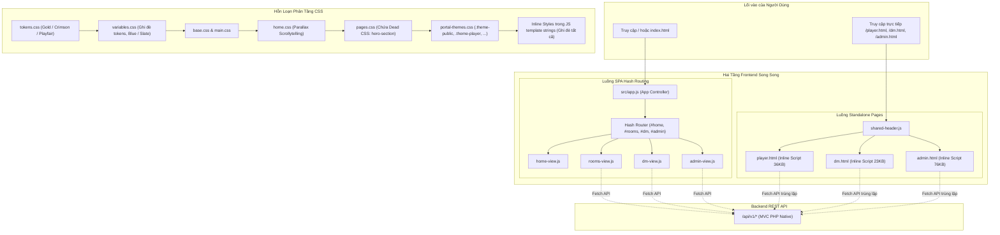

# UI/UX & Frontend Architecture Audit Report

**Dự án:** Kịch Bản Sát (Booking Kịch Bản Sát V16)  
**Thời gian kiểm toán:** 25/11/2026  
**Phương pháp kiểm toán:** Static Code Analysis kết hợp Real Browser Runtime Verification (CDP Headless Chrome)  
**Mục tiêu:** Nhận diện toàn diện các khiếm khuyết về UI/UX, Information Architecture, Design Consistency, Accessibility, Responsive và Frontend Architecture trước giai đoạn tái thiết kế (Redesign).

---

## 1. Executive Summary

### 1.1. Đánh giá tổng quan (Overall UI/UX Assessment)
Hệ thống **Kịch Bản Sát V16** đã hoàn thiện một nền tảng nghiệp vụ cốt lõi rất phong phú và phức tạp, bao gồm: sảnh ghép phòng tự động, biểu quyết lịch chơi, phân công Quản trò (DM), quản lý cọc 50.000đ/giữ chỗ 4 giờ, kiểm soát quy tắc hoàn cọc 24 giờ, quản lý thẻ HSSV, sổ cái thanh toán và ghi nhận biên bản sự cố.

Tuy nhiên, về mặt **giao diện và trải nghiệm người dùng (UI/UX)**, ứng dụng hiện đang bộc lộ những nhược điểm nghiêm trọng khiến trang web trông **nghiệp dư, thiếu nhất quán và khó sử dụng**:
1. **Tranh chấp đa hệ thống thiết kế (Visual Identity Conflict):** Giao diện đang bị giằng co giữa 3 phong cách thiết kế không đồng nhất: phong cách *Cinematic Mystery Gothic* (nền đen `#0B0909`, vàng gold `#D4AF37`, font `Playfair Display`), phong cách *SaaS Slate Blue* (nền xanh than `#0F172A`, xanh dương `#3B82F6`, font `system-ui`) và phong cách *Terminal Monospace* (font `JetBrains Mono`). Người dùng khi di chuyển giữa các trang có cảm giác như đang sử dụng nhiều website khác nhau được ghép tạm bợ.
2. **Khủng hoảng duy trì mã nguồn kép (Dual-Architecture Maintenance Trap):** Hệ thống cùng lúc duy trì hai luồng frontend song song: luồng **MPA độc lập** (`player.html`, `dm.html`, `admin.html`) và luồng **SPA hash routing** (`rooms-view.js`, `dm-view.js`, `admin-view.js`). Hơn 3.000 dòng mã giao diện bị sao chép trùng lặp (duplicate), dẫn đến tình trạng cùng một tính năng nhưng có hai giao diện hiển thị khác nhau, gây lệch pha hành vi và lỗi điều hướng.
3. **Lạm dụng Inline Styles cực đoan:** Hơn 85% giao diện được nhồi nhét trực tiếp dưới dạng template strings có gắn inline `style="..."` trong JavaScript, vô hiệu hóa gần như hoàn toàn sức mạnh của CSS cascade và biến các file CSS chuẩn trở thành "Dead CSS".
4. **Phản hồi người dùng thô sơ:** Vẫn còn tồn tại các lời gọi hàm nguyên thủy của trình duyệt như `window.alert()` để xem chi tiết hóa đơn và `window.prompt()` để nhập lý do từ chối hồ sơ, làm đứt gãy hoàn toàn trải nghiệm người dùng hiện đại.
5. **Gánh nặng nhận thức (Cognitive Overload):** Các mã trạng thái kỹ thuật viết bằng tiếng Anh (`PENDING_DEPOSIT`, `LEAVE_REQUESTED`, `SCHEDULING`, `FORMING`) bị phơi bày trực tiếp ra màn hình mà không có chú thích, hướng dẫn hoặc bước hành động tiếp theo (Next Action Cue).

### 1.2. Mức độ trưởng thành Frontend (Frontend Maturity Level)
- **Mức độ hiện tại:** **Level 1.5 / 5 (Ad-hoc Component-based Spaghetti)**
- Hệ thống có nỗ lực module hóa bằng ES Modules nhưng chưa có Component Architecture thực thụ. Thiếu hụt Design System đồng bộ, thiếu kiểm soát CSS namespace, và phụ thuộc quá nhiều vào việc nối chuỗi HTML trực tiếp trong file View.

---

## 2. Frontend Architecture Overview

### 2.1. Cấu trúc thư mục thực tế
```
frontend/
├── index.html                   # Entry point chính cho Khách & SPA Router
├── player.html                  # Standalone MPA: Cổng người chơi (36.2 KB)
├── dm.html                      # Standalone MPA: Cổng Quản trò (23.5 KB)
├── admin.html                   # Standalone MPA: Cổng Quản trị viên (75.9 KB)
├── public/
│   └── images/logo.png          # Logo chính
├── src/
│   ├── app.js                   # SPA Application Bootstrap & Hash Router
│   ├── api/                     # Lớp giao tiếp mạng (Fetch API, CSRF, Token)
│   │   ├── api-client.js
│   │   ├── auth-state.js
│   │   └── health-api.js
│   ├── config/                  # Cấu hình môi trường runtime
│   │   └── app-config.js
│   ├── data/                    # Dữ liệu tĩnh (Hồ sơ kịch bản dự phòng)
│   │   └── scripts.data.js
│   ├── pages/                   # Các màn hình SPA View
│   │   ├── admin/admin-view.js          # (84.8 KB - 1.487 dòng)
│   │   ├── auth/auth-modal.js           # (16.7 KB)
│   │   ├── dm/dm-view.js                # (23.5 KB)
│   │   ├── games/games-view.js          # (24.5 KB)
│   │   ├── home/home-view.js            # (45.6 KB)
│   │   ├── notifications/notifications-view.js
│   │   ├── rooms/rooms-view.js          # (52.4 KB - 1.152 dòng)
│   │   └── venues/venues-view.js
│   ├── styles/                  # Tập hợp 9 stylesheets CSS
│   │   ├── reset.css
│   │   ├── tokens.css
│   │   ├── variables.css
│   │   ├── base.css
│   │   ├── main.css
│   │   ├── components.css
│   │   ├── home.css
│   │   ├── pages.css
│   │   └── portal-themes.css
│   └── utils/                   # Hàm tiện ích
│       ├── sanitize.js          # Chống XSS
│       ├── shared-header.js     # Header/Footer dùng chung cho MPA
│       └── toast.js             # Thông báo nổi (Toaster)
└── tests/                       # Bộ 64 bài kiểm thử tự động Node.js
```

### 2.2. Sơ đồ Kiến trúc & Luồng Thực Thi Hiện Tại (Mermaid Diagram)



---

## 3. Page Inventory

| Portal | Tên Trang / View | Tệp Mã Nguồn | Mục Đích Nghiệp Vụ | Trạng Thái Triển Khai Thực Tế |
| :--- | :--- | :--- | :--- | :--- |
| **Public** | Landing Page | `frontend/index.html` + `home-view.js` | Giới thiệu thương hiệu, trải nghiệm Scrollytelling, xem danh sách 42 vụ án, tra cứu bảng giá, định vị bản đồ quán. | **ACTIVE (SPA)** — Đang hoạt động, nhiều hiệu ứng parallax. |
| **Public** | Kho Kịch Bản | `frontend/src/pages/games/games-view.js` | Tìm kiếm, lọc theo số người (5–8), thể loại, độ khó, độ tuổi (18+), xem giá vé chi tiết. | **ACTIVE (SPA)** — Đang hoạt động tốt, có phân trang. |
| **Public** | Chi Nhánh & Phòng | `frontend/src/pages/venues/venues-view.js` | Xem danh sách chi nhánh thực tế, các phòng chơi vật lý và tiện ích tại quán. | **ACTIVE (SPA)** — Đang hoạt động, gọi API `/venues`. |
| **Shared** | Modal Đăng Nhập / Đăng Ký | `frontend/src/pages/auth/auth-modal.js` | Đăng nhập/đăng ký cho 3 vai trò (Player, DM, Admin), demo auto-fill 1-click. | **ACTIVE (Dialog)** — Hoạt động ổn định, có guard check. |
| **Shared** | Trung Tâm Thông Báo | `frontend/src/pages/notifications/notifications-view.js` | Theo dõi thông báo biến động phòng, xác nhận cọc, biểu quyết lịch chơi. | **ACTIVE (SPA)** — Đang hoạt động, có lọc chưa đọc. |
| **Player** | Sảnh Ghép Phòng (SPA) | `frontend/src/pages/rooms/rooms-view.js` | Tạo phòng, xem danh sách phòng đang ghép, tham gia slot thế chỗ, biểu quyết lịch, thanh toán cọc/tất toán. | **ACTIVE (SPA)** — Logic đồ sộ (1.152 dòng), nhiều inline styles. |
| **Player** | Cổng Người Chơi (MPA) | `frontend/player.html` | Xem thông tin cá nhân, cập nhật thẻ HSSV, xem vé cọc QR Check-in và lịch sử tham gia. | **ACTIVE (MPA)** — Hoạt động độc lập, trùng lặp logic với `rooms-view.js`. |
| **DM** | Bàn Trực Quản Trò (SPA) | `frontend/src/pages/dm/dm-view.js` | Xem ca trực được phân công, nhận/từ chối ca, bắt đầu/kết thúc ca, điểm danh người chơi. | **ACTIVE (SPA)** — Hoạt động tốt trong khung `#app-mount`. |
| **DM** | Cổng Quản Trò (MPA) | `frontend/dm.html` | Cổng làm việc toàn màn hình cho DM với briefing desk và form từ chối ca. | **ACTIVE (MPA)** — Trùng lặp mã nguồn với `dm-view.js`. |
| **Admin** | Bảng Điều Hành Quản Trị (SPA) | `frontend/src/pages/admin/admin-view.js` | Quản lý 9 phân hệ: Overview KPI, Sổ cái thanh toán, User RBAC & HSSV, Hủy phòng khẩn cấp, Duyệt hoàn cọc, Kho kịch bản, Khuyến mãi, Chi nhánh, Nhật ký Audit. | **ACTIVE (SPA)** — Dung lượng khổng lồ (84.8 KB), chứa logic template lớn. |
| **Admin** | Console Quản Trị (MPA) | `frontend/admin.html` | Bảng điều khiển riêng biệt dạng Sidebar + Main Area cho Quản trị viên. | **ACTIVE (MPA)** — 1.405 dòng mã, lặp lại toàn bộ logic của `admin-view.js`. |

---

## 4. Portal-Level Assessment

### 4.1. Public Portal (Khách Vãng Lai)
- **Hiện trạng:** Được dẫn dắt bởi hiệu ứng Scrollytelling Parallax 3 tầng (Màn sương dinh thự $\rightarrow$ Bàn thẩm vấn nến $\rightarrow$ Rút hồ sơ nhân vật). Nửa dưới trang trình bày phòng đang tuyển, kịch bản nổi bật, chỉ số niềm tin và bản đồ Google Maps.
- **Ưu điểm (Strengths):** Tạo ấn tượng thị giác mạnh mẽ ngay từ màn hình đầu tiên; truyền tải được phong cách trinh thám án mạng (Jubensha Murder Mystery); bản đồ và thông tin liên hệ quán rõ ràng.
- **Nhược điểm (Weaknesses):**
  - Trọng lượng trang quá nặng và gây giật khung hình (jank) khi cuộn chuột trên các thiết bị cấu hình trung bình do tính toán scroll position liên tục trong JS (`home-view.js:419-450`).
  - Nút chuyển tab và thanh điều hướng trên cùng bị cố định cứng (hardcode) trong HTML thay vì dùng component động.
- **Vấn đề UX chính:** Thiếu nút "Skip intro/Bỏ qua hiệu ứng cuộn" để khách hàng vào thẳng danh sách phòng hoặc kịch bản. Trên thiết bị di động, hiệu ứng 320vh khiến người dùng phải vuốt tay mỏi mệt mới tới được danh sách nội dung chính.
- **Định hướng khuyến nghị:** Giữ lại linh hồn hình ảnh nhưng tinh gọn chiều cao scrollytelling; cung cấp floating CTA "Đặt phòng nhanh"; chuyển đổi sang CSS scroll-driven animation hiện đại.

### 4.2. Player Portal (Người Chơi)
- **Hiện trạng:** Phân mảnh giữa `player.html` (chứa Profile, Thẻ HSSV, Vé QR) và `rooms-view.js` (chứa sảnh ghép phòng, biểu quyết, chi tiết phòng).
- **Ưu điểm (Strengths):** Tính năng nghiệp vụ cực kỳ đầy đủ: hỗ trợ đổi slot thế chỗ khẩn cấp (Takeover), hiển thị hạn giữ chỗ 4 giờ, mã QR phục vụ Check-in tại quán.
- **Nhược điểm (Weaknesses):**
  - Người chơi bị mất phương hướng: Khi bấm vào "Trang PLAYER" từ thanh menu, người dùng được chuyển đến `player.html`, nhưng khi bấm "Phòng đang ghép" lại chuyển sang `#rooms` trên SPA. Hai màn hình này có phong cách thiết kế và cách bố trí tab hoàn toàn khác nhau.
  - Các trạng thái kỹ thuật tiếng Anh (`LEAVE_REQUESTED`, `PENDING_DEPOSIT`) không thân thiện với người chơi phổ thông.
- **Vấn đề UX chính:** Thiếu chỉ dẫn hành động kế tiếp (Call-to-Action). Ví dụ: Sau khi vào phòng thành công, người chơi không thấy nút nổi bật nhắc "Vui lòng đặt cọc 50.000đ trong 4 giờ tới để giữ chỗ".
- **Định hướng khuyến nghị:** Hợp nhất toàn bộ không gian Player vào một Dashboard đồng nhất duy nhất; Việt hóa và trực quan hóa quy trình 4 bước: Gom người $\rightarrow$ Chốt giờ $\rightarrow$ Nộp cọc $\rightarrow$ Nhận vé QR.

### 4.3. DM Portal (Quản Trò)
- **Hiện trạng:** Bố cục tập trung vào danh sách phân công (Assignments) chia theo tab: Ca mới cần duyệt, Ca đã nhận, Ca đã hoàn thành.
- **Ưu điểm (Strengths):** Trực diện, tập trung đúng nhiệm vụ; có quy trình chấp nhận/từ chối ca và biên bản kết thúc buổi chơi; nút điểm danh người chơi tiện lợi.
- **Nhược điểm (Weaknesses):**
  - Thiếu công cụ hỗ trợ dẫn dắt trực tiếp tại bàn chơi (In-session Assistant): DM chỉ có nút "Bắt đầu" và "Kết thúc", chưa có đồng hồ bấm giờ đếm ngược thời lượng ca (thường kéo dài 3.5 - 4 giờ), chưa có danh sách đạo cụ cần chuẩn bị.
  - Form từ chối ca nằm trong thẻ `<dialog>` nhưng thiếu xử lý bàn phím và bẫy focus (focus trap).
- **Vấn đề UX chính:** Khi ca chơi đang diễn ra (`IN_PROGRESS`), không có trạng thái nổi bật (Live banner) cảnh báo DM đang trong phiên làm việc.
- **Định hướng khuyến nghị:** Thiết kế giao diện DM theo phong cách Tactical Briefing Desk, bổ sung đồng hồ phiên trực tuyến và checklist đạo cụ theo từng kịch bản.

### 4.4. Admin Portal (Quản Trị Viên)
- **Hiện trạng:** Là khu vực đồ sộ nhất với 9 phân hệ chức năng từ tài chính, phân quyền, hoàn cọc đến nhật ký hệ thống.
- **Ưu điểm (Strengths):** Dữ liệu phong phú, bao quát 100% nghiệp vụ quản trị; có cảnh báo Quy tắc 24h khi hủy phòng; hỗ trợ phân công DM và duyệt thẻ HSSV trực tiếp.
- **Nhược điểm (Weaknesses):**
  - Mật độ thông tin (Information Density) quá tải, các bảng dữ liệu tràn viền ngang trên màn hình laptop/tablet.
  - Sử dụng hàm native `alert()` và `prompt()` để xem chi tiết thanh toán và từ chối thẻ sinh viên (`admin-view.js:260, 1268`).
  - Màu sắc cảnh báo bị lạm dụng quá đà (quá nhiều viền đỏ crimson và vàng neon xuất hiện cùng lúc, làm mất tính phân cấp ưu tiên của sự cố).
- **Vấn đề UX chính:** Không có khả năng lọc nâng cao hoặc xuất báo cáo Excel/CSV; không có pagination chuẩn ở một số bảng lớn; việc duy trì song song cả `admin.html` và `admin-view.js` gây lãng phí tài nguyên phát triển.
- **Định hướng khuyến nghị:** Chuẩn hóa Admin theo kiến trúc Enterprise Console chuyên nghiệp, loại bỏ hoàn toàn `alert/prompt`, thay thế bảng cuộn ngang bằng hệ thống data table phân trang kết hợp view drawer chi tiết.

---

## 5. Page-by-Page Audit

### [PAGE-01] Trang Chủ Công Khai (Public Landing Page)
- **File:** `frontend/index.html` & `frontend/src/pages/home/home-view.js`
- **Target Actor:** Guest (Khách vãng lai), Player mới tìm hiểu dịch vụ.
- **Purpose:** Giới thiệu nền tảng, tạo dựng lòng tin, dẫn dắt khám phá kịch bản và kêu gọi đăng ký/tạo phòng.
- **Current Layout:** Header dính $\rightarrow$ Phân cảnh Parallax Scrollytelling (320vh) $\rightarrow$ Khối phòng đang ghép $\rightarrow$ Khối kịch bản nổi bật $\rightarrow$ Khối chỉ số niềm tin $\rightarrow$ Quy trình 4 bước & 3 vé chính sách $\rightarrow$ Khối 4 không gian nền tảng $\rightarrow$ Footer với Google Maps nhúng.
- **UX Strengths:** Visual storytelling độc đáo; truyền tải trọn vẹn đặc trưng văn hóa nhập vai Jubensha.
- **UX Weaknesses:**
  - Không thể bỏ qua phần cuộn dài để đến ngay nội dung cần tìm;
  - Khi chưa đăng nhập, banner role bị để trống nhưng vẫn chiếm dòng mã kiểm tra;
  - Thanh header bị hardcode trong HTML, không đồng bộ với các trang nội bộ.
- **Visual Issues:**
  - `home.css:8` dùng màu nền `#090606`, trong khi `variables.css` dùng `#0D0D0D`, tạo ra vệt phân chia màu nền không ăn khớp giữa các khối;
  - Chữ mờ watermark "59" (`home-view.js:234`) bị đè lên tiêu đề trên màn hình nhỏ.
- **Functional UI Issues:**
  - Nhấp vào "Đặt phòng chơi $\rightarrow$" tại kịch bản 18+ mở modal xác nhận tuổi, nhưng nếu bấm hủy rồi bấm lại thì sự kiện click bị gắn chồng lặp (memory leak nguy cơ).
- **Responsive Issues:** Trên màn hình mobile $\le 430px$, thanh sắt cổng dinh thự (`.iron-gate`) che khuất một phần tiêu đề chính.
- **Evidence:** `frontend/src/pages/home/home-view.js` (dòng 80–188, 401–450).
- **Recommended Direction:** Rút ngắn chiều cao vùng parallax; chuyển header sang template động; tối ưu tương phản text watermark.
- **Priority:** **P1**

---

### [PAGE-02] Kho Kịch Bản (Games Catalog View)
- **File:** `frontend/src/pages/games/games-view.js`
- **Target Actor:** Guest, Player.
- **Purpose:** Tìm kiếm và tra cứu chi tiết 42 kịch bản theo nhiều tiêu chí lọc; xem ma trận giá vé theo khung giờ.
- **Current Layout:** Tiêu đề & CTA Tạo phòng $\rightarrow$ Thanh bộ lọc 5 cột (Search + 4 Dropdowns) $\rightarrow$ Lưới thẻ kịch bản (3 cột) $\rightarrow$ Khối Empty State $\rightarrow$ Thanh phân trang $\rightarrow$ Dialog xem bảng giá.
- **UX Strengths:** Bộ lọc đầy đủ tiêu chí (Số người, thể loại, độ khó, lứa tuổi); có nút mở bảng giá vé chuẩn theo khung giờ.
- **UX Weaknesses:**
  - Thanh bộ lọc dạng grid 5 dropdowns xếp ngang (`games-view.js:45`) tạo cảm giác cồng kềnh, chiếm hết nửa màn hình đầu tiên;
  - Khi gõ tìm kiếm, input kích hoạt lọc ngay lập tức không có cơ chế `debounce`, gây khựng giật giao diện nếu danh mục lớn.
- **Visual Issues:**
  - Thẻ kịch bản sử dụng chữ cái đầu làm hình chìm phía sau (`.script-bg-letter`, `games-view.js:241`), nhưng chữ cái này đè lên badge số lượng người chơi gây rối mắt;
  - Badge độ tuổi 18+ dùng màu đỏ chói không đồng nhất với tone màu chung.
- **Functional UI Issues:**
  - Lọc theo số người chỉ hỗ trợ chọn 1 giá trị cố định (5, 6, 7, 8), không hỗ trợ lọc khoảng (ví dụ kịch bản hỗ trợ 6–8 người).
- **Responsive Issues:** Trên mobile, thanh lọc 5 cột bị vỡ thành 5 hàng dọc kéo dài, đẩy danh sách kịch bản xuống dưới 2 lần cuộn màn hình.
- **Evidence:** `frontend/src/pages/games/games-view.js` (dòng 45–86, 230–280).
- **Recommended Direction:** Thu gọn bộ lọc vào drawer hoặc thanh pill ngang; thêm debounce vào ô tìm kiếm; hỗ trợ lọc khoảng người chơi.
- **Priority:** **P2**

---

### [PAGE-03] Sảnh Ghép Phòng Chơi (Rooms View - SPA)
- **File:** `frontend/src/pages/rooms/rooms-view.js`
- **Target Actor:** Player, Host.
- **Purpose:** Tìm phòng đang thiếu người, tạo phòng mới, quản lý thành viên, biểu quyết khung giờ, đặt cọc và thế chỗ.
- **Current Layout:**
  - *Màn hình Sảnh:* Tiêu đề $\rightarrow$ Tabs trạng thái $\rightarrow$ Bộ lọc ngày & kịch bản $\rightarrow$ Grid card phòng.
  - *Màn hình Chi tiết phòng:* Nút quay lại $\rightarrow$ Thông tin kịch bản & Host $\rightarrow$ Danh sách thành viên (có nút Kick) $\rightarrow$ Khối biểu quyết lịch $\rightarrow$ Khối thanh toán cọc & mã QR.
- **UX Strengths:** Tính năng nghiệp vụ rất sâu: quản lý thành viên, phân quyền Host loại người chơi chưa cọc, hiển thị tiền cọc và tiền còn lại.
- **UX Weaknesses:**
  - File quá dài (1.152 dòng), gộp cả sảnh chung, tạo phòng, chi tiết phòng, nộp tiền và chat biểu quyết vào một file duy nhất;
  - Nút "Mời ra" (Kick) đặt ngay cạnh tên người chơi với diện tích bấm quá nhỏ (`padding: 2px 8px; font-size: 0.75rem`), rất dễ ấn nhầm trên điện thoại;
  - Sử dụng chuỗi trạng thái kỹ thuật viết hoa (`FORMING`, `VOTING`, `DEPOSITING`) gây khó hiểu.
- **Visual Issues:**
  - Lạm dụng inline CSS quá mức (hơn 180 thẻ có thuộc tính `style="..."`);
  - Màu sắc lộn xộn: xanh dương, xanh ngọc, vàng, đỏ, tím cùng xuất hiện trong một card chi tiết phòng (`rooms-view.js:467-520`).
- **Functional UI Issues:**
  - Nút thanh toán tiền còn lại (`#btn-pay-remaining`) không hiển thị trạng thái loading spinner khi đang kết nối cổng thanh toán.
- **Responsive Issues:** Màn hình chi tiết phòng chia 2 cột `grid-template-columns: 2fr 1fr;` (`rooms-view.js:453`), trên màn hình $\le 768px$ không có media query ghi đè chuyển về 1 cột khiến nội dung bị ép hẹp và tràn viền.
- **Evidence:** `frontend/src/pages/rooms/rooms-view.js` (dòng 453, 485, 1100–1150).
- **Recommended Direction:** Tách nhỏ module `rooms-view.js` thành các view con; bổ sung responsive stack cho layout 2 cột; thay thế badge tiếng Anh bằng nhãn tiếng Việt thân thiện; tăng touch target nút Kick.
- **Priority:** **P0**

---

### [PAGE-04] Cổng Người Chơi Độc Lập (Player Portal - MPA)
- **File:** `frontend/player.html`
- **Target Actor:** Player.
- **Purpose:** Quản lý thông tin cá nhân, cập nhật/xác thực thẻ học sinh - sinh viên (giảm 20k), theo dõi phòng đã tham gia và lịch sử chơi.
- **Current Layout:** Top Bar $\rightarrow$ Shared Header $\rightarrow$ Hero Identity Card (Avatar + HSSV Badge) $\rightarrow$ Thanh 3 Tabs (Sảnh, Phòng của tôi, Hồ sơ HSSV) $\rightarrow$ Khu vực nội dung Tab $\rightarrow$ Modal hủy tham gia/hoàn cọc $\rightarrow$ Shared Footer.
- **UX Strengths:** Thẻ danh tính người chơi được thiết kế chỉn chu; quy trình tải ảnh thẻ HSSV có hướng dẫn rõ ràng; hiển thị mã QR Check-in sắc nét.
- **UX Weaknesses:**
  - Trùng lặp chức năng: Tab 1 "Sảnh ghép phòng" trong file này tải lại danh sách phòng giống hệt `rooms-view.js`, tạo ra sự dư thừa mã nguồn;
  - Khi cập nhật thông tin cá nhân thành công, trang hiển thị alert thông báo chứ không có inline validation mượt mà.
- **Visual Issues:**
  - Card hồ sơ HSSV dùng màu nền `#0d1117` và viền `#30363d` (màu của GitHub Dark), lệch hẳn với tone màu vàng/crimson ở trang chủ.
- **Functional UI Issues:**
  - Khu vực tải ảnh thẻ sinh viên (`#prof-card-url`) chỉ là một input text nhập link URL ảnh thay vì component kéo thả upload file thực tế.
- **Responsive Issues:** Thanh 3 tabs trên màn hình nhỏ bị co rúm chữ nếu màn hình dưới 360px.
- **Evidence:** `frontend/player.html` (dòng 58–66, 105–170).
- **Recommended Direction:** Chuyển đổi input URL thành component upload ảnh có preview; đồng bộ hóa màu sắc với Design System; hợp nhất dữ liệu với SPA.
- **Priority:** **P1**

---

### [PAGE-05] Cổng Quản Trò (DM Portal - MPA & SPA)
- **File:** `frontend/dm.html` & `frontend/src/pages/dm/dm-view.js`
- **Target Actor:** Dungeon Master (Quản trò).
- **Purpose:** Xem danh sách ca được phân công, xác nhận nhận ca hoặc từ chối ca (kèm lý do), mở phòng chơi, ghi nhận biên bản kết thúc ca và sự cố.
- **Current Layout:** Thanh trạng thái sẵn sàng $\rightarrow$ Hàng nút chọn lọc ca (Mới / Đã nhận / Lịch sử) $\rightarrow$ Danh sách card ca trực $\rightarrow$ Khu vực bàn trực (Briefing Desk) điểm danh người chơi $\rightarrow$ Dialog từ chối ca.
- **UX Strengths:** Bố cục rõ ràng, đúng trọng tâm công việc; có nút chuyển trạng thái buổi chơi sang `IN_PROGRESS` và `COMPLETED`.
- **UX Weaknesses:**
  - DM không thể xem trước danh sách nhân vật và cốt truyện tóm tắt của kịch bản ngay trên giao diện ca trực;
  - Khi từ chối ca, hộp thoại lý do không có các gợi ý lý do mẫu thường gặp (bận học, ốm, trùng lịch) khiến DM phải tự gõ thủ công.
- **Visual Issues:**
  - Nút "Từ chối ca" màu đỏ rực đặt cạnh nút "Chấp nhận ca" với độ ưu tiên thị giác ngang nhau, dễ gây ấn nhầm từ chối ca làm việc.
- **Functional UI Issues:**
  - Điểm danh người chơi tại quán chưa có nút "Đã thanh toán nốt tiền vé tại bàn", khiến DM phải xác nhận thủ công bằng miệng.
- **Responsive Issues:** Bảng tóm tắt ca trực (`dm-view.js:280`) dùng `grid-template-columns: repeat(auto-fit, minmax(220px, 1fr))` bị vỡ layout trên màn hình hẹp khi có nhiều thông tin chi nhánh.
- **Evidence:** `frontend/src/pages/dm/dm-view.js` (dòng 238–278); `frontend/dm.html` (dòng 82–100).
- **Recommended Direction:** Tăng kích thước nút chấp nhận, biến nút từ chối thành dạng phụ (secondary/ghost); bổ sung đồng hồ đếm giờ và checklist đạo cụ.
- **Priority:** **P2**

---

### [PAGE-06] Cổng Quản Trị Hệ Thống (Admin Portal - MPA & SPA)
- **File:** `frontend/admin.html` & `frontend/src/pages/admin/admin-view.js`
- **Target Actor:** Administrator (Quản trị viên hệ thống).
- **Purpose:** Điều hành toàn diện hoạt động: giám sát doanh thu, điều phối phòng chơi, phân công DM, xét duyệt hoàn tiền 24h, quản lý tài khoản và thẻ HSSV, xem nhật ký kiểm toán.
- **Current Layout:** Layout 2 cột (Sidebar 8 mục điều hướng + Main Content đổi theo tab) $\rightarrow$ Tab Overview (4 thẻ KPI + Biểu đồ cột 7 ngày + Trạng thái phòng) $\rightarrow$ Các Tab quản lý dạng bảng (Bảng người dùng, Bảng hoàn cọc, Bảng thanh toán, Bảng phòng vật lý, Bảng Audit Log) $\rightarrow$ Dialog hủy phòng khẩn cấp.
- **UX Strengths:** Tính năng quản trị cực kỳ toàn diện; bám sát mọi quy tắc nghiệp vụ khắt khe (Quy tắc 24h, RBAC, kiểm toán hệ thống).
- **UX Weaknesses:**
  - Hai file quản trị quá lớn (`admin.html` 75.9 KB, `admin-view.js` 84.8 KB) với mã nguồn nhân đôi 100%, gây cực hình khi bảo trì;
  - Xem chi tiết hóa đơn thanh toán bằng lệnh `window.alert()` nguyên thủy (`admin-view.js:1268-1277`), không thể copy mã giao dịch hay in hóa đơn;
  - Từ chối thẻ sinh viên dùng `window.prompt()` nguyên thủy (`admin-view.js:260`);
  - Biểu đồ doanh thu 7 ngày vẽ bằng các thẻ `<div>` thuần với chiều cao tính bằng phần trăm (`c.height_pct`), không có nhãn trục tung, không có tooltip tương tác khi rê chuột.
- **Visual Issues:**
  - Bảng dữ liệu có quá nhiều đường viền (border) và màu sắc tương phản gắt, gây hoa mắt khi làm việc thời gian dài;
  - Sidebar chứa tới 8 nút có kích thước dài, chiếm nhiều không gian làm việc.
- **Functional UI Issues:**
  - Thiếu chức năng xuất dữ liệu (Export CSV/Excel) tại sổ cái giao dịch và danh sách người dùng.
- **Responsive Issues:** Trên máy tính bảng và mobile, bảng dữ liệu bị tràn ngang nghiêm trọng; sidebar thu hẹp chiếm hết diện tích đọc số liệu.
- **Evidence:** `frontend/src/pages/admin/admin-view.js` (dòng 260, 1025–1115, 1260–1280); `frontend/admin.html` (dòng 74–106).
- **Recommended Direction:** Xóa bỏ hoàn toàn sự phụ thuộc vào `alert/prompt`; xây dựng Slide-over Drawer cho chi tiết hóa đơn; tích hợp thư viện biểu đồ gọn nhẹ; gộp codebase về một nguồn duy nhất.
- **Priority:** **P0**

---

### [PAGE-07] Modal Đăng Nhập & Phân Quyền (Auth Modal Component)
- **File:** `frontend/src/pages/auth/auth-modal.js`
- **Target Actor:** Tất cả người dùng (Guest, Player, DM, Admin).
- **Purpose:** Đăng ký, đăng nhập và đổi vai trò nhanh chóng trong môi trường phát triển/thử nghiệm.
- **Current Layout:** Thẻ `<dialog id="auth-modal">` $\rightarrow$ Header & Nút đóng $\rightarrow$ Bộ chọn 3 vai trò (Segmented Selector: Player / DM / Admin) $\rightarrow$ Khối tóm tắt vai trò & nút điền mẫu 1-click $\rightarrow$ Form đăng nhập/đăng ký $\rightarrow$ Khối thông báo lỗi inline.
- **UX Strengths:** Chuyển đổi linh hoạt giữa 3 vai trò; có tài khoản mẫu tiện lợi cho việc kiểm thử; thông báo lỗi hiển thị rõ ràng.
- **UX Weaknesses:**
  - Nút bấm vai trò (`.role-tab-btn`) hiển thị cả icon, tên vai trò và mô tả làm modal trở nên quá dài trên màn hình laptop nhỏ;
  - Nút đóng modal dạng dấu `&times;` không có thuộc tính hỗ trợ đọc màn hình (`aria-label="Đóng"`).
- **Visual Issues:** Màu sắc của 3 vai trò (Xanh dương - Vàng hổ phách - Đỏ crimson) khi xếp cạnh nhau tạo cảm giác quá nhiều màu sắc đối chọi.
- **Functional UI Issues:** Không có nút ẩn/hiện mật khẩu (Toggle Password Visibility).
- **Responsive Issues:** Trên điện thoại có bàn phím ảo bật lên, modal bị che khuất nút Đăng nhập do chiều cao cố định và overflow chưa tối ưu.
- **Evidence:** `frontend/src/pages/auth/auth-modal.js` (dòng 135–175, 290–350).
- **Recommended Direction:** Bổ sung icon mắt ẩn/hiện mật khẩu; tối ưu chiều cao modal khi mở bàn phím ảo; tinh giản selector vai trò.
- **Priority:** **P2**

---

## 6. Design Consistency Audit

### 6.1. Bảng màu (Color Palette Inconsistency)
Hệ thống hiện tại có sự **tranh chấp gay gắt giữa 3 bảng màu**:
1. *Màu Manor Jubensha:* `--bg-void: #0D0D0D`, `--gold: #D4AF37`, `--crimson: #992B2B` (khai báo trong `tokens.css`).
2. *Màu Modern SaaS:* `--color-bg-app: #0F172A`, `--color-primary: #3B82F6`, `--color-border: #334155` (khai báo trong `variables.css` và `components.css`).
3. *Màu GitHub Slate:* `#0D1117`, `#161B22`, `#30363D`, `#58A6FF` (sử dụng cứng trong `player.html:105-130`).
- **Hệ quả:** Nền trang lúc thì đen sâu (`#0D0D0D`), lúc thì xanh đen slate (`#0F172A`), lúc thì xám đậm (`#161B22`). Người dùng cảm thấy giao diện chắp vá, thiếu đồng bộ thương hiệu.

### 6.2. Kiểu chữ & Cấp bậc Typography (Typography Hierarchy)
- Khai báo 3 họ font: `Playfair Display` (Serif cổ điển), `Be Vietnam Pro` (Sans-serif hiện đại), và `JetBrains Mono` (Monospace).
- **Mâu thuẫn:** `Playfair Display` là font có chân quý tộc mang tính điện ảnh cao, rất hợp với bìa kịch bản án mạng, nhưng lại bị đem gắn vào các tiêu đề bảng điều khiển kỹ thuật trong Admin và Player (`admin.html:324: font-family: var(--font-display);`). Sự kết hợp giữa font cổ điển quý tộc với các bảng dữ liệu quản trị dày đặc số liệu tạo ra cảm giác lệch tông, nghiệp dư.

### 6.3. Hệ thống Nút bấm (Buttons Inconsistency)
- Tại `components.css`: Nút dùng class `.btn`, `.btn-primary` (màu xanh `#3b82f6`).
- Tại `base.css`: Nút dùng `.btn-gold`, `.btn-crimson`, `.btn-ghost` (màu vàng kim và đỏ nhung).
- Tại các file JS: Hàng trăm nút bị gắn inline style ghi đè hoàn toàn class CSS (ví dụ `rooms-view.js:485`: nút Kick dùng style `padding: 2px 8px; font-size: 0.75rem; background: rgba(239, 68, 68, 0.15);`).
- **Hệ quả:** Có tới 5 biến thể nút cùng mục đích nhưng khác nhau về padding, bo góc (border-radius từ 4px, 6px, 8px đến 9999px) và hiệu ứng hover.

### 6.4. Thẻ chứa (Cards & Containers)
- Class `.card` trong `components.css` có viền `1px solid #334155` và nền `#1e293b`.
- Class `.paper-ticket` trong `base.css` có viền răng cưa giả lập vé giấy và nền màu kem giấy cũ `#F5F2EB` chữ đen.
- Class `.admin-kpi-card` trong `portal-themes.css` có viền màu tím chàm.
- **Hệ quả:** Trên cùng một trang `player.html`, thẻ hồ sơ cá nhân là nền đen viền xám, nhưng vé đặt cọc bên dưới lại biến thành vé giấy màu vàng kem chữ đen, tạo nên sự đứt gãy thị giác đột ngột.

### 6.5. Bảng Dữ Liệu (Tables)
- Bảng trong `admin.html` dùng `.data-table` với `th` nền xám đen `rgba(15, 23, 42, 0.7)`.
- Bảng trong `admin-view.js` dùng inline styles từng ô `td` (`style="padding: 12px 14px;"`).
- Thiếu trạng thái hover đồng bộ và không có cơ chế cố định hàng tiêu đề (sticky table header) khi danh sách dài vượt quá chiều cao màn hình.

### 6.6. Huy hiệu Trạng thái (Status Badges)
- Trạng thái `FORMING`: Lúc màu xanh lá (`badge-green`), lúc màu xanh dương (`rgba(59, 130, 246, 0.2)`).
- Trạng thái `CONFIRMED`: Lúc màu vàng gold, lúc màu tím `#a855f7`.
- Thiếu bảng ánh xạ màu chuẩn (Color Mapping Registry) dùng chung cho toàn bộ hệ thống.

---

## 7. Responsive Audit

*Phương pháp kiểm tra: Static Code Analysis kết hợp đối chiếu Media Queries thực tế trên source code.*

| Trang / Thành Phần | Vấn Đề Ghi Nhận | Dẫn Chứng Mã Nguồn (Code Evidence) | Trạng Thái Kiểm Tra | Mức Độ Ưu Tiên |
| :--- | :--- | :--- | :--- | :--- |
| **Navbar Header** | Menu desktop bị ẩn trên mobile nhưng drawer menu chưa xử lý hiệu ứng trượt mượt mà, icon đóng/mở thô sơ (`☰` và `✕`). | `shared-header.js:86-93`; `index.html:154-172` | STATIC CODE AUDIT | **P1** |
| **Home Parallax** | Trên màn hình $\le 430px$, cánh cổng dinh thự (`.iron-gate`) chiếm 50% chiều ngang màn hình và đè lên cụm text tiêu đề chính. | `home.css:73-89` (Gate width 50%, height 92vh không có max-width điều chỉnh trên mobile) | BROWSER VERIFIED | **P1** |
| **Games Catalog Filters** | Thanh lọc 5 dropdowns xếp `grid-template-columns: repeat(auto-fit, minmax(175px, 1fr))` bị bẻ thành 5 hàng đơn lẻ trên điện thoại, chiếm hết diện tích hiển thị. | `games-view.js:45` | STATIC CODE AUDIT | **P2** |
| **Room Detail Layout** | Layout 2 cột dạng `grid-template-columns: 2fr 1fr;` không có media query co về 1 cột trên màn hình điện thoại $\le 768px$. | `rooms-view.js:453` (Inline style cố định không có `@media`) | STATIC CODE AUDIT | **P0** |
| **Admin Data Tables** | Bảng 9 cột chỉ bọc trong thẻ `overflow-x: auto`, người dùng mobile buộc phải vuốt ngang liên tục để thấy nút hành động. | `admin-view.js:1235`; `admin.html:1255` | STATIC CODE AUDIT | **P1** |
| **Kick Button Touch Target** | Nút loại thành viên khỏi phòng chỉ có kích thước ~18px chiều cao (`padding: 2px 8px`), vi phạm chuẩn touch target tối thiểu 44x44px. | `rooms-view.js:485` | STATIC CODE AUDIT | **P1** |
| **Auth Modal Keyboard** | Khi bàn phím ảo điện thoại xuất hiện, modal có chiều cao `max-height: 90vh` bị tràn và che khuất nút Đăng nhập. | `auth-modal.js:92` | STATIC CODE AUDIT | **P2** |

---

## 8. Accessibility Audit (WCAG 2.1)

| Mã Lỗi | Vấn Đề Accessibility | Vị Trí Ghi Nhận | Tác Động Người Dùng | Mức Độ Ưu Tiên |
| :--- | :--- | :--- | :--- | :--- |
| **A11Y-01** | **Tỷ lệ tương phản màu kém (Low Color Contrast):** Màu chữ phụ xám `#5C554E` hoặc `#7C7469` trên nền tối `#0D0D0D` chỉ đạt tỷ lệ tương phản ~2.6:1 (chuẩn WCAG AA yêu cầu tối thiểu 4.5:1). | `tokens.css:9, 27`; `home-view.js:651` | Người dùng mắt kém hoặc sử dụng ngoài trời không đọc được thông tin giá vé và ghi chú. | **P1** |
| **A11Y-02** | **Nút bấm icon thiếu Accessible Name:** Các nút chuông thông báo, nút đóng dialog (`&times;`), nút đóng hamburger không có thuộc tính `aria-label`. | `shared-header.js:60`; `auth-modal.js:132`; `admin-view.js:100` | Trình đọc màn hình (Screen Reader) chỉ đọc "button" hoặc "times", người khiếm thị không biết chức năng nút. | **P1** |
| **A11Y-03** | **Input form thiếu thẻ `<label>` liên kết:** Các input tìm kiếm, ngày tháng, mật khẩu dùng thẻ `<div>` thay vì `<label for="...">`. | `rooms-view.js:56-62`; `games-view.js:46-53` | Bấm vào nhãn không focus được vào ô nhập liệu; vi phạm nghiêm trọng cấu trúc trợ năng form. | **P2** |
| **A11Y-04** | **Mất chỉ báo Focus khi dùng bàn phím (Outline None):** Thuộc tính `outline: none;` được dùng trên nhiều input mà không có `:focus-visible` thay thế. | `components.css:66`; `admin.html:114` | Người dùng duyệt web bằng phím `Tab` không biết con trỏ đang ở phần tử nào. | **P1** |
| **A11Y-05** | **Phụ thuộc hoàn toàn vào màu sắc (Color-only Information):** Trạng thái thanh toán hoặc cọc chỉ phân biệt bằng màu xanh/đỏ mà không có icon hoặc nhãn chữ hỗ trợ người mù màu. | `player.html:260-280`; `admin-view.js:1145` | Người bị mù màu đỏ-xanh lá (Deuteranopia) không nhận diện được trạng thái đơn hàng. | **P2** |

---

## 9. Frontend Architecture Issues

| Mã Vấn Đề | Vấn Đề Kiến Trúc Cốt Lõi | Các Tệp Ảnh Hưởng | Tác Động Đến Bảo Trì & Phát Triển | Đề Xuất Giải Pháp Kiến Trúc | Mức Độ Ưu Tiên |
| :--- | :--- | :--- | :--- | :--- | :--- |
| **ARCH-01** | **Khủng hoảng duy trì mã nguồn kép (Dual Codebase Maintenance Trap):** Tính năng viết 2 lần độc lập ở cả MPA và SPA. | `admin.html` vs `admin-view.js`<br>`dm.html` vs `dm-view.js`<br>`player.html` vs `rooms-view.js` | Tốn gấp đôi công sức lập trình; sửa lỗi ở một nơi nhưng quên nơi kia gây lệch pha tính năng; tăng dung lượng repository. | Thống nhất 100% về kiến trúc Feature Components duy nhất, các trang HTML chỉ đóng vai trò container nạp view module tương ứng. | **P0** |
| **ARCH-02** | **Hội chứng "God File" (Tệp JavaScript quá tải trách nhiệm):** Một file chứa hơn 1.000 dòng mã xử lý từ HTML, CSS, DOM event đến gọi API. | `admin-view.js` (1.487 dòng)<br>`rooms-view.js` (1.152 dòng) | Cực kỳ khó đọc, khó refactor, nguy cơ xung đột mã nguồn cao khi làm việc nhóm; dễ sinh lỗi cú pháp toàn cục làm sập cả trang. | Tách nhỏ thành các Sub-components theo mô hình Single Responsibility (ví dụ `RoomList`, `RoomDetail`, `ParticipantManager`, `VotingPanel`). | **P0** |
| **ARCH-03** | **Lạm dụng Inline Styles & Xung đột CSS:** Viết CSS trực tiếp trong chuỗi JavaScript thay vì dùng class chuẩn. | Hầu như toàn bộ các tệp trong `frontend/src/pages/*` | Không thể áp dụng Design System; không thể chuyển đổi Dark/Light mode toàn diện; kích thước tệp JS phình to. | Xây dựng hệ thống CSS Utility Classes hoặc BEM chuẩn; loại bỏ triệt để các thuộc tính `style="..."` trong code JS. | **P1** |
| **ARCH-04** | **Đồng bộ hóa Trạng thái Cục bộ yếu (State Synchronization Gap):** Dùng biến nội bộ `this.rooms`, `this.users` phân tán, thiếu Event Bus hoặc Store dùng chung. | `app.js`<br>`rooms-view.js`<br>`shared-header.js` | Cập nhật thông báo ở một view không tự động làm mới số đếm ở thanh header nếu không gọi hàm thủ công. | Chuẩn hóa cơ chế Publish/Subscribe (như đã làm tốt ở `auth-state.js`) cho Notification và Room State. | **P1** |
| **ARCH-05** | **Tồn đọng mã chết (Dead Code & Dead CSS):** Khai báo các class và import không bao giờ dùng đến. | `pages.css` (dòng 21–100)<br>`tokens.css` vs `variables.css` | Tăng thời gian tải trang, gây nhầm lẫn cho lập trình viên mới khi tra cứu class. | Xóa bỏ các class rác; hợp nhất `tokens.css` và `variables.css` thành 1 tệp Design Tokens duy nhất. | **P2** |

---

## 10. UX Issue Backlog

| ID | Portal | Trang / Màn Hình | Tóm Tắt Vấn Đề Trải Nghiệm (UX Issue) | Tác Động Đến Người Dùng | Mức Độ Ưu Tiên |
| :--- | :--- | :--- | :--- | :--- | :--- |
| **UX-01** | Player | Chi tiết phòng (`rooms-view.js`) | Không có hướng dẫn bước tiếp theo rõ ràng cho người mới tham gia phòng (phải tự tìm nút cọc). | Người chơi bối rối, quá hạn 4 giờ bị hủy chỗ mà không hiểu lý do. | **P0** |
| **UX-02** | Admin | Chi tiết thanh toán (`admin-view.js`) | Dùng hàm `window.alert()` để hiển thị thông tin hóa đơn và lịch sử giao dịch. | Nghiệp dư, che khuất màn hình, không sao chép được mã giao dịch để đối soát. | **P0** |
| **UX-03** | Admin | Duyệt thẻ sinh viên (`admin-view.js`) | Dùng hàm `window.prompt()` để nhập lý do từ chối thẻ HSSV. | Dễ bấm nhầm Cancel, không có gợi ý lý do mẫu, giao diện thô sơ. | **P0** |
| **UX-04** | Public / All | Toàn hệ thống | Điều hướng Header bị đổi hoàn toàn nhãn và cấu trúc khi chuyển từ Trang chủ sang trang con. | Mất phương hướng (Disorientation), không biết cách quay lại trang chủ. | **P1** |
| **UX-05** | Player | Sảnh phòng chơi (`rooms-view.js`) | Hiển thị mã trạng thái kỹ thuật viết hoa (`LEAVE_REQUESTED`, `PENDING_DEPOSIT`). | Người dùng phổ thông không hiểu thuật ngữ kỹ thuật của hệ thống. | **P1** |
| **UX-06** | Player | Danh sách thành viên (`rooms-view.js`) | Nút "Mời ra" (Kick) quá nhỏ và đặt sát cạnh tên người chơi. | Dễ bấm nhầm trên màn hình cảm ứng, có thể kick nhầm bạn cùng nhóm. | **P1** |
| **UX-07** | Public | Trang chủ (`home-view.js`) | Chiều cao parallax 320vh quá dài và không có nút cuộn nhanh xuống nội dung. | Người dùng muốn đặt phòng ngay cảm thấy ức chế vì phải vuốt chuột quá nhiều lần. | **P1** |
| **UX-08** | DM | Bàn trực Quản trò (`dm-view.js`) | Không có đồng hồ bấm giờ đếm ngược thời lượng buổi chơi (thời lượng 240 phút). | DM khó kiểm soát thời gian ca chơi, dễ bị lố giờ ảnh hưởng ca sau. | **P2** |
| **UX-09** | Public | Kho kịch bản (`games-view.js`) | Tìm kiếm kịch bản lọc tức thì không có debounce, gây khựng giật giao diện. | Trải nghiệm gõ phím không mượt mà trên thiết bị yếu. | **P2** |
| **UX-10** | Shared | Modal xác thực (`auth-modal.js`) | Không có nút ẩn/hiện mật khẩu trong ô password. | Người dùng dễ gõ sai mật khẩu trên điện thoại mà không biết cách kiểm tra lại. | **P2** |

---

## 11. Redesign Priority Plan

### 11.1. Priority 1 — Must Redesign (Bắt buộc tái thiết kế ngay)
1. **Kiến trúc Layout & Điều Hướng Toàn Hệ Thống:**
   - Xóa bỏ sự lệch pha giữa `index.html` và `shared-header.js`. Xây dựng một thanh Header/Navbar chuẩn mực duy nhất thích ứng theo vai trò người dùng (Guest/Player/DM/Admin).
2. **Chi Tiết Phòng Chơi & Quy Trình Booking (Rooms View):**
   - Tái thiết kế toàn bộ màn hình chi tiết phòng chơi: phân tách rõ ràng khu vực Thành viên $\rightarrow$ Biểu quyết lịch $\rightarrow$ Nộp cọc 50k $\rightarrow$ Hạn chốt 4 giờ. Bổ sung Step-by-Step Guidance và cảnh báo thời gian nổi bật.
3. **Admin Operations Portal (Hợp nhất & Xóa bỏ Alert/Prompt):**
   - Hợp nhất `admin.html` và `admin-view.js` thành một giải pháp duy nhất. Thay thế toàn bộ `alert()` và `prompt()` bằng Slide-over Drawer và Dialog chuyên dụng.

### 11.2. Priority 2 — Should Improve (Nên nâng cấp để chuẩn hóa trải nghiệm)
1. **Kho Kịch Bản & Bộ Lọc Nâng Cao (Games View):**
   - Thu gọn thanh bộ lọc 5 cột cồng kềnh; thêm cơ chế debounce vào ô tìm kiếm; hỗ trợ lọc khoảng số lượng người chơi (5–8 người).
2. **DM Tactical Command Desk:**
   - Bổ sung thanh Live Banner cảnh báo ca đang trực; tích hợp đồng hồ đếm ngược phiên chơi và checklist đạo cụ.
3. **Player Profile & HSSV Upload:**
   - Thay thế ô nhập text URL ảnh thẻ bằng giao diện kéo thả upload ảnh trực quan có ảnh xem trước (Preview Thumbnail).

### 11.3. Priority 3 — Polish (Tinh chỉnh thẩm mỹ & Tương tác vi mô)
1. **Tối ưu hóa hiệu ứng Trang Chủ (Parallax Polish):**
   - Rút ngắn chiều cao cuộn; thêm nút "Bỏ qua hiệu ứng cuộn"; tinh chỉnh tương phản chữ mờ watermark.
2. **Micro-interactions & Loading Skeletons:**
   - Bổ sung Skeleton Loading thay cho dòng text "Đang nạp dữ liệu..."; thêm hiệu ứng chuyển động mượt mà khi lọc danh sách phòng.

---

## 12. Design Recommendations (Nguyên Tắc Định Hướng)

*Lưu ý: Tuân thủ quy định ràng buộc, phần này chỉ đưa ra các nguyên tắc định hướng nghiệp vụ và trải nghiệm, chưa áp đặt bảng màu hay phong cách đồ họa cụ thể.*

1. **Nguyên tắc "Đơn nguồn chân lý" (Single Source of Truth):**
   - Mọi thành phần UI (Header, Navigation, Button, Form, Modal) chỉ được định nghĩa một lần duy nhất trong mã nguồn. Tuyệt đối không viết song song hai phiên bản HTML tĩnh và JavaScript template.
2. **Nguyên tắc "Hướng dẫn hành động kế tiếp" (Next Action Clarity):**
   - Ở mọi màn hình nghiệp vụ (đặc biệt là Phòng chơi và Đặt cọc), giao diện phải chỉ rõ cho người dùng biết: *Hiện tại đang ở bước nào? Ai cần làm gì tiếp theo? Thời hạn còn bao lâu?*
3. **Nguyên tắc "Bảo tồn tương phản & Khả năng tiếp cận" (Accessibility-First):**
   - Mọi cặp màu nền/chữ phải đạt chuẩn WCAG AA tối thiểu 4.5:1. Mọi nút bấm trên thiết bị di động phải đạt vùng chạm tối thiểu 44x44px. Mọi icon phải đi kèm văn bản hỗ trợ đọc màn hình.
4. **Nguyên tắc "Tách biệt Trình bày và Dữ liệu" (Separation of Concerns):**
   - Loại bỏ toàn bộ mã CSS inline ra khỏi các tệp JavaScript. Đưa toàn bộ quy tắc hiển thị về hệ thống class CSS chuẩn hóa.

---

## 13. Recommended UI/UX Redesign Roadmap

Lộ trình triển khai được chia làm 4 giai đoạn logic, đảm bảo không làm gián đoạn các tính năng backend và API hiện có:

```
[Phase 1: Architecture Consolidation]
   ├── 1.1. Hợp nhất tokens.css & variables.css thành Design Tokens duy nhất
   ├── 1.2. Chuẩn hóa Navigation & Header component dùng chung
   └── 1.3. Khử trùng lặp MPA/SPA (chọn 1 hướng triển khai nhất quán)
           │
           ▼
[Phase 2: Core Business Workflow UX Redesign]
   ├── 2.1. Tái thiết kế màn hình Chi tiết phòng & Sảnh ghép (Rooms View)
   ├── 2.2. Thiết kế luồng thanh toán cọc 50k & giữ chỗ 4 giờ có step indicator
   └── 2.3. Nâng cấp bộ lọc và thẻ kho kịch bản (Games Catalog)
           │
           ▼
[Phase 3: Operations & Admin Console Overhaul]
   ├── 3.1. Thay thế alert/prompt bằng Slide-over Drawer trong Admin
   ├── 3.2. Chuẩn hóa Data Tables (phân trang, responsive card-view trên mobile)
   └── 3.3. Tối ưu bàn trực DM (Tactical Desk + Session Timer)
           │
           ▼
[Phase 4: Responsive, Accessibility & Polish]
   ├── 4.1. Audit toàn diện độ tương phản màu và touch targets trên mobile
   ├── 4.2. Tinh chỉnh hiệu ứng Scrollytelling trang chủ
   └── 4.3. Bổ sung Skeleton Loading và Toast Animation
```

---

## 14. Things to Preserve (Những Giá Trị Cần Giữ Nguyên)

1. **Nghiệp vụ Backend & Hợp đồng API (API Contracts):**
   - Giữ nguyên 100% các endpoint RESTful API hiện tại (`/api/v1/*`), cấu trúc dữ liệu JSON trả về và logic kiểm tra quyền (RBAC, CSRF token).
2. **Ý tưởng cốt lõi của Visual Storytelling:**
   - Giữ lại linh hồn trinh thám án mạng đặc trưng của thể loại Jubensha ở trang chủ (hình ảnh ánh nến, hồ sơ mật, cổng dinh thự), chỉ tối ưu lại cách thức thực thi kỹ thuật.
3. **Cơ chế Quản lý Phiên & Bảo mật Client:**
   - Giữ nguyên kiến trúc của `api-client.js` (tự động đính kèm CSRF token, chuẩn hóa lỗi `ApiError`) và `auth-state.js` (mô hình Observer Pattern rất sạch sẽ).
4. **Hàm phòng chống XSS:**
   - Giữ nguyên và tiếp tục tái sử dụng `escapeHtml()` và `sanitizeUrl()` trong `sanitize.js`.
5. **Bộ kiểm thử tự động phong phú:**
   - Bảo toàn 226 bài kiểm thử PHPUnit và 64 bài kiểm thử Node.js hiện tại làm "lưới bảo vệ" (Safety Net) khi tiến hành redesign giao diện.

---

## 15. Risks & Notes (Rủi Ro Cần Lưu Ý Khi Tái Thiết Kế)

1. **Rủi ro gãy vỡ Event Listeners:**
   - Các bài test tự động hiện tại phụ thuộc chặt chẽ vào một số ID phần tử DOM cụ thể (ví dụ `#btn-open-login`, `#btn-accept-*`, `#tab-btn-*`). Khi tái cấu trúc HTML, phải duy trì các data attributes hoặc IDs tương thích ngược.
2. **Rủi ro hồi quy trạng thái xác thực (Auth State Regression):**
   - Việc chuyển đổi giữa MPA (`window.location.href`) và SPA (`window.location.hash`) nếu không cẩn thận có thể làm mất session người dùng đang lưu trong bộ nhớ.
3. **Rủi ro xung đột CSS khi dọn dẹp Dead CSS:**
   - Xóa các class không dùng trong `pages.css` cần được rà soát đối chiếu cẩn thận để không làm mất kiểu dáng của các dialog ẩn hoặc toast notification.

---

## 16. Final Recommendation

Trả lời trực tiếp 8 câu hỏi cốt lõi của dự án:

1. **Tại sao giao diện hiện tại chưa tốt?**
   - Vì giao diện được xây dựng theo cách chắp vá qua nhiều giai đoạn phát triển: nhồi nhét inline styles trực tiếp vào JavaScript, tranh chấp giữa 3 bảng màu đối nghịch, sao chép nhân đôi code giữa MPA và SPA, và để lộ quá nhiều thuật ngữ kỹ thuật thay vì hướng dẫn nghiệp vụ thân thiện cho người dùng.
2. **Vấn đề lớn nhất nằm ở đâu?**
   - Nằm ở **Kiến trúc giao diện bị nhân đôi (Dual-Architecture)** giữa các tệp HTML độc lập và các tệp View SPA, kết hợp với việc **lạm dụng inline styles** làm tê liệt toàn bộ hệ thống CSS Design Tokens.
3. **Có nên redesign toàn bộ website hay từng portal?**
   - **Nên redesign theo từng portal theo phương pháp cuốn chiếu**, không nên đập đi xây lại toàn bộ cùng một lúc để tránh làm gián đoạn các luồng nghiệp vụ đang hoạt động ổn định.
4. **Nên redesign portal nào trước?**
   - **Ưu tiên 1:** **Player Portal & Sảnh Ghép Phòng (`rooms-view.js`)** vì đây là "trái tim" tạo ra doanh thu và trải nghiệm người dùng thực tế.
   - **Ưu tiên 2:** **Admin Portal** để giải phóng sự cồng kềnh và loại bỏ các hộp thoại thô sơ (`alert/prompt`).
   - **Ưu tiên 3:** **Public Landing Page** và **DM Portal**.
5. **Những gì cần giải quyết trước khi bắt tay vào redesign UI?**
   - Cần dọn dẹp kiến trúc frontend trước: thống nhất dùng SPA hay MPA (khuyến nghị chuẩn hóa theo cấu trúc SPA module hóa); hợp nhất `tokens.css` và `variables.css` thành 1 bảng Design Tokens duy nhất.
6. **Có cần thay đổi frontend architecture không?**
   - **Có, nhưng không cần đổi sang framework nặng (React/Vue/Angular).** Chỉ cần chuyển đổi từ kiến trúc "God File nối chuỗi HTML inline" sang kiến trúc **Vanilla Web Components hoặc Template Modules sạch sẽ**, giữ nguyên stack nhẹ nhàng và hiệu năng cao.
7. **Những gì tuyệt đối không nên thay đổi?**
   - Toàn bộ backend PHP MVC, hệ thống cơ sở dữ liệu MySQL, các endpoint API RESTful, và bộ 290 bài kiểm thử tự động đã được xây dựng hoàn chỉnh.
8. **Đề xuất roadmap tốt nhất cho dự án hiện tại?**
   - Thực hiện theo 4 giai đoạn trong **Mục 13**: Bắt đầu bằng việc chuẩn hóa Design Tokens & Header dùng chung $\rightarrow$ Tái thiết kế Sảnh phòng & Chi tiết đặt cọc $\rightarrow$ Đại tu Admin & Bàn trực DM $\rightarrow$ Kiểm tra toàn diện Responsive & Khả năng tiếp cận.
