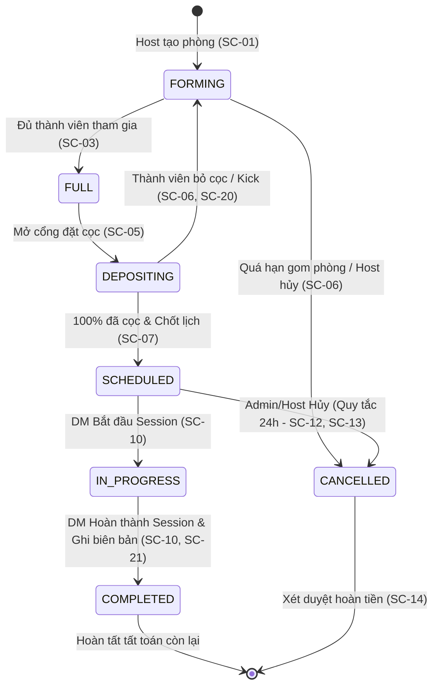

# MA TRẬN KỊCH BẢN NGHIỆP VỤ & KIỂM THỬ (BUSINESS SCENARIO TEST MATRIX)
### Dự án: Kịch Bản Sát V16 — Booking Kịch Bản Sát
**Phiên bản:** V16.4 — Cập nhật toàn diện Phase D & Gói 1-2-3 (Reliability & Production-Ready)

---

## 1. TỔNG QUAN QUY TẮC NGHIỆP VỤ CỐT LÕI (CORE BUSINESS RULES)

Hệ thống Kịch Bản Sát V16 vận hành dựa trên các quy tắc cốt lõi:
1. **Quy tắc 1 (Room Formation & Host Quota):** Mỗi người chơi chỉ được phép làm chủ phòng (`Host`) tối đa 3 phòng đang trong giai đoạn gom người (`FORMING`). Kịch bản phải ở trạng thái `ACTIVE`. Số người tham gia nằm trong khoảng từ `min_players` đến `max_players` (4–12 người).
2. **Quy tắc 2 (Deposit Deadline & Auto Kick):** Người tham gia khi join phòng phải thanh toán tiền cọc (50.000 VNĐ) trước hạn chót (`deposit_deadline_at`). Quá hạn sẽ bị Cron Job tự động loại bỏ (`CANCELLED_UNPAID`) và kích hoạt cơ chế tuyển thế chỗ (`REPLACEMENT_WINDOW`).
3. **Quy tắc 3 (Quy Tắc Vàng 24 Giờ - 24-Hour Cutoff):** 
   - Hủy phòng trước giờ chơi $\ge 24\text{h}$: Hoàn cọc 100% tự động (`status = COMPLETED`).
   - Hủy phòng trong vòng $< 24\text{h}$: Mất cọc hoặc cần Admin xét duyệt theo quy trình ngoại lệ (`status = PENDING`).
4. **Quy tắc 4 (Pricing & Snapshot Calculation):** Giá vé mỗi người chơi = (Giá gốc theo khung giờ Sáng/Chiều/Tối - Khuyến mãi Voucher - Giảm trừ thẻ HSSV 20.000đ) kèm lưu snapshot cố định tại thời điểm chốt phòng.
5. **Quy tắc 5 (DM Assignment & Lifecycle):** DM được phân công có thời gian phản hồi nhận/từ chối ca trực. Khi bắt đầu buổi chơi, Session chuyển sang `IN_PROGRESS`; khi kết thúc, chuyển sang `COMPLETED`, ghi nhận biên bản/sự cố và mở thanh toán phần còn lại.
6. **Quy tắc 6 (Host Room Management):** Chủ phòng có quyền kick thành viên chưa đóng cọc (`PENDING_DEPOSIT`) và có quyền chuyển quyền Host cho thành viên khác.
7. **Quy tắc 7 (Financial & Audit Integrity):** Toàn bộ giao dịch tài chính ghi nhận idempotent, hỗ trợ phân loại `DEPOSIT`/`REMAINING`/`FULL`. Mọi thao tác nhạy cảm (duyệt hoàn cọc, đổi role, hủy phòng khẩn cấp) bắt buộc ghi vết kiểm toán (`audit_logs`) vào cả Database và đĩa.
8. **Quy tắc 8 (Traffic Protection & Health):** Áp dụng Rate Limiting bảo vệ endpoint chống tấn công brute-force/DoS; định kỳ kiểm tra sức khỏe hạ tầng qua `/api/v1/admin/system/health`.

---

## 2. BẢNG MA TRẬN KỊCH BẢN KIỂM THỬ (SCENARIO MATRIX)

| Mã | Phân Hệ Nghiệp Vụ | Tác Nhân (Actor) | Dữ Liệu Đầu Vào / Tiền Đề | Quy Tắc Nghiệp Vụ Kiểm Tra | Kết Quả Mong Đợi (Expected Outcome) | File Test Tự Động |
|:---:|---|:---:|---|---|---|---|
| **SC-01** | Tạo phòng chơi | Player | Game ID, Title, Min/Max Players | Max 3 phòng active/host; Game phải ACTIVE; Min $\ge 4$, Max $\le 12$ | Tạo phòng thành công (`status=FORMING`), tạo slot Host, tạo Payment cọc | `GameRoomApiTest.php`, `BusinessRulesTest.php` |
| **SC-02** | Giới hạn tạo phòng | Player | Đã có 3 phòng `FORMING` | Host Quota Limit = 3 | Trả về `422 Unprocessable Entity`, từ chối tạo phòng thứ 4 | `BusinessRulesTest.php`, `GameRoomApiTest.php` |
| **SC-03** | Tham gia phòng (Join) | Player 2 | Room ID hợp lệ, phòng `FORMING` | Phòng chưa đủ slot, user chưa có slot active | Thêm participant `PENDING_DEPOSIT`, sinh hạn chót cọc `deposit_deadline_at` | `GameRoomApiTest.php`, `EndToEndBookingFlowTest.php` |
| **SC-04** | Trùng lặp tham gia | Player 2 | User đã ở trong phòng | Chống Double Join / Slot Collision | Báo lỗi user đã tham gia phòng (422) | `GameRoomApiTest.php` |
| **SC-05** | Thanh toán tiền cọc | Player | Payment ID, 50.000 VNĐ, Idempotency Key | Idempotent deposit transaction | Cập nhật `DEPOSITED`, khi đủ người phòng chuyển `FULL` / `DEPOSITING` | `PaymentApiTest.php`, `EndToEndBookingFlowTest.php` |
| **SC-06** | Hết hạn cọc (Cron Job) | System | Participant `PENDING_DEPOSIT` quá hạn | Background Job Deposit Timeout & Auto-retry | Participant chuyển `CANCELLED_UNPAID`, mở cửa sổ tuyển thay thế | `BackgroundJobTest.php`, `CronJobLoggingAndRetryTest.php` |
| **SC-07** | Đề xuất & Vote lịch | Host & Member | Venue ID, Physical Room, Khung giờ | Phải là thành viên active trong phòng | Tạo proposal, các thành viên vote `ACCEPT`/`DECLINE` | `SchedulingApiTest.php`, `EndToEndBookingFlowTest.php` |
| **SC-08** | Phân công DM | Admin | Room ID, DM User ID | Chỉ Admin được phân công DM | Tạo `dm_assignments` (`status=PENDING`), gửi notification tới DM | `DMAssignmentApiTest.php` |
| **SC-09** | DM Phản hồi | DM | Assignment ID, `ACCEPT` / `REJECT` | DM có quyền nhận/từ chối kèm lý do | Nếu accept: `ASSIGNED`; nếu reject: thông báo Admin điều phối lại | `DMAssignmentApiTest.php`, `PhaseCBusinessFlowTest.php` |
| **SC-10** | Vòng đời chơi (Play) | DM | Session ID | Session bắt đầu -> kết thúc | `start` -> `IN_PROGRESS`, `complete` -> `COMPLETED`, mở thanh toán còn lại | `SessionPlayLifecycleTest.php`, `EndToEndBookingFlowTest.php` |
| **SC-11** | Rời phòng trước 24h | Player | Room ID, trước giờ chơi > 24h | Quy tắc 24h: Cho phép rời phòng, hoàn cọc | Slot chuyển `LEAVE_REQUESTED` hoặc hoàn cọc nếu có người thay | `RefundLifecycleApiTest.php`, `BusinessRulesTest.php` |
| **SC-12** | Admin Hủy phòng $\ge$ 24h | Admin | Room ID, Cancellation Reason | Quy tắc 24h: Tự động hoàn cọc 100% | Phòng `CANCELLED`, toàn bộ cọc được hoàn tự động 100% | `AdminRoomCancelRefundApiTest.php` |
| **SC-13** | Admin Hủy phòng < 24h | Admin | Room ID, Cancellation Reason | Quy tắc 24h: Hoàn tiền cần xét duyệt | Phòng `CANCELLED`, yêu cầu hoàn tiền chuyển `PENDING` chờ duyệt | `AdminRoomCancelRefundApiTest.php`, `BusinessRulesTest.php` |
| **SC-14** | Duyệt hoàn tiền Admin | Admin | Refund ID, `APPROVE` / `REJECT` | Chỉ Admin được phê duyệt hoàn tiền | Ghi nhận giao dịch hoàn tiền, gửi thông báo cho người chơi | `RefundLifecycleApiTest.php`, `PhaseCBusinessFlowTest.php` |
| **SC-15** | Tính giá kịch bản | Public / Auth | Game ID, Slot (Morning/Afternoon/Evening), Promo Code | Bảng giá khung giờ & Giảm giá voucher | Tính chính xác số tiền mỗi người, không bao giờ âm | `PricingCalculationApiTest.php`, `BusinessRulesTest.php` |
| **SC-16** | Đăng ký & Đăng nhập | Guest | Email, Password, Full Name, Phone | Session Auth, Hash Bcrypt, Cấm tự gán role ADMIN/DM | Session khởi tạo an toàn, gán role mặc định `PLAYER` | `AuthApiTest.php`, `SecurityMiddlewareTest.php` |
| **SC-17** | Rate Limiting | Any | Gửi liên tục > 60 req/phút hoặc > 10 login | Bảo vệ chống DoS / Brute-force | Trả về `429 Too Many Requests` kèm headers `Retry-After` | `RateLimitMiddlewareTest.php` |
| **SC-18** | Audit Trail | Admin | Đổi quyền, Khóa tài khoản, Hủy phòng, Duyệt hoàn tiền | Lưu vết kiểm toán cho mọi thao tác đặc quyền | Ghi nhận bản ghi kiểm toán kèm IP, User Agent, giá trị trước/sau | `AuditLogTest.php` |
| **SC-19** | Xác thực thẻ HSSV | Player & Admin | Ảnh thẻ SV, duyệt trạng thái APPROVED | Ưu đãi -20.000đ/vé cho sinh viên đã xác thực | Thẻ duyệt -> `PricingService` tự trừ 20k, từ chối kèm lý do | `Goi1FeaturesTest.php`, `phase-c-business-flow.test.mjs` |
| **SC-20** | Host Kick thành viên | Host | Thành viên chưa cọc (`PENDING_DEPOSIT`) | Quyền Host kick người chiếm chỗ | Xóa slot, hủy payment cọc, giải phóng chỗ cho người khác | `Goi1FeaturesTest.php`, `phase-c-business-flow.test.mjs` |
| **SC-21** | Ghi nhận kết quả / sự cố | DM | Session ID, `session_notes`, `incident_report` | DM nghiệm thu buổi chơi | Cập nhật ghi chú và biên bản sự cố vào DB `sessions` | `Goi1FeaturesTest.php`, `phase-c-business-flow.test.mjs` |
| **SC-22** | Dashboard Doanh thu Admin | Admin | GET `/admin/dashboard` | Thống kê doanh thu, tỷ lệ lấp đầy, biểu đồ 7 ngày | Trả về KPI thực tế từ DB; từ chối 403 với non-admin | `AdminDashboardAndPaymentApiTest.php` |
| **SC-23** | Sổ cái Giao dịch Admin | Admin | GET `/admin/payments`, Search, Filter | Quản lý mọi hóa đơn cọc / tất toán toàn hệ thống | Trả về danh sách phân trang, tổng tiền PAID & PENDING | `AdminDashboardAndPaymentApiTest.php` |
| **SC-24** | Quản lý cấu hình kịch bản | Admin | GET/POST/PATCH `/admin/games/{id}/configurations` | Cấu hình nhân vật, đạo cụ, phiên bản kịch bản | Tạo version mới, kích hoạt cấu hình, ghi vết audit log | `AdminGoi3SystemAndConfigTest.php` |
| **SC-25** | Giám sát sức khỏe hạ tầng | Admin | GET `/admin/system/health`, `/admin/audit-logs` | Theo dõi MySQL, RAM, Disk, Storage Logs, Audit Log | Trả về báo cáo sức khỏe HEALTHY và nhật ký thao tác | `AdminGoi3SystemAndConfigTest.php` |

---

## 3. BẢN ĐỒ CHUYỂN TRẠNG THÁI PHÒNG & BUỔI CHƠI (STATE MACHINE)

---

## 4. CHIẾN LƯỢC KIỂM THỬ ĐỘ TIN CẬY (PHASE D RELIABILITY STRATEGY)

1. **ACID Transactions:** Mọi thao tác ghi nhận thanh toán, cọc, hoàn tiền và hủy phòng đều được bọc trong `PDO::beginTransaction()` và `PDO::rollBack()`. Được kiểm thử nghiêm ngặt tại `DatabaseTransactionIntegrationTest.php`.
2. **Idempotency Guarantee:** Ngăn ngừa double-deposit và xung đột giao dịch thông qua `idempotency_key` duy nhất và ràng buộc database `UNIQUE(idempotency_key)`.
3. **Cron Job Resiliency & Retry:** Tự động retry tối đa 3 lần với exponential backoff khi xử lý tác vụ nền; ghi nhật ký chi tiết vào `backend/storage/logs/jobs-YYYY-MM-DD.log`. Được kiểm thử tại `CronJobLoggingAndRetryTest.php`.
4. **Audit Logging:** Toàn bộ hành động của Quản trị viên (đổi role, duyệt hoàn cọc, hủy phòng, cấu hình kịch bản) ghi nhận cả Database và File Disk `audit-YYYY-MM-DD.log`. Được kiểm thử tại `AuditLogTest.php` và `AdminGoi3SystemAndConfigTest.php`.
5. **Rate Limiting Protection:** Ngăn ngừa Brute-force & DDoS thông qua `RateLimitMiddleware` (sliding window 60s, response 429). Được kiểm thử tại `RateLimitMiddlewareTest.php`.
