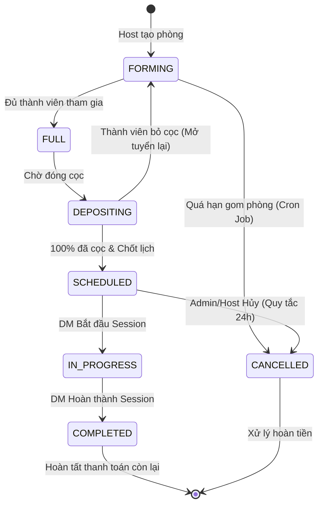

# MA TRẬN KỊCH BẢN NGHIỆP VỤ & KIỂM THỬ (BUSINESS SCENARIO TEST MATRIX)
### Dự án: Kịch Bản Sát V16 — Booking Kịch Bản Sát
---

## 1. Tổng quan ma trận nghiệp vụ (Business Rules Overview)
Hệ thống Kịch Bản Sát V16 vận hành dựa trên các quy tắc cốt lõi (Core Business Rules):
- **Quy tắc 1 (Room Formation & Host Quota):** Mỗi người dùng chỉ được phép làm chủ phòng tối đa 3 phòng đang gom người (`FORMING`). Kịch bản phải ở trạng thái `ACTIVE`.
- **Quy tắc 2 (Deposit Deadline & Auto Kick):** Người tham gia khi join phòng phải thanh toán tiền cọc (50.000 VNĐ) trước hạn chót (`deposit_deadline_at`). Quá hạn sẽ bị hệ thống tự động loại bỏ (`CANCELLED_UNPAID`) và kích hoạt `REPLACEMENT_WINDOW`.
- **Quy tắc 3 (Quy tắc vàng 24 Giờ - 24-Hour Cutoff):** 
  - Hủy phòng trước giờ chơi $\ge 24\text{h}$: Hoàn cọc 100% tự động.
  - Hủy phòng trong vòng $< 24\text{h}$: Mất cọc hoặc cần Admin xét duyệt lý do đặc biệt.
- **Quy tắc 4 (Pricing & Snapshot Calculation):** Giá vé mỗi người chơi = (Giá gốc theo khung giờ Sáng/Chiều/Tối - Khuyến mãi Voucher) kèm snapshot cố định tại thời điểm chốt phòng.
- **Quy tắc 5 (DM Assignment & Lifecycle):** DM được phân công có 24h để chấp nhận/từ chối. Khi bắt đầu buổi chơi, Session chuyển sang `IN_PROGRESS`; khi kết thúc, chuyển sang `COMPLETED` và tính toán nốt phần tiền còn lại.

---

## 2. Bảng Ma Trận Kịch Bản Kiểm Thử (Scenario Matrix)

| Mã Kịch Bản | Phân Hệ Nghiệp Vụ | Tác Nhân (Actor) | Dữ Liệu Đầu Vào / Điều Kiện Tiền Đề | Quy Tắc Nghiệp Vụ Kiểm Tra | Kết Quả Mong Đợi (Expected Outcome) | File Kiểm Thử Tự Động |
|---|---|---|---|---|---|---|
| **SC-01** | Tạo phòng chơi | Player | Game ID, Title, Max Players, Min Players | Max 3 phòng active/host; Game phải ACTIVE; Min $\ge 4$, Max $\le 12$ | Tạo phòng thành công (`status=FORMING`), tạo slot Host, tạo Payment cọc | `GameRoomApiTest.php`, `BusinessRulesTest.php` |
| **SC-02** | Giới hạn tạo phòng | Player | Đã có 3 phòng `FORMING` | Host Quota Limit = 3 | Trả về `422 Unprocessable Entity`, từ chối tạo phòng thứ 4 | `BusinessRulesTest.php`, `GameRoomApiTest.php` |
| **SC-03** | Tham gia phòng (Join) | Player 2 | Room ID hợp lệ, phòng `FORMING` | Phòng chưa đủ slot, user chưa có slot active | Thêm participant `PENDING_DEPOSIT`, sinh hạn chót cọc `deposit_deadline_at` | `GameRoomApiTest.php`, `EndToEndBookingFlowTest.php` |
| **SC-04** | Trùng lặp tham gia | Player 2 | User đã ở trong phòng | Chống Double Join / Slot Collision | Báo lỗi user đã tham gia phòng | `GameRoomApiTest.php` |
| **SC-05** | Thanh toán tiền cọc | Player | Payment ID, 50.000 VNĐ, Idempotency Key | Idempotent deposit transaction | Cập nhật `DEPOSITED`, khi đủ người phòng chuyển `FULL` / `DEPOSITING` | `PaymentApiTest.php`, `EndToEndBookingFlowTest.php` |
| **SC-06** | Hết hạn cọc (Cron Job) | System | Participant `PENDING_DEPOSIT` quá hạn | Background Job Deposit Timeout | Participant chuyển `CANCELLED_UNPAID`, mở cửa sổ tuyển thay thế | `BackgroundJobTest.php`, `CronJobLoggingAndRetryTest.php` |
| **SC-07** | Đề xuất & Vote lịch | Host & Member | Venue ID, Physical Room, Khung giờ | Phải là thành viên active trong phòng | Tạo proposal, các thành viên vote `ACCEPT`/`DECLINE` | `SchedulingApiTest.php`, `EndToEndBookingFlowTest.php` |
| **SC-08** | Phân công DM | Admin | Room ID, DM User ID | Chỉ Admin được phân công DM | Tạo `dm_assignments` (`status=PENDING`), gửi notification tới DM | `DMAssignmentApiTest.php` |
| **SC-09** | DM Phản hồi | DM | Assignment ID, `ACCEPT` / `REJECT` | DM có quyền nhận/từ chối kèm lý do | Nếu accept: `ASSIGNED`; nếu reject: thông báo Admin điều phối lại | `DMAssignmentApiTest.php`, `PhaseCBusinessFlowTest.php` |
| **SC-10** | Vòng đời chơi (Play) | DM | Session ID | Session bắt đầu -> kết thúc | `start` -> `IN_PROGRESS`, `complete` -> `COMPLETED`, mở thanh toán còn lại | `SessionPlayLifecycleTest.php`, `EndToEndBookingFlowTest.php` |
| **SC-11** | Rời phòng trước 24h | Player | Room ID, trước giờ chơi > 24h | Quy tắc 24h: Cho phép rời phòng, hoàn cọc | Slot chuyển `LEAVE_REQUESTED` hoặc hoàn cọc nếu có người thay | `RefundLifecycleApiTest.php`, `BusinessRulesTest.php` |
| **SC-12** | Admin Hủy phòng $\ge$ 24h | Admin | Room ID, Cancellation Reason | Quy tắc 24h: Tự động hoàn cọc `COMPLETED` | Phòng `CANCELLED`, toàn bộ cọc được hoàn tự động 100% | `AdminRoomCancelRefundApiTest.php` |
| **SC-13** | Admin Hủy phòng < 24h | Admin | Room ID, Cancellation Reason | Quy tắc 24h: Hoàn tiền cần xét duyệt | Phòng `CANCELLED`, yêu cầu hoàn tiền chuyển `PENDING` chờ duyệt | `AdminRoomCancelRefundApiTest.php`, `BusinessRulesTest.php` |
| **SC-14** | Duyệt hoàn tiền Admin | Admin | Refund ID, `APPROVE` / `REJECT` | Chỉ Admin được phê duyệt hoàn tiền | Ghi nhận giao dịch hoàn tiền, gửi thông báo cho người chơi | `RefundLifecycleApiTest.php`, `PhaseCBusinessFlowTest.php` |
| **SC-15** | Tính giá kịch bản | Public / Auth | Game ID, Slot (Morning/Afternoon/Evening), Promo Code | Bảng giá khung giờ & Giảm giá voucher | Tính chính xác số tiền mỗi người, không bao giờ âm | `PricingCalculationApiTest.php`, `BusinessRulesTest.php` |
| **SC-16** | Đăng ký & Đăng nhập | Guest | Email, Password, Full Name, Phone | Session Auth, Hash Bcrypt, Cấm tự gán role ADMIN/DM | Session khởi tạo an toàn, gán role mặc định `PLAYER` | `AuthApiTest.php`, `SecurityMiddlewareTest.php` |
| **SC-17** | Rate Limiting | Any | Gửi liên tục > 60 req/phút hoặc > 10 login | Bảo vệ chống DoS / Brute-force | Trả về `429 Too Many Requests` kèm headers rate limit | `RateLimitMiddlewareTest.php` |
| **SC-18** | Audit Trail | Admin | Đổi quyền, Khóa tài khoản, Hủy phòng, Duyệt hoàn tiền | Lưu vết kiểm toán cho mọi thao tác đặc quyền | Ghi nhận bản ghi kiểm toán kèm IP, User Agent, giá trị trước/sau | `AuditLogTest.php` |

---

## 3. Bản Đồ Trạng Thái (State Transition Coverage)

