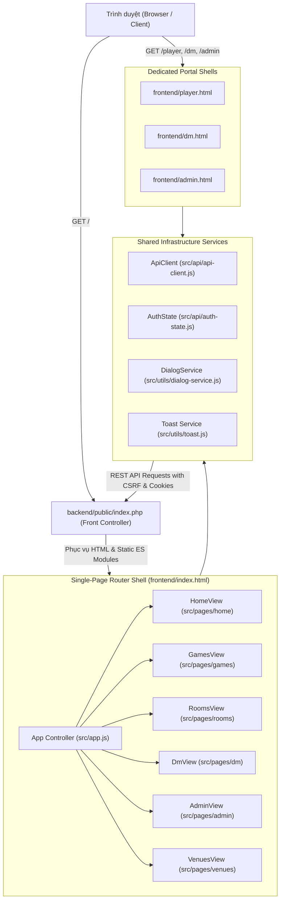

# TÀI LIỆU KIẾN TRÚC FRONTEND (FRONTEND ARCHITECTURE)
## KỊCH BẢN SÁT V16

---

## 1. MÔ HÌNH KIẾN TRÚC TỔNG THỂ

Dự án **Kịch Bản Sát V16** áp dụng mô hình **Hybrid MPA + Feature-Based Architecture** sử dụng thuần túy chuẩn Web hiện đại: **HTML5, CSS3 Tokens và Vanilla JavaScript ES Modules**, kết nối chặt chẽ với **PHP Native 8.2+ RESTful Backend**.



---

## 2. CẤU TRÚC THƯ MỤC DỰ ÁN

```
frontend/
├── index.html                   # Shell chính tích hợp Hash Router SPA
├── player.html                  # Standalone Shell cho Cổng Người Chơi (Player Portal)
├── dm.html                      # Standalone Shell cho Cổng Quản Trò (DM Portal)
├── admin.html                   # Standalone Shell cho Cổng Quản Trị (Admin Portal)
├── src/
│   ├── app.js                   # Main Entry Point & Router cho index.html
│   ├── api/
│   │   ├── api-client.js        # REST Client, CSRF Prefetch & Cookie Session management
│   │   └── auth-state.js        # Centralized Observable Auth State (Observer Pattern)
│   ├── data/
│   │   └── scripts.data.js      # Danh mục kịch bản mẫu & metadata offline
│   ├── pages/
│   │   ├── auth/                # Modal đăng nhập/đăng ký đa vai trò (AuthModal)
│   │   ├── home/                # Trang chủ Cinematic Scrollytelling (HomeView)
│   │   ├── games/               # Kho kịch bản và bộ lọc tìm kiếm (GamesView)
│   │   ├── rooms/               # Sảnh ghép phòng & Chi tiết phòng chơi (RoomsView)
│   │   ├── dm/                  # Cổng vận hành ca trực của Quản trò (DmView)
│   │   ├── admin/               # Cổng điều phối tổng thể và tài chính (AdminView)
│   │   ├── notifications/       # Trung tâm thông báo hệ thống (NotificationsView)
│   │   └── venues/              # Khám phá chi nhánh và phòng chơi vật lý (VenuesView)
│   ├── styles/
│   │   ├── design-tokens.css    # Official Design Tokens v1.0 (Cinematic Modern Hybrid)
│   │   ├── tokens.css           # Legacy tokens alias (@import './design-tokens.css')
│   │   ├── variables.css        # Legacy variables alias (@import './design-tokens.css')
│   │   ├── reset.css            # CSS Reset chuẩn
│   │   ├── base.css             # Typography & Base HTML elements
│   │   ├── main.css             # Layout chung, Header, Footer
│   │   ├── components.css       # Buttons, Badges, Modals, Tables
│   │   ├── home.css             # Sân khấu Parallax 3 tầng & hiệu ứng ánh nến
│   │   ├── pages.css            # Styles cho các màn hình con
│   │   └── portal-themes.css    # Themes định danh cho 4 Portal, Mobile Bottom Nav, Steps
│   └── utils/
│       ├── config.js            # Cấu hình môi trường & base URL API
│       ├── dialog-service.js    # Slide-over Drawer & Custom Modal Dialogs (No alert/prompt)
│       ├── sanitize.js          # XSS Sanitizer: escapeHtml, sanitizeUrl
│       ├── shared-header.js     # Đồng bộ Header & Navigation giữa các trang
│       └── toast.js             # Thông báo Toast thời gian thực
└── tests/                       # 11 test suites kiểm thử tích hợp (Node.js Test Runner)
```

---

## 3. CƠ CHẾ QUẢN LÝ TRẠNG THÁI (STATE MANAGEMENT)

### 3.1. Auth State Management (`auth-state.js`)
- Triển khai theo mẫu thiết kế **Observer Pattern**.
- Lưu trữ người dùng hiện tại (`currentUser`), vai trò chuẩn hóa (`PLAYER`, `DM`, `ADMIN`).
- Cung cấp phương thức `subscribe(listener)` cho phép các giao diện tự động cập nhật khi trạng thái đăng nhập thay đổi.
- Khi người dùng đăng xuất, gọi `api.clearCsrfToken()` và xóa sạch phiên làm việc trên bộ nhớ.

### 3.2. Dialog & Drawer Service (`dialog-service.js`)
- Thay thế hoàn toàn các lệnh gốc `window.alert()` và `window.prompt()` gây chặn luồng rendering.
- `DialogService.drawer(title, htmlContent)`:
  - Tạo cấu trúc Slide-over Drawer từ mép phải màn hình với hiệu ứng trượt êm ái.
  - Tự động bắt phím `Escape` và click ra ngoài backdrop để đóng.
  - Phục vụ hiển thị chi tiết hóa đơn thanh toán, lịch sử giao dịch và nhật ký kiểm toán.
- `DialogService.prompt(title, message, defaultValue)`:
  - Trả về một `Promise<string|null>`.
  - Hiển thị Modal nhập liệu hiện đại với trường `input`, nút xác nhận và hủy bỏ.

### 3.3. API Client & Quản lý Bảo mật CSRF (`api-client.js`)
- Tự động nạp trước (Prefetch) và lưu trữ mã `csrf_token` từ endpoint `/api/v1/auth/csrf-token`.
- Mọi mutation requests (`POST`, `PUT`, `PATCH`, `DELETE`) tự động gắn header `X-CSRF-Token`.
- Hỗ trợ cơ chế truyền cookie phiên PHP (`credentials: 'include'`).
- Tích hợp AbortController quản lý timeout (mặc định 15.000ms), phân biệt rành mạch giữa `REQUEST_TIMEOUT` và `REQUEST_ABORTED`.

---

## 4. BỘ ĐIỀU HƯỚNG & PHÂN QUYỀN (ROUTING & GUARDS)

1. **Routing Mechanism**:
   - Sử dụng **Hash Routing** (`#home`, `#games`, `#rooms`, `#dm`, `#admin`, `#venues`, `#notifications`) giúp điều hướng nhanh không gián đoạn tải trang.
2. **Navigation Guards (Role-based)**:
   - Route `#dm`: Yêu cầu tài khoản có vai trò `DM` hoặc `ADMIN`. Nếu chưa đủ quyền, cảnh báo qua Toast và tự động mở hộp thoại đăng nhập tương ứng.
   - Route `#admin`: Yêu cầu vai trò `ADMIN`. Nếu tài khoản Player truy cập, hiển thị màn hình 403 Forbidden chuyên nghiệp với nút chuyển nhanh tài khoản.
3. **Thin Wrapper Strategy**:
   - Các trang độc lập `player.html`, `dm.html`, `admin.html` và SPA Shell `index.html` cùng chia sẻ chung các modules nghiệp vụ và Shared Header, chấm dứt hoàn toàn tình trạng duplicate giao diện.
